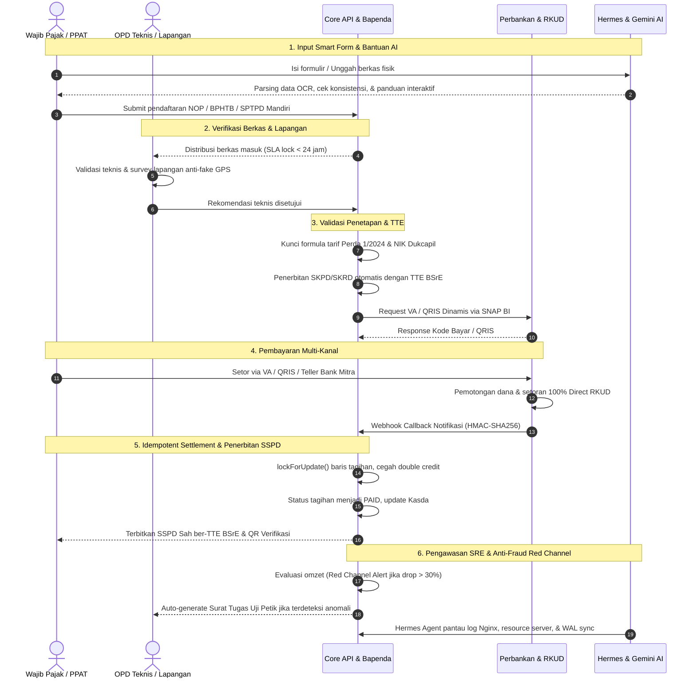

# 📊 MASTER BLUEPRINT & STANDAR ARSITEKTUR LAYANAN M-PAD V4
## Integrasi Ekosistem Multi-Platform, Pemetaan Aktor (RACI), Standar Blanko Cerdas (Smart Forms), Pengamanan 3-Lapis, serta Orkestrasi Agentic AI & Otomasi Infrastruktur (Gemini Sparks, Hermes Server Agent DeepSeek-V4-Flash, & Google Antigravity IDE Multi-Model)

---

## 1. Filosofi & Paradigma: Service Excellence Berbasis Autonomous Agentic AI

Platform **MITRA-PAD (M-PAD)** Pemerintah Kota Baubau berevolusi dari sekadar sistem pelaporan administratif dan pengawasan pasif menjadi **Platform Ekosistem Layanan Publik Berkinerja Tinggi Berbasis Agentic AI**. 

Mengusung tiga pilar filosofi:
> **"Zero-Friction for Taxpayers, Zero-Leakage for Regional Cash (RKUD), Zero-Downtime for Infrastructure"**

M-PAD mengintegrasikan kecerdasan buatan secara struktural untuk:
1. Mempercepat pelayanan masyarakat melalui panduan formulir cerdas dan konsultasi natural.
2. Mengamankan pendapatan daerah (PAD) dari risiko kecurangan, *under-reporting*, dan kebocoran kasda.
3. Mengotomasi siklus hidup rekayasa perangkat lunak (*Self-Healing SRE, Automated CI/CD, & Continuous Testing*).

Landasan hukum operasional tetap berpegang teguh pada:
- **UU No. 1 Tahun 2022** tentang Hubungan Keuangan antara Pemerintah Pusat dan Pemerintahan Daerah (HKPD).
- **PP No. 35 Tahun 2023** tentang Ketentuan Umum Pajak Daerah dan Retribusi Daerah (KUPDRD).
- **Perda Kota Baubau No. 1 Tahun 2024** tentang Pajak Daerah dan Retribusi Daerah.

---

## 2. Pemetaan & Tupoksi Agent AI Automasi Terintegrasi M-PAD

Arsitektur AI pada M-PAD tidak berjalan sporadis, melainkan dibagi secara hierarkis dan fungsional ke dalam tiga pilar otomasi utama:

| Pilar Otomasi AI | Fondasi Model & Mesin | Peran Arsitektural | Tupoksi Utama & Output Sistem |
| :--- | :--- | :--- | :--- |
| **1. Citizen & Business Intelligence Agent** | **Google Gemini Sparks**<br>*(Ultra-fast multimodal reasoning & knowledge graph)* | Asisten Cerdas Wajib Pajak, Pemandu Smart Form, & Otomasi Analitik PAD | • **Smart Form Assistant:** Memandu warga/PPAT mengisi formulir pendaftaran, membedah teks/foto akta tanah atau KTP, dan mendeteksi inkonsistensi berkas secara interaktif.<br>• **Simulasi & Edukasi Pajak:** Menjelaskan kalkulasi tarif Perda 1/2024 dan simulasi BPHTB/PBB secara natural.<br>• **Executive Predictive Engine:** Mengolah data agregat penerimaan kasda menjadi insight naratif ringkas harian bagi Walikota dan Kepala Bapenda. |
| **2. Infrastructure & Server SRE Agent** | **Hermes Server Agent** ditenagai **DeepSeek-V4-Flash**<br>*(High-speed code/terminal reasoning & low latency)* | DevOps / SRE Otonom, Watchdog Keamanan, & Orkestrasi VPS / Cloud | • **Server Watchdog & Health Healing:** Monitoring utilisasi CPU/RAM/SSD, status koneksi database PostgreSQL, dan service Redis 24/7; melakukan auto-restart worker yang hang.<br>• **Log Anomaly Detector:** Memantau error log Nginx/Laravel dan mengidentifikasi serangan brute force, rate-limit abuse, serta traffic spike.<br>• **Automated Deployment Assistant:** Menjalankan script migrasi database, clearing cache, pembaruan sertifikat SSL, dan validasi backup WAL kasda ke cloud storage. |
| **3. Software Engineering Multi-Agent Hub** | **Google Antigravity IDE**<br>*(Multi-Model Agent-First Development Platform)* | Pusat Rekayasa Kode Sumber, Pengujian Otomatis, & Refactoring Lintas Platform | • **Autonomous Cross-Surface Coding:** Menjalankan sub-agent mandiri yang bekerja simultan melintasi editor kode, terminal shell, dan browser testing.<br>• **Multi-Model Orchestration:** Membagi tugas teknis sesuai spesialisasi model AI (Gemini 3 Pro, Claude Sonnet 4.5, dan GPT-OSS / DeepSeek Code).<br>• **Audit Artifacts & Test Verification:** Menguji endpoint API Laravel, mengaudit skema CUID/UUID PostgreSQL, dan memvalidasi responsivitas antarmuka React.js sebelum rilis ke production. |

---

## 3. Bedah Spesialisasi Model AI di dalam Google Antigravity IDE

Di dalam lingkungan Google Antigravity IDE, pengembangan ekosistem M-PAD (`retribusi-api`, `retribusi-admin`, `retribusi-mobile`, dan `retribusi-petugas`) dikerjakan menggunakan pembagian tugas multi-model terpadu:

| Model AI Internal | Spesialisasi Teknis | Tupoksi pada Komponen M-PAD | Indikator Hasil (Artifacts) |
| :--- | :--- | :--- | :--- |
| **Gemini 3 Pro** | Long-Context Architecture, Multi-Modal Parsing, & Sistem Integrasi Besar | • Menjaga pemahaman menyeluruh atas seluruh basis kode (~261 routes Laravel API dan skema database relasional).<br>• Menyusun dokumentasi teknis OpenAPI/Swagger dan audit keselarasan regulasi Perda No. 1/2024.<br>• Merancang alur integrasi perbankan standar SNAP BI & verifikasi tanda tangan HMAC-SHA256. | Dokumen arsitektur, diagram alur swimlane, dan Kerangka Acuan Kerja (KAK) teknis yang presisi. |
| **Claude Sonnet 4.5** | Complex Logic Reasoning, Refactoring, & Frontend Ergonomics | • Merekayasa logika kompleks komponen Smart Forms pada React SPA (State management multi-persona, validasi in-line, dan interaksi MapPicker ZNT).<br>• Mengaudit keamanan kode backend dari celah Race Condition, SQL injection, dan IDOR.<br>• Memastikan penanganan error/rejection path pada antarmuka admin dan portal warga berjalan intuitif. | Komponen React yang bersih, bebas bug state, dan memiliki skor aksesibilitas tinggi. |
| **GPT-OSS / DeepSeek Specialized Engine** | High-Speed Syntax Generation, CLI Scripts, & Automated Testing Unit | • Menulis skrip migrasi database DDL PostgreSQL dan seeders data master tarif.<br>• Membangun skenario pengujian otomatis (Unit Testing PHPUnit & PEST) untuk menguji kalkulator BPHTB, validasi denda, dan skenario `lockForUpdate()`.<br>• Menghasilkan skrip shell automasi terminal untuk rclone dan backup terjadwal. | 100% test passing pada unit test finansial dan skrip automasi terminal yang stabil. |

---

## 4. Arsitektur Multi-Platform Terpadu M-PAD

Ekosistem M-PAD mendistribusikan layanan ke dalam 4 platform terintegrasi dengan endpoint domain Pemkot Baubau:

| Platform | Stack & URL Akses | Fokus Arsitektur | Fungsi Utama & Interaksi AI |
| :--- | :--- | :--- | :--- |
| **1. Core Engine**<br>*(API Gateway & Backend)* | • Laravel RESTful API (PHP 8.2+)<br>• PostgreSQL (CUID/UUID & JSONB)<br>• Redis Cache & Horizon Queue<br>• `api.mpad.baubaukota.go.id` | Pusat komputasi transaksi, validasi bisnis, enkripsi data, dan orkestrasi perbankan. | • Menyediakan ~261 rute layanan terenkripsi JWT.<br>• Integrasi H2H SNAP BI (VA & QRIS), SIAK Dukcapil, & BHUMI BPN.<br>• Mesin Immutable Audit Logs dan pemicu Red Channel Alert.<br>• Dipantau dan dioptimasi kinerjanya oleh Hermes Agent (DeepSeek-V4-Flash). |
| **2. Admin Panel**<br>*(Web Dashboard)* | • React.js SPA + TypeScript<br>• Tailwind CSS / Ant Design<br>• `adminmpad.baubaukota.go.id` | Pusat kendali operasional, verifikasi penetapan, rekonsiliasi kasda, dan pengawasan. | • **Workspace Bapenda:** Penetapan SKPD/SKRD, monitoring mutasi kasda, modul anti-fraud, dan master tarif Perda 1/2024.<br>• **Workspace OPD Teknis:** Verifikasi administratif berkas masuk, disposisi surat tugas lapangan, dan penerbitan izin teknis.<br>• **Workspace Pimpinan:** Eksekutif dashboard dengan insight naratif Gemini Sparks. |
| **3. Mobile Warga**<br>*(PWA / Public App)* | • React.js PWA / Responsive Web<br>• Service Worker (Offline-ready)<br>• `mpad.baubaukota.go.id` | Saluran layanan mandiri satu pintu bagi masyarakat, pelaku usaha, dan PPAT. | • Implementasi 5 Prinsip Smart Forms (Auto-pull NIK, GIS MapPicker, kalkulator simulasi instan).<br>• Didukung chatbot pemandu interaktif Gemini Sparks untuk konsultasi pengisian blanko.<br>• Pembayaran multi-channel SNAP BI & unduh SSPD/e-SPPT resmi ber-TTE BSrE. |
| **4. Petugas Mobile**<br>*(Field Officer App)* | • React Native / PWA Dedicated<br>• Geolocation GPS & Camera API<br>• `petugasmpad.baubaukota.go.id` | Aplikasi operasional bergerak bagi surveyor lapangan, penagih retribusi, dan tim audit. | • Validasi fisik lapangan dan geotagging batas poligon tanah/reklame (anti-mock GPS).<br>• Penagihan retribusi harian/pasar berbasis QRIS Dinamis & cetak struk thermal Bluetooth.<br>• Penerimaan disposisi elektronik Surat Tugas Uji Petik Lapangan (Red Channel Trigger). |

---

## 5. Diagram Alur Transaksional End-to-End (Cross-Functional Swimlane)



---

## 6. Pemetaan Aktor Sistem & Hak Akses (RBAC)

| Persona Aktor | Platform yang Diakses | Kewenangan Utama (Permissions) | Batasan & Larangan Keamanan |
| :--- | :--- | :--- | :--- |
| **1. Wajib Pajak Mandiri** | Portal Mobile Warga (PWA) | Input Smart Form dibantu Gemini Sparks, bayar via VA/QRIS, unduh bukti ber-TTE BSrE, beri ulasan layanan. | Hanya dapat melihat data pribadi yang terikat NIK/NPWPD terverifikasi; tidak dapat merubah data berkas yang sedang diverifikasi. |
| **2. Notaris / PPAT** | Portal Mobile Warga / Web PPAT | Input e-BPHTB klien, validasi NOP & NPOP, unggah akta tanah/AJB, unduh SSPD BPHTB validasi bank. | Dibatasi oleh wilayah kerja; dipantau ketat jika nilai transaksi di bawah harga pasar wajar ZNT BPN. |
| **3. Verifikator OPD Teknis** | Admin Panel (Workspace OPD) | Pemeriksaan teknis kelengkapan formulir, telaah zonasi/izin, menyetujui/menolak berkas, disposisi ke surveyor lapangan. | Dilarang keras mengubah nominal tarif perda; tidak memiliki akses ke mutasi rekening kasda. |
| **4. Petugas Lapangan / Surveyor** | Petugas Mobile App | Perekaman titik koordinat GPS anti-fake location, foto fisik objek, penarikan retribusi QRIS, eksekusi uji petik omzet. | Hanya beroperasi pada radius tugas aktif; dilarang menerima uang tunai tanpa menerbitkan tanda terima QRIS. |
| **5. Verifikator & Penetap Bapenda** | Admin Panel (Workspace Bapenda) | Penetapan SKPD/SKRD, validasi NOP ganda, persetujuan pembetulan, penerbitan Surat Tagihan Pajak Daerah (STPD). | Seluruh tindakan penetapan tercatat permanen pada tabel `audit_logs` (nilai sebelum vs sesudah). |
| **6. Bendahara Penerimaan / Dual PIC Fraud** | Admin Panel (Workspace Kasda) | Rekonsiliasi mutasi harian RKUD vs log sistem, investigasi alert anomali transaksi malam hari (23.00–04.00 WITA). | Memerlukan persetujuan ganda (Dual PIC) untuk mengubah/menyesuaikan status transaksi yang tertahan. |
| **7. Walikota / Kepala Badan (Eksekutif)** | Admin Panel (Executive View) | Menerima briefing naratif PAD dari Gemini Sparks, pantau realisasi target kasda real-time, dan monitor rapor SLA dinas. | Hak akses murni Read-Only (analisis dan agregasi tanpa kemampuan mengubah data transaksional). |

### 6.1. Matriks Batas Otoritas Administrator (Boundary of Authority)

| No | Hal yang Boleh Dikelola Administrator | Hal yang Dilarang Keras Disentuh Administrator |
| :---: | :--- | :--- |
| **1** | Manajemen akun pengguna (aktivasi, reset sandi, penonaktifan personel staf). | Mengubah, merevisi, atau membatalkan ketetapan pajak (SKPD/SKRD) yang telah terbit resmi secara sepihak. |
| **2** | Konfigurasi teknis infrastruktur (domain, perutean jaringan, load balancing, koneksi Redis). | Mengedit tarif pajak dan retribusi yang diatur dalam Perda langsung melalui antarmuka atau database. |
| **3** | Pemeliharaan basis data (pembersihan berkas sementara/cache, optimasi indeks kueri, verifikasi backup). | Menghapus, merevisi, atau memanipulasi baris pada tabel `audit_logs` (append-only mutlak). |
| **4** | Pemantauan operasional server dan integritas konektivitas API eksternal (SNAP BI, Dukcapil). | Melakukan eksekusi transaksi pembayaran, pengeluaran kas, atau pemotongan piutang wajib pajak. |
| **5** | Pengelolaan data master referensi non-finansial (nama jalan, klasifikasi zona wilayah administratif). | Mengubah atau mengintervensi arus rekening koran elektronik Kas Daerah (RKUD). |

### 6.2. 5 Instrumen Pengamanan Teknis Pembatasan Admin

1. **Penguncian Tarif di Level Basis Data (Database-Level Tarif Lock)**:
   - Perubahan tarif perda tidak dapat dilakukan melalui antarmuka web admin maupun skrip ad-hoc. Tabel tarif dikunci dengan izin *read-only* bagi pengguna aplikasi dan hanya dapat diubah melalui berkas migrasi resmi yang didasari lembaran pengesahan regulasi baru.
2. **Isolasi Mutasi RKUD bagi OPD Teknis**:
   - Secara arsitektural, akun admin OPD Teknis (Dinas Pariwisata, Dishub, DLH, dsb.) diblokir total dari modul keuangan kasda, mutasi rekening bank, dan rekonsiliasi penerimaan. Akses ini diisolasi khusus untuk Bapenda/Kasda.
3. **Penguncian Jejak Rekam (Immutable Audit Logs)**:
   - Hak akses `UPDATE` dan `DELETE` dicabut (`REVOKE`) dari seluruh role database aplikasi pada tabel `audit_logs`. Setiap upaya manipulasi log akan digagalkan oleh PostgreSQL Rule System dan memicu *Security Emergency Trigger*.
4. **Prinsip Four-Eyes & Dual PIC Fraud Approval**:
   - Untuk pembatalan denda keterlambatan, pembetulan ketetapan tertahan, atau rekonsiliasi data selisih, sistem melarang eksekusi oleh admin tunggal. Proses wajib melalui mekanisme ganda (*Maker-Checker-Approver*) yang melibatkan Kepala Bidang Pendapatan dan Pejabat Pengelola Keuangan Daerah (PPKD).
5. **Penegakan SLA Verifikasi Teknis < 24 Jam**:
   - Admin verifikator OPD dibatasi oleh sistem hitung mundur (*countdown timer*). Jika berkas permohonan warga/PPAT tidak diproses dalam waktu 18 jam kerja, sistem secara otomatis mengirimkan notifikasi eskalasi kepada atasan langsung dan Inspektorat untuk mencegah pengendapan berkas.

---

## 7. Siklus Kegiatan Terintegrasi Lintas Platform & AI (Urutan Operasional End-to-End)

Urutan kronologis 9 kegiatan komprehensif yang menghubungkan interaksi warga, petugas lapangan, administrator, dan agen AI otonom:

| Urutan | Nama Kegiatan | Aktor / Agent Terlibat | Platform Digunakan | Aksi Teknis & Output Nyata |
| :---: | :--- | :--- | :--- | :--- |
| **Tahap 1** | **Penginputan Blanko Cerdas (Smart Form)** | Wajib Pajak & Gemini Sparks | Mobile Warga (PWA) | Input NIK auto-pull SIAK; Gemini Sparks memvalidasi kelengkapan dokumen; MapPicker mengunci koordinat ZNT; terbit ID Pendaftaran (CUID/UUID). |
| **Tahap 2** | **Verifikasi Administratif & Teknis** | Verifikator OPD Teknis | Admin Panel (OPD) | Pemeriksaan kepatuhan berkas perizinan/retribusi sesuai regulasi; sistem mengunci SLA < 24 jam; status: Approved atau Revision. |
| **Tahap 3** | **Validasi Lapangan & Survey Spasial** | Petugas Lapangan (Surveyor) | Petugas Mobile App | Menerima tugas pada app; verifikasi koordinat fisik (anti-mock GPS); unggah foto bukti objek; sinkronisasi otomatis ke Core API. |
| **Tahap 4** | **Penetapan Pajak & Penerbitan Billing** | Penetap Bapenda & Core Engine | Admin Panel & Backend API | Formula Perda 1/2024 dikunci; dokumen SKPD/SKRD ditandatangani TTE BSrE; Core API menembak SNAP BI perbankan untuk membuat Virtual Account/QRIS. |
| **Tahap 5** | **Pembayaran & Settlement Langsung** | Wajib Pajak & Bank Mitra | Kanal Bank & Core API | WP membayar via VA/QRIS; Webhook SNAP BI diterima sistem; mekanisme `lockForUpdate()` mencegah double credit; dana 100% Direct RKUD. |
| **Tahap 6** | **Penerbitan Bukti Sah & Rekonsiliasi** | Wajib Pajak & Dual PIC Fraud | Mobile Warga & Admin Panel | Status tagihan menjadi PAID; WP langsung mengunduh SSPD ber-barcode verification; mutasi rekening koran kasda cocok secara otomatis (Zero Gap). |
| **Tahap 7** | **Pengawasan Omzet & Anti-Fraud (Red Channel)** | Core API & Petugas Lapangan | Core Backend & Petugas Mobile | Algoritma mendeteksi laporan omzet bulanan drop > 30% pada peak season; otomatis menerbitkan elektronik Surat Tugas Uji Petik ke Petugas Mobile. |
| **Tahap 8** | **Server SRE & DevOps Watchdog** | Hermes Agent (DeepSeek-V4-Flash) | VPS / Cloud Server Core Engine | Monitoring kesehatan CPU/RAM/Database; deteksi anomali log error Nginx; eksekusi isolasi IP berbahaya; pencadangan WAL harian ke cloud storage. |
| **Tahap 9** | **Pengembangan & Continuous Testing** | Developer & Antigravity IDE Multi-Model | Google Antigravity Platform | Gemini 3 Pro merancang arsitektur API; Claude Sonnet merefaktor komponen form React; GPT-OSS mengeksekusi test suite otomatis PEST/PHPUnit. |

---

## 8. Rekonstruksi Framework 7-Langkah (Dual-Cycle Architecture)

Pemisahan tegas antara kesiapan rekayasa (*Pre-Launch Readiness*) dan pengawasan harian (*Post-Launch Governance*):

```text
┌─────────────────────────────────────────────────────────────────────────────────────────────┐
│                    SIKLUS A: FASE FONDASI & KESIAPAN LAYANAN (PRE-LAUNCH)                  │
├─────────────────┬─────────────────┬─────────────────┬───────────────────┬───────────────────┤
│    Langkah 1    │    Langkah 2    │    Langkah 3    │     Langkah 4     │     Langkah 5     │
│   Top-Down      │   As-Is Code &  │   SOTK & RBAC   │    H2H Flow &     │   Best-Practice   │
│   Compliance    │   DB Mapping    │   Alignment     │ Financial Safety  │ Engineering Design│
└────────┬────────┴────────┬────────┴────────┬────────┴─────────┬─────────┴─────────┬─────────┘
         │                 │                 │                  │                   │
         └─────────────────┴─────────┬───────┴──────────────────┴───────────────────┘
                                     ▼
┌─────────────────────────────────────────────────────────────────────────────────────────────┐
│               SIKLUS B: FASE TATA KELOLA OPERASIONAL BERKELANJUTAN (POST-LAUNCH)            │
├─────────────────────────────────────────────┬───────────────────────────────────────────────┤
│                  Langkah 6                  │                   Langkah 7                   │
│         User-Centric Sentiment Audit        │       SLA & Revenue Variance Monitoring       │
└─────────────────────────────────────────────┴───────────────────────────────────────────────┘
```

### A. Fase Fondasi & Kesiapan Layanan (Pre-Launch Readiness)

| Langkah | Fokus Utama | Checklist Verifikasi Teknis | Integrasi Anti-Fraud | Indikator Keberhasilan (KPI) |
| :--- | :--- | :--- | :--- | :--- |
| **Langkah 1** | **Top-Down Compliance Audit** | • Kepatuhan regulasi fiskal (UU HKPD No. 1/2022, PP KUPDRD No. 35/2023, Perda Kota Baubau No. 1/2024).<br>• Tabel tarif terkunci di tingkat basis data (DB constraint/seeder read-only).<br>• Formula denda bunga keterlambatan per bulan terverifikasi hukum.<br>• Katalog klasifikasi retribusi sinkron antar-18 OPD. | **Pencegahan Distorsi Tarif:** Tidak ada bypass manipulasi tarif manual dari UI aplikasi. | **Toleransi Penyimpangan Regulasi = 0%** |
| **Langkah 2** | **As-Is Codebase & DB Mapping** | • Standardisasi arsitektur DDL PostgreSQL, RESTful API, & React SPA.<br>• Identifikasi entitas menggunakan ID unik konsisten (UUIDv7/ULID/CUID).<br>• Penyelarasan skema database relasional & foreign key interlock.<br>• Audit performa query, N+1 elimination, dan indeksasi kunci utama. | **Anti-Fraud Lapis 2 (Part A):** Pembatasan laju trafik (*Rate limiting* 30 req/min) dan pemblokiran akses ke raw table/direct endpoint. | Seluruh rute API terdokumentasi (OpenAPI/Swagger) & lulus uji beban dasar (*baseline load test*). |
| **Langkah 3** | **SOTK-RBAC Alignment** | • Pemisahan tegas batas wewenang institusional (Bapenda vs OPD Teknis).<br>• **Hak Bapenda:** Administrator global, penetap akhir, *cashflow controller*, pengawas kasda.<br>• **Hak OPD Teknis:** Verifikasi berkas fisik dan validasi lapangan saja.<br>• Pemisahan Multi-Factor Authentication (MFA) bagi akun Superadmin. | **Anti-Privilege Escalation:** Pencegahan eskalasi wewenang antar-instansi; akun OPD dilarang memiliki akses write ke status bayar/settlement. | Struktur matriks hak akses disahkan oleh Kepala Bapenda & Kepala OPD terkait. |
| **Langkah 4** | **H2H Flow & Financial Security** | • Konektivitas perbankan standar SNAP BI dan jaminan dana kasda.<br>• Verifikasi signature payload (HMAC-SHA256 / Asymmetric RSA).<br>• Validasi devsite ASPI & sertifikasi keamanan perbankan.<br>• Penyaluran dana 100% Direct RKUD tanpa rekening perantara (*escrow/third-party intermediary*). | **Anti-Fraud Lapis 1:** Pengawasan anomali mutasi 24 jam dengan penunjukan Dual PIC Fraud dan sistem *Out-of-Hours Alert* (23.00 – 04.00 WITA). | Rekonsiliasi transaksi bank vs log tagihan mencapai akurasi 100% (**Zero Balance Gap**). |
| **Langkah 5** | **Best-Practice Engineering Design** | • Penerapan TTE bersertifikasi BSrE pada e-SPPT, SKRD, dan SSPD.<br>• Fitur *Reverse Inquiry by NIK* terhubung H2H Dukcapil.<br>• Skema pencadangan otomatis (*automated WAL archiving* per 15 menit).<br>• Logika idempotent handling dan async worker offloading. | **Anti-Fraud Lapis 2 (Part B):** Penguncian tabel `audit_logs` tanpa izin UPDATE/DELETE (*append-only / tamper-proof audit trail*). | Waktu respon pembuatan dokumen terenkripsi < 2 detik per lembar. |

---

### B. Fase Tata Kelola Operasional Berkelanjutan (Post-Launch Governance)

| Langkah | Fokus Utama | Checklist Operasional & Pengawasan | Integrasi Anti-Fraud | Indikator Keberhasilan (KPI) |
| :--- | :--- | :--- | :--- | :--- |
| **Langkah 6** | **User-Centric Sentiment Audit** | • Pengawasan mutu interaksi pengguna dan penanganan keluhan wajib pajak.<br>• Audit log sentimen pengaduan masyarakat lintas kanal.<br>• Evaluasi 3 Pilar: **Stabilitas Aplikasi**, **Layanan Perbankan**, **Integritas Petugas Lapangan**.<br>• Penyediaan portal aduan anonim terenkripsi (*whistleblowing system*). | **Deteksi Dini Fraud Lapangan:** Identifikasi pola indikasi pungli atau oknum petugas nakal melalui analisis sentimen ulasan bintang 1-2. | **Tingkat kepuasan wajib pajak > 85%** dan resolusi tiket aduan < 48 jam. |
| **Langkah 7** | **SLA & Revenue Variance Monitoring** | • Monitoring durasi verifikasi berkas per dinas teknis (Target SLA $\le 24$ jam kerja).<br>• Notifikasi eskalasi otomatis ke pimpinan (Sekda/Wali Kota) jika berkas mandek $> 48$ jam.<br>• Komparasi dinamis antara target potensi kalkulator bisnis vs realisasi kas riil RKUD. | **Anti-Fraud Lapis 3:** Pemicu otomatis *Red Channel Trigger* (omzet turun drastis $> 30\%$) dan penerbitan elektronik Surat Tugas Uji Petik Lapangan. | Deviasi antara potensi dan realisasi kasda terpantau **< 5% per kuartal**. |

---

## 9. Matriks Detail Protokol Anti-Fraud 3 Lapis

| Lapisan | Lokasi & Komponen | Mekanisme Operasional | Tindakan Otomatis Sistem |
| :--- | :--- | :--- | :--- |
| **Lapis 1: Finansial & Perbankan** | Jalur H2H Bank, Webhook Gateway, Akun Kasda. | • Pengawasan mutasi 24 jam dengan penunjukan **Dual PIC Fraud Bapenda**.<br>• **Out-of-Hours Alert**: Pemindaian transaksi mencurigakan di luar jam operasional wajar (pukul 23.00 – 04.00 WITA).<br>• Pencocokan biner: nominal tagihan tersimpan di DB vs nominal yang disetor bank. | Jika terdeteksi nominal tidak cocok (*mismatch*), transaksi langsung diisolasi (status: `PENDING_VERIFICATION`), diblokir dari penerbitan SSPD, dan sistem mengirim **SMS/Telegram Alert darurat ke Dual PIC**. |
| **Lapis 2: Core API & Basis Data** | Backend Laravel, PostgreSQL, Endpoint Internal Pengawas. | • Penyediaan endpoint audit internal `/pengawas/anomalies`.<br>• **Immutability Audit Logs**: Rekam jejak seluruh mutasi di tabel `audit_logs` memuat `user_id`, `ip_address`, `user_agent`, `payload_before`, `payload_after`, dan timestamp presisi mikrodetik.<br>• Tabel `audit_logs` dilindungi trigger basis data (Mencegah `UPDATE` dan `DELETE`).<br>• Pembatasan laju trafik API (*Rate Limiting* 30 req/min). | Pencabutan token sesi (*instant token revocation*) jika ada percobaan injeksi parameter, eskalasi privilege, atau akses tanpa wewenang ke tabel ketetapan pajak. |
| **Lapis 3: Lapangan & Pelaporan Wajib Pajak** | Modul Self-Assessment SPTPD (Hotel, Restoran, Hiburan, Parkir) & Dashboard Pemeriksa. | • **Red Channel Trigger**: Algoritma deteksi deviasi yang mengevaluasi laporan omzet bulanan wajib pajak.<br>• Pemindaian deviasi penurunan omzet drastis **$> 30\%$** dari rerata riwayat transaksi 6 bulan terakhir, terutama saat periode ramai (*peak season*). | Sistem secara instan membekukan validasi otomatis SPTPD, mengubah status ke `RED_CHANNEL`, dan secara otomatis menerbitkan **Surat Tugas Pemeriksaan Lapangan (Uji Petik) digital** bagi tim auditor Bapenda. |

---

## 10. Protokol Penanganan & Mitigasi Kegagalan Sistemik

Untuk menjamin prinsip **High Availability (99.9% uptime)** serta zero data loss pada transaksi kasda:

1. **Double Callback & Race Condition**:
   - Sistem menerapkan kombinasi identitas unik `bank_id` + `transaction_id` + `bill_id` sebagai **Idempotency Key**.
   - Setiap callback webhook bank mengunci baris data di level database menggunakan `lockForUpdate()`.
   - Jika status record sudah `PAID`, sistem mengabaikan eksekusi mutasi susulan dan seketika merespons HTTP `200 OK` dengan payload status akhir.
2. **Lonjakan Beban Transaksi (Peak Season)**:
   - **Read/Write Separation**: Kueri inkuiri tagihan dan data objek pajak dialihkan ke **Redis In-Memory Caching**.
   - **Background Queue Workers**: Pembuatan PDF e-SPPT, penyematan barcode/TTE digital BSrE, dan notifikasi dialihkan ke antrean asinkron (*Laravel Horizon*).
3. **Failover Gateway Perbankan**:
   - Backend mengaktifkan **Circuit Breaker** dinamis jika terjadi kegagalan beruntun pada satu bank mitra.
   - Portal warga secara dinamis mengalihkan ke kanal alternatif aktif (QRIS Dinamis atau VA bank daerah lain).
   - > [!IMPORTANT]
     > Untuk tagihan bernilai $> \text{Rp } 10.000.000$ (limit maksimum QRIS BI ASPI), failover dialihkan ke **VA Bank Mitra Sekunder** atau **Kanal Teller Direct RKUD**, bukan QRIS.
4. **Disaster Recovery Plan (DRP)**:
   - Full Database Backup harian otomatis + pencadangan inkremental WAL (*Write-Ahead Logging*) setiap **15 menit**.
   - Replikasi arsip terenkripsi (AES-256) ke *Offsite Cloud Storage*.
   - Target: **RPO < 15 menit** dan **RTO < 2 jam**.

---

## 11. Matriks Akuntabilitas Tata Kelola (RACI Matrix)

| Aktivitas / Modul Kerja | Bapenda | OPD Teknis | Bank Mitra | Inspektorat / BPK |
| :--- | :---: | :---: | :---: | :---: |
| **Validasi Formula Tarif & Regulasi Perda** | **A / R** | C | I | C |
| **Verifikasi Dokumen Teknis & Geotagging Objek** | I | **A / R** | I | I |
| **Penetapan Ketetapan Pajak (SKPD / SKRD / SSPD)** | **A / R** | I | I | I |
| **Eksekusi SNAP BI & Settlement Direct RKUD** | A | I | **R** | I |
| **Investigasi Anomali Transaksi (Dual PIC Fraud)** | **A / R** | I | C | C |
| **Pemeriksaan Lapangan (Red Channel Trigger)** | **A / R** | C | I | I |
| **Audit Jejak Rekam Sistem (Audit Logs Review)** | C | I | I | **A / R** |

> **Keterangan Kode RACI:**
> - **R (Responsible)**: Pelaksana teknis yang mengerjakan tugas secara langsung.
> - **A (Accountable)**: Penanggung jawab utama yang memiliki wewenang persetujuan akhir (*veto power*).
> - **C (Consulted)**: Pihak yang dimintai masukan, keahlian teknis, atau pertimbangan regulasi.
> - **I (Informed)**: Pihak yang menerima pemberitahuan/laporan berkala atas hasil pelaksanaan tugas.

---

## 12. Catatan Kritis & Safeguard Rekayasa Sistem (Engineering Notes)

1. **Standardisasi Identitas Record (Primary Key Integrity)**:
   - Penggunaan UUID (v4/v7) atau ULID yang seragam di seluruh migration Laravel 11. Seluruh kolom foreign key wajib diindeks untuk mencegah table scan pada jutaan baris transaksi.
2. **Kompensasi Musiman pada Red Channel Trigger**:
   - Penurunan omzet $> 30\%$ wajib mengikutsertakan analisis musiman *Year-over-Year (YoY)* pada bulan yang sama tahun lalu (misal: bulan Ramadhan pada perhotelan/restoran) agar tidak menghasilkan *false positive*.
3. **Pemberlakuan Bunga Sanksi Administratif Sesuai UU HKPD**:
   - Bunga keterlambatan berpedoman pada suku bunga acuan BI per bulan ditambah persentase markup (maksimal 24 bulan) sesuai Perwali Kota Baubau, bukan flat 2%.
4. **Legal Admissibility & Hash-Chaining Audit Log**:
   - Tabel `audit_logs` transaksi finansial memiliki retensi minimum 5 tahun (standar BPK RI) dan dilengkapi verifikasi integritas hash baris untuk kekuatan pembuktian hukum.

---

## 13. Standar Penyusunan & Ergonomi Sidebar Admin Multi-OPD (Segregation of Duties)

Sistem M-PAD Kota Baubau mengadopsi prinsip **Segregation of Duties (SoD)** dan antarmuka *Role-Tailored UX*. Admin OPD teknis bukanlah admin Bapenda; antarmuka setiap dinas disusun secara presisi mencerminkan layanan yang diampu berdasarkan Perda No. 1 Tahun 2024 tanpa kebocoran modul dinas lain.

### A. Prinsip Dasar Penyusunan Sidebar OPD
1. **Isolasi Mutlak Modul Fiskal (Zero-Leakage SoD)**:
   - Modul perpajakan daerah Bapenda (PBB-P2, BPHTB, 9 Pajak PBJT, Pajak Reklame, SPTPD Mandiri, dan Rekonsiliasi Perbankan Makro) **dilarang keras** tampil di sidebar OPD teknis.
   - OPD teknis hanya mengelola **Retribusi Jasa Umum, Jasa Usaha, dan Perizinan Tertentu** yang menjadi kewenangan fungsionalnya.
2. **Kaidah Ergonomi & Redaksi Ringkas (Human-Centric Copywriting)**:
   - Hindari label yang panjang, berulang, atau memuat akronim teknis di dalam tanda kurung `(...)` pada sidebar utama.
   - *Contoh Perbaikan Redaksi:*
     - `Peta Sebaran Parkir (GIS)` $\rightarrow$ **`Peta Parkir`**
     - `Deteksi Kebocoran (EWS)` $\rightarrow$ **`Deteksi Kebocoran`**
     - `Tarif Sandar (Proxy GT)` $\rightarrow$ **`Tarif Sandar Kapal`**
     - `Verifikasi & Validasi Data` $\rightarrow$ **`Verifikasi Data`**
     - `Laporan Realisasi PAD` $\rightarrow$ **`Laporan PAD`**
     - `Master Data Retribusi` $\rightarrow$ **`Master Tarif`**
3. **Struktur Arsitektur 6–7 Rumpun Standar**:
   - `Utama`: Berisi Dashboard eksekutif spesifik dinas (bukan dashboard generic).
   - `Rumpun Layanan Inti 1`: Layanan retribusi jasa umum utama dinas.
   - `Rumpun Layanan Inti 2`: Pemanfaatan sarana/aset kekayaan daerah milik dinas.
   - `Rumpun Layanan Pendukung/Khusus`: Unit pelaksana teknis (Dermaga, Balai Benih, Laboratorium, dsb.).
   - `Pengawasan`: Modul uji petik lapangan, tim patroli/lapangan, dan deteksi anomali.
   - `Data & Laporan`: Subjek retribusi dinas (wajib retribusi/pedagang/nelayan), ketetapan e-SKRD, verifikasi data, laporan realisasi, dan master tarif.
   - `Bantuan`: Panduan SOP, unduh aplikasi mobile petugas, dan informasi aplikasi.

---

### B. Studi Kasus 1: Dinas Perhubungan (DISHUB Kota Baubau — OPD ID 2)
*Dasar Regulasi: Perda No. 1/2024 Pasal 78 (TJU), Pasal 88 (TKP), Pasal 84 ayat (1) huruf i (Kios Jembatan Batu), & Pasal 91 (Jasa Kepelabuhanan).*

| Rumpun Sidebar | Label Menu | Path URL | Penjelasan Fungsional & Keterkaitan Regulasi |
| :--- | :--- | :--- | :--- |
| **Utama** | **`Dashboard`** | `/dishub/dashboard` | Command center Dishub: Real-time Kasda 70%, Wallet Jukir 30%, okupansi dermaga. |
| **Layanan Parkir** | **`Titik Parkir`** | `/tax-objects` | Inventarisasi ruas jalan TJU dan lokasi Tempat Khusus Parkir (TKP). |
| | **`Juru Parkir`** | `/dishub/dashboard?tab=jukir` | Manajemen mitra jukir resmi, kuota deposit pre-paid, dan cetak kartu QR rompi. |
| | **`Peta Parkir`** | `/dishub/dashboard?tab=gis` | WebGIS sebaran titik parkir dengan indikator warna status hijau/kuning/merah. |
| | **`Bagi Hasil 70:30`** | `/dishub/dashboard?tab=split` | Monitoring split transaksi otomatis: 70% RKUD Kasda dan 30% Jasa Jukir. |
| | **`Deteksi Kebocoran`** | `/dishub/dashboard?tab=ews` | Early Warning System (EWS) anomali titik nol (Kotamara, Wameo, dsb.). |
| **Jembatan Batu** | **`Kios Pelabuhan`** | `/dishub/dashboard?tab=kios` | Recurring auto-billing e-SKRD 15 Kios Jembatan Batu (Rp 120.000 / unit / bulan). |
| | **`Penitipan Inap`** | `/dishub/dashboard?tab=kios` | Retribusi pelataran penitipan inap kendaraan bermotor/truk (Rp 25.000/malam). |
| **Kepelabuhanan** | **`Dermaga Sandar`** | `/dishub/dashboard?tab=pelabuhan` | Monitoring 4 dermaga sandar rakyat (Jembatan Batu, Wameo, Kamali, Bungi). |
| | **`Tarif Sandar Kapal`** | `/dishub/dashboard?tab=proxy_gt` | Klasifikasi kapal tradisional via Proxy GT (Golongan I <5 GT s.d. IV >20 GT). |
| **Pengawasan** | **`Uji Petik`** | `/spot-checks` | Jadwal dan pelaksanaan sidak lapangan Tim Satgas Wasdal (Dishub + Satpol PP). |
| | **`Patroli Lapangan`** | `/tasks` | Penugasan bergerak dan tracking patroli petugas Dishub di lapangan. |
| **Data & Laporan** | **`Wajib Retribusi`** | `/taxpayers` | Basis data penyewa kios, operator parkir, dan pemilik armada pelabuhan. |
| | **`Ketetapan e-SKRD`** | `/billing` | Penerbitan dan pencatatan ketetapan SKRD retribusi perhubungan. |
| | **`Verifikasi Data`** | `/verification` | Verifikasi dokumen pengajuan izin titik parkir atau sewa kios. |
| | **`Laporan PAD`** | `/reporting` | Laporan realisasi penerimaan kasda sektor perhubungan. |
| | **`Master Tarif`** | `/master-data` | Tabel tarif resmi Perda 1/2024 sektor perhubungan. |
| **Bantuan** | **`Panduan SOP`** | `/user-guide` | SOP operasional jukir wallet, cetak thermal 58mm, dan penagihan dermaga. |
| | **`Unduh Aplikasi`** | `/download` | Tautan instalasi APK mobile petugas lapangan Dishub. |
| | **`Tentang`** | `/about` | Informasi arsitektur M-PAD V5 Kota Baubau. |

---

### C. Studi Kasus 2: Dinas Perikanan (DISKAN Kota Baubau — OPD ID 10 / 12)
*Dasar Regulasi: Perda No. 1/2024 tentang Retribusi Pelelangan Ikan, Pemanfaatan Aset TPI, dan Balai Benih Ikan.*

| Rumpun Sidebar | Label Menu | Path URL | Penjelasan Fungsional & Keterkaitan Regulasi |
| :--- | :--- | :--- | :--- |
| **Utama** | **`Dashboard`** | `/perikanan/dashboard` | Monitoring tonase lelang TPI Wameo, okupansi tambatan perahu, dan aset pendingin. |
| **Layanan Pelelangan TPI** | **`Lelang Harian Ikan`** | `/perikanan/dashboard?tab=monitoring` | Pencatatan transaksi lelang hasil laut, volume ikan masuk, dan rincian retribusi lelang. |
| | **`Kasir & Setoran Lelang`** | `/perikanan/dashboard?tab=reconciliation` | Rekonsiliasi setoran tunai kasir TPI dan settlement H2H RKUD Bank Sultra. |
| | **`Armada & Objek Nelayan`** | `/tax-objects` | Basis data kapal nelayan, bobot GT perahu, dan status kepemilikan alat tangkap. |
| **Sarana & Aset TPI** | **`Cold Storage & Kios Ikan`** | `/perikanan/dashboard?tab=assets` | Pengelolaan sewa fasilitas pendingin (Cold Storage/ABF), es balok, dan 10 kios ikan. |
| **Balai Benih (BBI)** | **`Balai Benih Ikan (BBI)`** | `/perikanan/dashboard?tab=bbi` | Retribusi penyediaan dan penjualan bibit ikan air tawar/payau binaan dinas. |
| **Pengawasan Perikanan** | **`Sinergi Restoran`** | `/perikanan/dashboard?tab=intelligence` | Uji silang (*cross-reference*) pasokan ikan TPI terhadap omzet restoran PBJT makanan. |
| | **`Uji Petik TPI`** | `/spot-checks` | Uji petik timbangan dan volume transaksi lelang riil di dermaga TPI. |
| | **`Petugas Lapangan`** | `/tasks` | Penugasan juru lelang, pengawas mutu, dan petugas kebersihan TPI. |
| **Data & Laporan** | **`Wajib Retribusi Nelayan`** | `/taxpayers` | Data nelayan terdaftar, pengusaha kapal, dan pedagang ikan TPI. |
| | **`Ketetapan e-SKRD`** | `/billing` | Penerbitan e-SKRD sewa cold storage, kios TPI, dan retribusi lelang. |
| | **`Verifikasi Kapal & Dokumen`**| `/verification` | Verifikasi dokumen pas kecil, surat tanda lapor perikanan, dan kelaikan cold storage. |
| | **`Laporan PAD TPI`** | `/reporting` | Laporan penerimaan PAD sektor kelautan dan perikanan. |
| | **`Master Tarif Perda Perikanan`**| `/master-data` | Master tarif retribusi pelelangan, sewa sarana TPI, dan bibit BBI. |
| **Bantuan** | **`Panduan SOP`** | `/user-guide` | SOP operasional pelelangan ikan dan pengelolaan aset pendingin. |
| | **`Unduh Aplikasi`** | `/download` | Unduh aplikasi juru lelang dan pencatat hasil laut mobile. |
| | **`Tentang`** | `/about` | Keterangan versi modul perikanan M-PAD. |

---

### D. Protokol Implementasi Frontend (`retribusi-admin`)
Untuk memastikan penyusunan sidebar berjalan tanpa kebocoran:
1. **Helper Deteksi Robust (`roleUtils.ts`)**:
   Pengecekan tidak boleh hanya mengandalkan satu atribut string `user.role === 'opd'`, melainkan memeriksa kombinasi:
   - `user.role_code` & `user.metadata.role_code`
   - `user.opd.code` & `user.opd.name` (menggunakan `includes()`)
   - `user.opd_id` & `user.access.opd_id`
   - Pola alamat email instansi (`admin.dishub@...`, `admin.dinas_perikanan@...`).
2. **Isolasi Menu Dedicated (`Layout.tsx`)**:
   Susun percabangan menu dengan ternary operator terpisah (`isDishub ? [...] : isPerikanan ? [...] : isPariwisata ? [...] : ...`).
3. **Proteksi Custom Labels (`filteredMenu`)**:
   Pastikan mapper `filteredMenu` tidak menimpa (*override*) label yang sudah dirancang spesifik untuk Dishub atau Perikanan menjadi label generik.
4. **Landing Redirection (`App.tsx`)**:
   Setiap admin dinas otomatis diarahkan ke URL dashboard spesifiknya saat login (`/dishub/dashboard` untuk Dishub, `/perikanan/dashboard` untuk Dinas Perikanan).

---

## 14. Dokumen Rujukan Khusus Sektor & OPD

- **Panduan Desain & Studi Kasus Sidebar Multi-OPD (Dishub & Diskan)**:
  Lihat [sidebar_opd_case_studies.md](file:///Users/pondokit/Herd/retribusi-api/.agent/skills/service_performance_audit/references/sidebar_opd_case_studies.md) untuk panduan mendalam mengenai arsitektur 7 rumpun baku, kaidah copywriting ringkas, serta cuplikan kode implementasi frontend TypeScript.
- **Dinas Perhubungan (Dishub / OPD ID 2)**:
  Lihat [dishub_opd2_blueprint.md](file:///Users/pondokit/Herd/retribusi-api/.agent/skills/service_performance_audit/references/dishub_opd2_blueprint.md) untuk analisis komprehensif implementasi M-PAD V5 mencakup EWS Parkir (Red Channel > 35%), Google Gemini Sparks Briefing Kepelabuhanan/Parkir, Hermes SRE antrean jukir, serta pengawalan Milestone 32 (M32) Leantime PMO.
