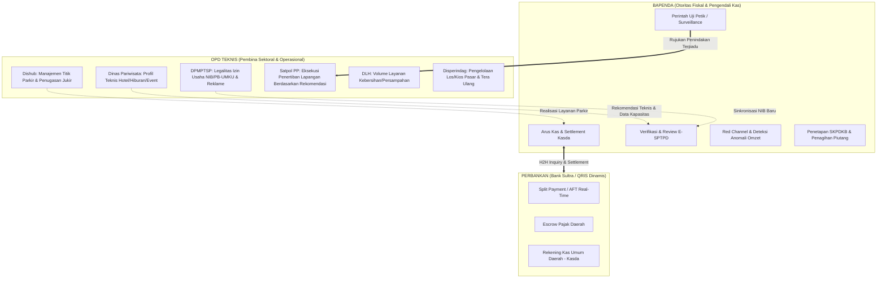

# Cetak Biru Implementasi: Sistem Kontrol Pendapatan Daerah & Pemisahan Tupoksi OPD
**Ekosistem Terintegrasi M-PAD (Pajak, Retribusi, dan Aset Daerah Kota Baubau)**

---

## 1. Filosofi & Prinsip Arsitektur: Segregation of Duties (SoD)

Sistem M-PAD dibangun di atas prinsip pemisahan wewenang dan fungsi (*Segregation of Duties*) yang tegas antara **Badan Pendapatan Daerah (Bapenda)** sebagai otoritas fiskal pengendali pendapatan, dengan **Organisasi Perangkat Daerah (OPD) Teknis** sebagai pembina sektoral dan pengelola operasional layanan.

---

## 2. Matriks Pembagian Tupoksi Lintas Sektor

| Instansi | Peran Utama di M-PAD | Lingkup Akses & Kewenangan | Batasan Tegas (*What They CANNOT Do*) |
| :--- | :--- | :--- | :--- |
| **BAPENDA** | **Revenue Controller & Fiscal Authority** | 1. Kontrol seluruh aliran uang (*money flow*) dan target PAD. 2. Review, approval, dan audit laporan omzet mandiri (E-SPTPD). 3. Pemantauan anomali omzet (*Red Channel & Gap Analysis*). 4. Perintah uji petik (*spot check*) dan surveillance lapangan. 5. Rekonsiliasi Host-to-Host Bank Sultra dan Kasda. 6. Penerbitan SKPDKB, surat teguran, dan denda keterlambatan. | Tidak mencampuri urusan teknis izin operasional pariwisata atau rekayasa lalu lintas jalan Dishub. |
| **Dinas Pariwisata** | **Pembina Teknis Pariwisata & Ekonomi Kreatif** | 1. Profiling teknis objek wisata, hotel, resto, dan hiburan malam. 2. Verifikasi kapasitas teknis (bintang hotel, jumlah kamar, kapasitas room karaoke, meja biliar, sound system, jam operasional). 3. Sertifikasi kelayakan dan kepatuhan CHSE. 4. Kalender agenda event hiburan daerah. | **DILARANG** memungut uang pajak, mengubah status pembayaran, atau mengakses kas daerah. |
| **Dishub** | **Pengelola Operasional Parkir & Terminal** | 1. Inventarisasi dan zonasi titik parkir tepi jalan umum. 2. Registrasi dan monitoring tugas Juru Parkir (Jukir). 3. Pelaporan realisasi operasional parkir harian. | Menyetor langsung ke kasda via sistem digital; tidak menetapkan besaran tarif di luar Perda. |
| **DPMPTSP** | **Otoritas Perizinan & Legalitas Usaha** | 1. Verifikasi data NIB, KBLI, dan PB-UMKU pelaku usaha. 2. Verifikasi teknis titik konstruksi reklame (kesesuaian tata ruang). 3. *Bridge* data pelaku usaha baru ke database calon wajib pajak M-PAD. | Tidak menerbitkan ketetapan pajak reklame (penetapan pajak adalah hak Bapenda). |
| **Satpol PP** | **Penegak Hukum Perda & Ketertiban** | 1. Menerima notifikasi rujukan penindakan dari Bapenda/OPD. 2. Eksekusi penertiban lapangan (penempelan stiker peringatan/penyegelan tempat usaha yang menunggak). 3. Penertiban/pembongkaran reklame liar tanpa stempel lunas. | Tidak mengelola data keuangan atau menerima pembayaran tunai di lapangan. |
| **DLH** | **Pengelola Layanan Kebersihan** | 1. Penginputan data volume timbulan sampah komersial/industri. 2. Verifikasi status pelayanan pengangkutan sampah berkala. | Pembayaran retribusi wajib via kanal digital M-PAD menuju Kasda. |
| **Disperindag** | **Pengelola Operasional Pasar** | 1. Manajemen data blok, los, dan kios pasar rakyat. 2. Penataan penempatan pedagang dan jadwal tera ulang timbangan. | Pembayaran sewa/karcis wajib digital terintegrasi M-PAD. |

---

## 3. Skema Inovasi: Kalkulator Bisnis Digital & AFT (Cashflow-Based Enforcement)

Menggantikan metode lama (*Tapping Box* fisik) yang berbiaya tinggi (pengadaan miliaran rupiah), rentan manipulasi (kabel dimatikan), dan sering rusak:

1. **Digital POS / Kalkulator Bisnis**:
   - Modul aplikasi kasir digital terpasang di smartphone/tablet pelaku usaha (di `retribusi-bisnis` / `retribusi-mobile`).
   - Kasir menginput nilai transaksi konsumen.
   - Sistem otomatis menghitung: `Nilai Penjualan Bersih` + `PBJT 10%` = `Total Tagihan Konsumen`.
2. **Dynamic QRIS / Virtual Account Split-Payment**:
   - Konsumen membayar 100% total tagihan via QRIS Dinamis atau VA Bank Sultra.
   - **Mekanisme Automatic Fund Transfer (AFT)**:
     - 90% (nilai pokok penjualan) otomatis masuk ke rekening operasional merchant.
     - 10% (komponen PBJT) otomatis ditarik dan dialokasikan langsung ke **Escrow Pajak Bapenda / Kasda**.
   - e-Resi dan bukti bayar pajak langsung terbit seketika (*real-time tax clearance*).
3. **PKS & Kuasa Auto-Debit**:
   - Diikat secara legal melalui penandatanganan Perjanjian Kerja Sama (PKS) dan Surat Kuasa Pendebetan Rekening saat onboarding merchant di M-PAD.

---

## 4. Sistem Deteksi Anomali & Red Channel di `retribusi-admin`

Untuk pelaku usaha yang masih menggunakan metode *Self-Assessment* murni (melaporkan omzet bulanan via E-SPTPD), Bapenda dibekali instrumen **Red Channel & Gap Monitoring**:

### Algoritma Penilaian Risiko Omzet:
1. **Deviasi Historis (Historical Variance)**:
   $$\Delta_{\text{histori}} = \frac{|\text{Omzet Bulan Ini} - \text{Rata-rata 3 Bulan Terakhir}|}{\text{Rata-rata 3 Bulan Terakhir}} \times 100\%$$
   - Jika $\Delta_{\text{histori}} > 30\%$ penurunan drastis tanpa ada alasan musim/bencana: **Yellow Flag**.
2. **Deviasi Uji Petik (Spot Check Variance)**:
   $$\Delta_{\text{spot}} = \frac{\text{Proyeksi Omzet Uji Petik} - \text{Omzet Dilaporkan}}{\text{Proyeksi Omzet Uji Petik}} \times 100\%$$
   - Jika $\Delta_{\text{spot}} > 40\%$: **Red Flag (Indikasi Manipulasi Omzet / Fraud)**.
3. **Tindakan Bapenda di Admin**:
   - Mengunci laporan SPTPD.
   - Menerbitkan **Surat Perintah Uji Petik Mendalam** ke petugas lapangan.
   - Apabila terbukti under-reporting, menerbitkan **SKPDKB (Surat Ketetapan Pajak Daerah Kurang Bayar)** ditambah sanksi bunga 1% - 2% per bulan sesuai Perda 1/2024.

---

## 5. Rencana Eksekusi Repositori (Lintas Komponen)

### A. Repositori `retribusi-admin` (Frontend Admin)
1. **Restrukturisasi Halaman E-SPTPD (`src/pages/ESptpd.tsx`)**:
   - Mengubah halaman dari formulir input warga menjadi **Dashboard Review & Validasi E-SPTPD Bapenda**.
   - Menampilkan tabel pelaporan omzet bulanan dengan filter: Periode, Jenis Pajak (Restoran, Hotel, Hiburan), Status (Menunggu Review, Disetujui, Red Channel, Ditolak).
   - Menambahkan visualisasi skor anomali (*Anomaly Gauge*) dan tombol aksi: *Setujui*, *Minta Klarifikasi*, *Trigger Uji Petik*, *Terbitkan SKPDKB*.
2. **Dashboard Sektoral Dinas Pariwisata (`src/pages/PariwisataDashboard.tsx`)**:
   - Mengakomodasi peran khusus Dispar: Profiling teknis hotel & hiburan malam, jumlah kamar/meja biliar/room karaoke, kepatuhan sertifikasi, dan kalender event hiburan, tanpa fungsi manipulasi kas.
3. **Perapian RBAC Menu di `src/components/Layout.tsx`**:
   - Memisahkan grup navigasi secara tegas:
     * **Klaster Pengendali Pendapatan (Bapenda)**: Dashboard Fiskal, Review E-SPTPD & Anomali, Rekonsiliasi Kasda, Penagihan & SKPDKB.
     * **Klaster Layanan & Operasional OPD**: Pariwisata, Dishub (Parkir), DPMPTSP (Perizinan & Reklame), DLH (Sampah), Disperindag (Pasar).
     * **Klaster Penegakan Terpadu**: Satpol PP & Wasdal (Surveillance & Surat Tugas).

### B. Repositori `retribusi-api` (Backend Core)
1. **Controller E-SPTPD (`app/Http/Controllers/SptpdController.php`)**:
   - Tambahkan method:
     * `index(Request $request)`: Filter data SPTPD untuk admin Bapenda berdasar status, OPD, dan range tanggal.
     * `verify(Request $request, $id)`: Validasi/approval laporan oleh verifikator Bapenda.
     * `flagAnomaly(Request $request, $id)`: Tandai laporan masuk ke Red Channel dan otomatis terbitkan draf surat tugas uji petik.
2. **RBAC Middleware Scoping**:
   - Memastikan otorisasi berbasis `opd_id` dan role berjalan konsisten. OPD teknis hanya memiliki izin *Read/Write* pada data profil teknis objek mereka, sementara penetapan tagihan dan settlement kasda terisolasi hanya untuk role Bapenda.

### C. Repositori `retribusi-bisnis` & `retribusi-mobile`
1. **Modul Kalkulator Bisnis & Split-Payment**:
   - Interface input cepat kasir untuk perhitungan omzet + PBJT 10%.
   - Integrasi pembuatan invoice QRIS Bank Sultra.

### D. Repositori `retribusi-petugas`
1. **Modul Uji Petik Lapangan (Spot Check)**:
   - Form pencatatan surveillance harian (pencatatan pengunjung/kendaraan masuk selama sampling 2-3 jam) untuk dikirim langsung ke Bapenda sebagai pembanding deviasi SPTPD.
