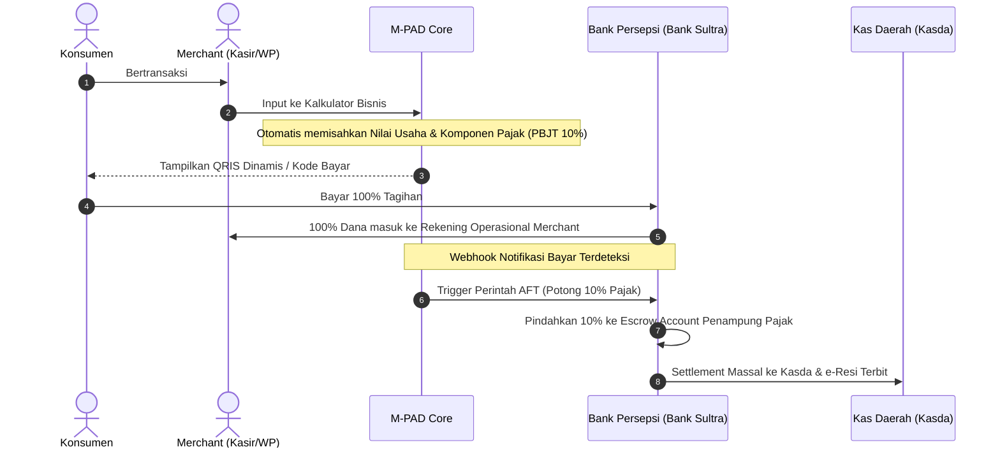

# Skema Inovasi: Kalkulator Bisnis Digital & Auto-Debit (AFT)
**Transformasi Pengawasan Pajak dari Hardware-Based ke Cashflow-Based Enforcement**

---

## 1. Latar Belakang & Konsep
Menggantikan pengadaan perangkat fisik *Tapping Box* yang berbiaya miliaran rupiah dengan modul **Kalkulator Bisnis Digital** di aplikasi M-PAD yang terhubung langsung dengan mekanisme **Automatic Fund Transfer (AFT)** / *Split-Payment* perbankan.

---

## 2. Alur Transaksi (Workflow)

---

## 3. Analisis Regulasi & Aspek Hukum

### A. Aspek yang Legal dan Mendukung (UU HKPD No. 1/2022)
* **Asas Titipan (Fidusia Pajak):** Pelaku usaha bertindak sebagai Pemungut Pajak (*Withholding Tax*). Dana pajak yang dibayarkan konsumen hakikatnya adalah hak daerah. Penarikan otomatis mempercepat penyetoran hak negara.
* **ETPD (Elektronifikasi Transaksi Pemda):** Selaras dengan mandat percepatan digitalisasi pendapatan daerah untuk menutup celah kebocoran kas (*leakage*).

### B. Batasan Hukum Privasi Perbankan & Solusinya
* **Ketentuan:** Bank dilarang mendebet dana nasabah tanpa persetujuan tertulis pemegang rekening.
* **Solusi Wajib:** Penyediaan klausul **Surat Kuasa Debet Rekening / Perjanjian Kerja Sama (PKS)** bertandatangan elektronik (TTE) antara Wajib Pajak, Bapenda, dan Bank BPD saat pendaftaran usaha di sistem M-PAD.

---

## 4. Manajemen Risiko & Mitigasi

| Risiko | Deskripsi | Mitigasi Solusi |
| :--- | :--- | :--- |
| **Timing & Likuiditas** | Dana konsumen terlanjur dipakai belanja merchant sebelum eksekusi AFT berjalan (gagal debet). | Eksekusi AFT *near-instant* (< 5 detik) atau skema *Split-Payment* langsung di level Payment Gateway saat transaksi terjadi. |
| **Resistensi WP** | Kasir tidak menginput transaksi ke kalkulator (transaksi bawah meja). | Integrasi API langsung ke software POS modern (Moka/Majoo) + Uji Petik Digital berkala oleh tim Bapenda. |
| **Biaya Transaksi (Admin Fee)** | Transaksi pajak kecil tergerus biaya kliring/BI-FAST bank. | PKS khusus dengan Bank Sultra menetapkan biaya administrasi AFT adalah **Rp0,- (Gratis)** demi mendukung ETPD. |
