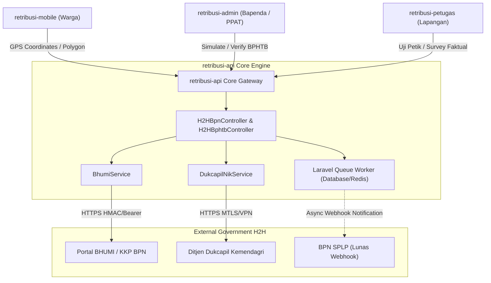

# SOFTWARE REQUIREMENTS SPECIFICATION (SRS)
## Spesifikasi Perangkat Lunak Integrasi H2H ATR/BPN, KKP, dan Dukcapil

---

**Nomor Dokumen:** SRS-MPAD-H2H-001  
**Versi:** 1.0.0  
**Tanggal:** 5 September 2026  
**Penyusun:** Arsitek Sistem M-PAD  
**Target Repositori:** `retribusi-api`, `retribusi-mobile`, `retribusi-petugas`, `retribusi-admin`  
**Milestone Leantime:** [M35: Integrasi H2H ATR/BPN & Dukcapil](https://leantime.sarjanakomputer.id) (ID: 2180, Tasks: 2181-2188)

---

## 1. Arsitektur Komponen & Antarmuka Layanan (API Specification)

Ekosistem H2H diatur melalui arsitektur multi-layer di mana `retribusi-api` bertindak sebagai *API Gateway & Orchestration Core*.



---

## 2. Kebutuhan Skema Basis Data (Database Requirements)

### 2.1. Ekstensi PostGIS & Kolom Spasial
Pada migrasi database Laravel:
```php
// Memastikan ekstensi PostGIS aktif secara aman
DB::statement('CREATE EXTENSION IF NOT EXISTS postgis;');

Schema::table('taxpayer_pbb_objects', function (Blueprint $table) {
    $table->string('nib_code', 20)->nullable()->index()->after('nop');
    $table->string('znt_zone_code', 10)->nullable()->after('nib_code');
    $table->decimal('nir_value', 15, 2)->nullable()->after('znt_zone_code');
    $table->geometry('polygon_geom', 'polygon', 4326)->nullable()->after('nir_value');
});

Schema::table('pbb_nop_applications', function (Blueprint $table) {
    $table->string('nib', 20)->nullable()->index()->after('applicant_nik');
    $table->string('znt_applied', 10)->nullable()->after('nib');
    $table->decimal('nir_applied', 15, 2)->nullable()->after('znt_applied');
    $table->json('polygon_coordinates')->nullable()->after('nir_applied');
    $table->boolean('is_bpn_verified')->default(false)->after('polygon_coordinates');
});
```

---

## 3. Spesifikasi Endpoint H2H & Kontrak Data

### 3.1. Inbound Spatial Reverse Lookup (`POST /api/h2h/bhumi/reverse-lookup`)
Endpoint untuk menarik data NIB, ZNT, dan geometri resmi BPN berdasarkan poligon/koordinat yang digambar pengguna di peta.

- **Request Header:** `Authorization: Bearer <token>`
- **Request Body:**
```json
{
  "latitude": -5.4664,
  "longitude": 122.6025,
  "polygon_coordinates": [
    [-5.4663, 122.6024],
    [-5.4665, 122.6024],
    [-5.4665, 122.6026],
    [-5.4663, 122.6026],
    [-5.4663, 122.6024]
  ]
}
```

- **Response Success (200 OK):**
```json
{
  "status": "success",
  "data": {
    "is_matched": true,
    "nib": "21.01.01.02.00123",
    "nop_bpn": "747201000100200340",
    "zona_znt": "AA",
    "nir_value": 450000.00,
    "legal_land_area": 350.00,
    "hak_type": "Hak Milik",
    "official_polygon": {
      "type": "Polygon",
      "coordinates": [...]
    },
    "verification_badge": "VERIFIED_BPN_BHUMI"
  }
}
```

- **Response Fallback (200 OK - Belum Terpetakan di BPN):**
```json
{
  "status": "success",
  "data": {
    "is_matched": false,
    "nib": null,
    "zona_znt": null,
    "nir_value": null,
    "legal_land_area": null,
    "verification_badge": "UNVERIFIED_NON_SERTIPIKAT",
    "message": "Bidang tanah belum terdaftar di peta kadaster BHUMI ATR/BPN. Silakan lengkapi data mandiri."
  }
}
```

---

### 3.2. Asynchronous Webhook Notifikasi Pelunasan (`Job: NotifyBpnSplpPaymentJob`)
Notifikasi pelunasan ke BPN dijalankan di antrean latar belakang:
- **Trigger:** Event `PaymentReceived` atau callback payment gateway Bank Sultra / BRI.
- **Queue Payload:**
```json
{
  "nop": "747201000100200340",
  "nib": "21.01.01.02.00123",
  "billing_number": "INV-PBB-2026-00912",
  "amount_paid": 315000,
  "payment_date": "2026-09-05T14:30:00Z",
  "bank_ref": "BSLTRA-TRX-882711",
  "type": "PBB"
}
```
- **Ketahanan Jaringan:** Auto-retry 5 kali dengan *exponential backoff* (delay 30 detik, 2 menit, 10 menit, 1 jam, 6 jam). Jika tetap gagal, dicatat di tabel `h2h_connector_logs` dan mengirimkan *alert* Telegram ke tim operasional Bapenda.

---

## 4. Kebutuhan Antarmuka Pengguna (UI Requirements)

### 4.1. Mobile Warga (`retribusi-mobile`)
- Pada layar pendaftaran objek pajak PBB (`PbbNopApplication.tsx`):
  1. Komponen `MapPicker` mendukung mode `polygon`.
  2. Saat pengguna selesai menggambar bidang tanah poligon (minimal 3 titik koordinat tertutup), sistem memicu debounced call ke `reverse-lookup`.
  3. Field NIB, Luas Tanah, dan Zona ZNT otomatis terkunci (*read-only*) dan menampilkan *tag* hijau:
     `[✓ NIB Teridentifikasi BPN: 21.01.01.02.00123]`.
  4. Jika bidang belum teridentifikasi di BPN, input luas tanah menjadi aktif (*editable*) dan muncul pemberitahuan ramah:
     `"Bidang tanah belum terpetakan di sistem BPN. Luas tanah akan diverifikasi melalui pengukuran lapangan oleh petugas Bapenda."`

### 4.2. Admin Web Bapenda (`retribusi-admin`)
- Pada menu verifikasi pendaftaran PBB dan e-BPHTB:
  - Menyediakan tampilan *Side-by-Side Dual-View*:
    - **Kolom Kiri (Klaim Warga / PPAT):** Luas tanah yang dilaporkan, nilai transaksi perolehan (NPOP).
    - **Kolom Kanan (Data Resmi ATR/BPN BHUMI):** Luas tanah kadaster BPN, Nilai ZNT, Peta poligon resmi BPN.
    - **Indikator Kewajaran:** Menghitung selisih persentase deviasi luas dan nilai transaksi.

---

## 5. Kebutuhan Keamanan Data & Kepatuhan Privasi (Security & Privacy)

1. **Enkripsi Data Pribadi (PII Protection):**
   - NIK dan Nomor Telepon pemohon wajib disimpan dalam keadaan terenkripsi atau disamarkan (*masked*, misal `747201******0001`) pada log transaksi publik.
2. **Autentikasi & Otorisasi Antar-Lembaga:**
   - Pertukaran data H2H menggunakan koneksi terenkripsi HTTPS TLS 1.3 dengan *Header Signature* HMAC-SHA256 atau mTLS.
   - Endpoint H2H BPN dilindungi dengan validasi IP Whitelist (khusus IP Server BPN dan Bapenda).
