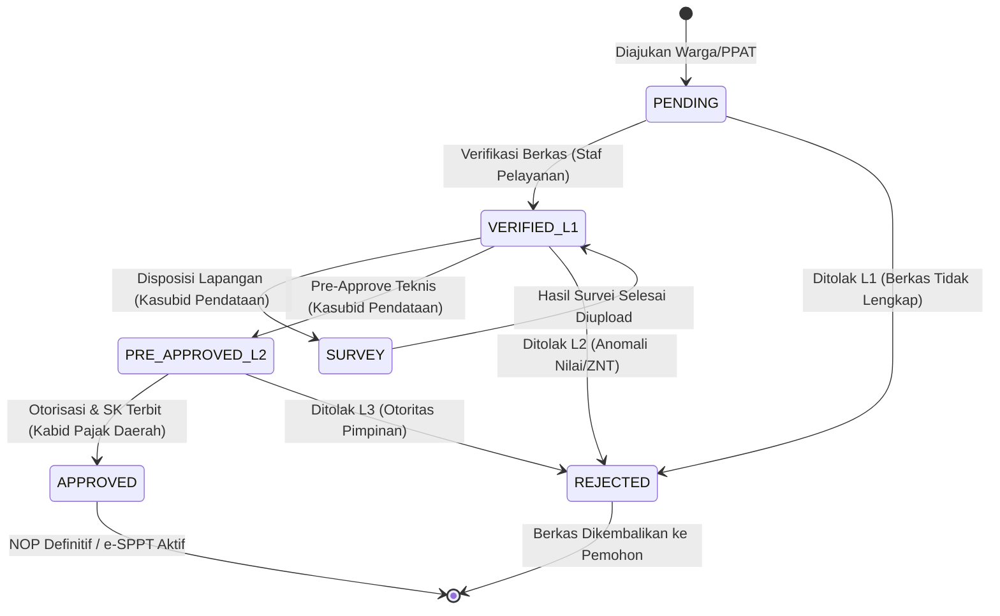

# SOFTWARE REQUIREMENTS SPECIFICATION (SRS)
## Spesifikasi Teknis Layanan PBB-P2 9 Skenario & Sistem Verifikasi Berjenjang 3 Tingkat

---

**Nomor Dokumen:** SRS-MPAD-PBB-002  
**Versi:** 1.0.0  
**Tanggal:** 23 September 2026  
**Penyusun:** Tim Arsitek Sistem & Backend M-PAD  
**Status:** Baseline Spesifikasi Teknis  
**Referensi BRD:** [BRD-MPAD-PBB-002 (Tata Kelola Mutasi PBB-P2 & Verifikasi 3 Tingkat)](../03_proses_bisnis_penagihan/BRD_PBB_MUTASI_DAN_VERIFIKASI_BERJENJANG.md)  

---

## 1. Pendahuluan

### 1.1. Tujuan Dokumen
Dokumen Software Requirements Specification (SRS) ini merumuskan kebutuhan teknis perangkat lunak, arsitektur basis data, pemetaan Role-Based Access Control (RBAC), siklus *state machine*, dan kontrak antarmuka pemrograman aplikasi (REST API) untuk modul pelayanan Pajak Bumi dan Bangunan Perdesaan dan Perkotaan (PBB-P2) Kota Baubau di ekosistem M-PAD.

### 1.2. Ruang Lingkup Sistem
Modul ini mencakup interaksi lintas platform:
- **Backend API (`retribusi-api`):** Penegakan validasi bisnis, otorisasi RBAC, kalkulasi formula fiskal, dan integrasi database.
- **Admin Dashboard (`retribusi-admin`):** Antarmuka konsol verifikasi untuk Verifikator/Staf Pelayanan (Level 1), Kasubid Pendataan (Level 2), dan Kabid Pajak Daerah (Level 3).
- **Petugas Mobile (`retribusi-petugas`):** Modul survei lapangan, pengisian LSPOP, dan geotagging koordinat objek pajak.
- **Warga Portal (`retribusi-mobile`):** Pengajuan permohonan 9 skenario dan pelacakan status berkas secara real-time.

---

## 2. Arsitektur Role-Based Access Control (RBAC) & Otorisasi

### 2.1. Definisi Role Baru: Kasubid Pendataan (`kasubid_pendataan`)
Untuk menegakkan pemisahan tugas (*segregation of duties*) dan akuntabilitas verifikasi teknis, sistem mendefinisikan role khusus aparatur:

```php
// retribusi-api/app/Models/User.php
const ROLE_KASUBID_PENDATAAN = 'kasubid_pendataan';
```

Dan penyesuaian tipe TypeScript pada frontend:
```typescript
// retribusi-admin/src/types/index.ts
export type UserRole = 
  | 'super_admin' 
  | 'admin' 
  | 'opd' 
  | 'verifikator' 
  | 'kasubid_pendataan'  // Role Baru: Kasubid Pendataan
  | 'kabid_pengawas'     // Role Pimpinan: Kabid Pajak Daerah
  | 'kasubid_pengawas'   // Divisi Pengawasan & Penindakan
  | 'petugas' 
  | 'notaris'
  | ...;
```

### 2.2. Matriks 6 Permission Teknis Kasubid Pendataan

| Kode Permission | Deskripsi Fungsional | Endpoint / Aksi Terkait |
|---|---|---|
| `pbb.mutation.view_l2` | Mengakses antrean verifikasi Level 2 pada dashboard | `GET /api/v1/pbb/mutations?status=VERIFIED_L1` |
| `pbb.mutation.verify_technical` | Melakukan telaah parameter ZNT, DBKB, dan data teknis | `POST /api/v1/pbb/mutations/{id}/verify-technical` |
| `pbb.survey.assign` | Menerbitkan surat tugas survei dan mendelegasikan ke petugas lapangan | `POST /api/v1/pbb/mutations/{id}/status` (`status: SURVEY`) |
| `pbb.survey.review` | Meninjau hasil pengukuran, foto fisik, dan draf LSPOP petugas | `GET /api/v1/pbb/mutations/{id}` |
| `pbb.sppt.pre_approve` | Memberikan persetujuan teknis pra-penetapan sebelum diajukan ke Kabid | `POST /api/v1/pbb/mutations/{id}/status` (`status: PRE_APPROVED_L2`) |
| `pbb.kavling.verify_debt` | Memvalidasi formula pembagian piutang proporsional pecah kavling | `POST /api/v1/pbb/calculator/proportional-debt` |

### 2.3. Rencana Migrasi Akun Database (Institutional Account)
Akun aparatur Bapenda terkait di dalam database disesuaikan dengan prinsip akun berbasis institusi/jabatan (bukan nama orang):
- **Nama Akun:** `Kasubid Pendataan`
- **Email:** `kasubid_pendataan@mpad.online`
- **Role:** `kasubid_pendataan`
- **OPD:** Bapenda Kota Baubau (`opd_id: 5`)
- **Password Default Staging:** `password123`

---

## 3. Spesifikasi Basis Data & State Machine

### 3.1. Siklus Status Mutasi PBB (`pbb_mutations.status`)



### 3.2. Kolom Verifikasi pada Tabel `pbb_mutations`

```sql
ALTER TABLE pbb_mutations 
ADD COLUMN verified_l1_by BIGINT UNSIGNED NULL,
ADD COLUMN verified_l1_at TIMESTAMP NULL,
ADD COLUMN verified_l2_by BIGINT UNSIGNED NULL,
ADD COLUMN verified_l2_at TIMESTAMP NULL,
ADD COLUMN approved_l3_by BIGINT UNSIGNED NULL,
ADD COLUMN approved_l3_at TIMESTAMP NULL,
ADD COLUMN assigned_officer_id BIGINT UNSIGNED NULL,
ADD COLUMN survey_notes TEXT NULL,
ADD COLUMN rejection_reason TEXT NULL;
```

---

## 4. Spesifikasi Kontrak REST API

### 4.1. Endpoint Verifikasi & Transisi Status Mutasi
- **URL:** `POST /api/v1/pbb/mutations/{id}/status`
- **Middleware:** `auth:sanctum`, `ensure.admin`
- **Request Payload:**
```json
{
  "status": "PRE_APPROVED_L2",
  "notes": "Parameter ZNT dan DBKB sesuai kondisi lapangan. Nilai proporsional piutang telah divalidasi.",
  "assigned_officer_id": null,
  "survey_notes": null,
  "rejection_reason": null
}
```

- **Aturan Validasi Role Backend:**
  - Status `VERIFIED_L1`: Dapat diupdate oleh role `admin`, `verifikator`, `super_admin`.
  - Status `PRE_APPROVED_L2` dan `SURVEY`: Khusus role `kasubid_pendataan`, `admin`, `super_admin`.
  - Status `APPROVED`: Khusus role `kabid_pengawas`, `kepala_bapenda`, `super_admin`.
  - Status `REJECTED`: Wajib menyertakan parameter `rejection_reason`.

### 4.2. Endpoint Kalkulator Piutang Proporsional Pecah Kavling
- **URL:** `POST /api/v1/pbb/calculator/proportional-debt`
- **Fungsi:** Menghitung pembagian piutang NOP induk per meter persegi kavling pecahan.
- **Formula:**
  $$\text{Piutang Pecahan} = \text{round}\left( \frac{\text{Luas Pecahan}}{\text{Luas Induk}} \times \text{Total Piutang Induk} \right)$$
- **Request Payload:**
```json
{
  "parent_nop": "747201000100100010",
  "items": [
    { "item_index": 1, "target_nik": "7472010101900001", "land_area_m2": 250 },
    { "item_index": 2, "target_nik": "7472010101900002", "land_area_m2": 200 }
  ]
}
```

---

## 5. Kebutuhan Antarmuka Pengguna (UI/UX Requirements)

### 5.1. Tampilan Matriks Verifikasi Dashboard (`PbbNopApplicationsTab.tsx` & `PbbMutationsTab.tsx`)
1. **Checklist 6 Poin Verifikasi:**
   - [ ] 1. Identitas Pemohon / Surat Kuasa
   - [ ] 2. Sertifikat / Bukti Hak Tanah
   - [ ] 3. Kesesuaian Luas Tanah ATR/BPN
   - [ ] 4. Foto Fisik Bangunan dari WP
   - [ ] 5. Titik Koordinat Peta Satelit
   - [ ] 6. PBG (Asas Kebenaran Materiil - Opsional)
2. **Tombol Tindakan Berdasarkan Role:**
   - Jika login sebagai `verifikator`: Tombol aktif hanya `Level 1: Verifikasi Berkas (Staf Pelayanan)`.
   - Jika login sebagai `kasubid_pendataan`: Tombol aktif mencakup `Level 2: Pre-Approve Teknis (Kasubid Pendataan)` dan `Tugaskan Survei Lapangan`.
   - Jika login sebagai `kabid_pengawas`: Tombol aktif `Level 3: Sahkan SK & Terbitkan Definitif (Kabid Pajak Daerah)`.
   - Role `super_admin`: Memiliki akses *override* ke seluruh tingkatan.
