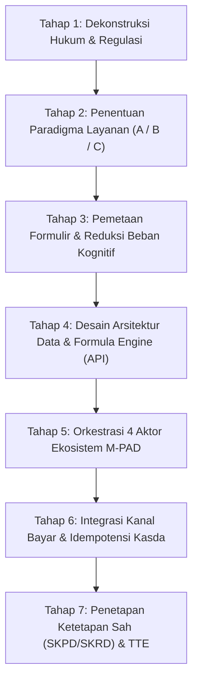

# Framework & Proses Berpikir: Dari Regulasi hingga Terbit Suatu Layanan M-PAD
**Pemerintah Kota Baubau — Badan Pendapatan Daerah (BAPENDA)**  
*Metodologi Hulu-ke-Hilir Digitalisasi Layanan Pajak & Retribusi Daerah (UU HKPD 1/2022 & Perda Kota Baubau 1/2024)*

---

## 1. Filosofi Dasar: "The Golden Triangle of M-PAD"

Setiap layanan yang diterbitkan di ekosistem M-PAD (baik di aplikasi Warga, Petugas, maupun Admin) harus berdiri kokoh di atas **Segitiga Emas Layanan Publik**:

```
                       [ 1. HUKUM & REGULASI ]
                     (UU HKPD 1/2022 & Perda 1/2024)
                                  ▲
                                 / \
                                /   \
                               /     \
    [ 2. PENGALAMAN WARGA ]  ◄─────────►  [ 3. AKUNTABILITAS KASDA ]
     (Citizen-Centric UX)                   (Anti-Fraud & Audit BPK)
```

1. **Hukum & Regulasi**: Tidak boleh ada satu rupiah pun ditarik tanpa dasar pasal Perda dan SK Walikota yang sah.
2. **Pengalaman Warga (*Citizen-Centric UX*)**: Warga tidak boleh dibebani kerumitan birokrasi, rumus NJOP, atau kode akun rekening APBD.
3. **Akuntabilitas Kasda**: Setiap rupiah harus masuk ke Rekening Kas Umum Daerah (RKUD) secara *real-time* tanpa peluang kebocoran atau pembayaran ganda.

---

## 2. Peta 7 Tahap Proses Berpikir (The 7-Step Service Thinking Process)



---

### TAHAP 1: Dekonstruksi Hukum & Regulasi (*Legal Ingestion*)
Sebelum menulis satu baris kode pun, arsitek sistem harus menjawab 6 pertanyaan yuridis dasar:

| Pertanyaan Regulasi | Contoh Kasus: Sarang Burung Walet | Contoh Kasus: Sewa Rusunawa |
| :--- | :--- | :--- |
| **1. Apa Jenis Penerimaannya?** | Pajak Daerah (UU HKPD Pasal 4 ayat 1) | Retribusi Jasa Usaha (Pemanfaatan Kekayaan Daerah) |
| **2. Siapa Subjek & Wajibnya?** | Orang Pribadi / Badan yang melakukan pengambilan/pengusahaan walet | Penyewa hunian yang terikat Surat Perjanjian Sewa |
| **3. Apa Dasar Pengenaan (DPP)?** | Nilai Jual Sarang Walet (Volume Kg $\times$ Harga Pasar Standar) | Luas Lantai, Tipe Kamar, & Kategori Tarif Perda |
| **4. Berapa Tarif Sahnya?** | **10%** (Perda Baubau No. 1/2024 Pasal 48) | Tarif flat per bulan (misal: Rp 250.000 / bulan) |
| **5. Apa Harga Acuan Bapenda?** | **Rp 6.000.000 / Kg** (Standar Resmi Bapenda Baubau) | Berdasarkan SK Walikota tentang Sewa Aset |
| **6. Apa Sanksi Keterlambatan?** | Bunga 1% per bulan (UU HKPD Pasal 94) + SKPDKB | Peringatan 1-3, Denda Keterlambatan, hingga Segel Unit |

> **Prinsip Berpikir**: *Jika sebuah layanan tidak memiliki pasal perda atau keputusan kepala daerah yang mengikat, layanan tersebut TIDAK BOLEH dibuatkan sistemnya.*

---

### TAHAP 2: Penentuan Paradigma Layanan (*Service Classification*)
Tentukan ke dalam kelompok mana layanan ini beroperasi:

```
                                  [ EVALUASI SIFAT LAYANAN ]
                                              │
                    ┌─────────────────────────┼─────────────────────────┐
                    ▼                         ▼                         ▼
            [ SIFAT OMZET? ]          [ SIFAT TETAP / NJOP? ]     [ SIFAT KONTRAK BULANAN? ]
                    │                         │                         │
                    ▼                         ▼                         ▼
             POLA A:                   POLA B:                   POLA C:
        SELF-ASSESSMENT          OFFICIAL-ASSESSMENT         RETRIBUSI DAERAH
       (e-SPTPD Pelaporan)       (Ketetapan Bapenda)       (Tagihan Rutin Otomatis)
       Contoh: Walet, PBJT      Contoh: PBB-P2, Reklame   Contoh: Rusunawa, Pasar
```

* **Pola A (Lapor Mandiri)**: Memerlukan alur *Warga lapor $\rightarrow$ Admin Review $\rightarrow$ SKPD terbit*.
* **Pola B (Ketetapan Bapenda)**: Memerlukan inkuiri NOP instan atau formulir survei spesifikasi fisik.
* **Pola C (Retribusi Rutin)**: Memerlukan cron-job otomatis generator tagihan bulanan pada tanggal 1 setiap bulan.

---

### TAHAP 3: Pemetaan Formulir & Reduksi Beban Kognitif (*Citizen-Centric Blanko*)
Saat mengubah blanko fisik kertas dinas menjadi form mobile, gunakan aturan pemilahan field:

```
[ BLANKO FISIK LAMA DARI DINAS ]
      │
      ├─► [ AUTO-FILL (IKD) ]    : NIK, Nama Wajib Pajak, Alamat KTP (Jangan suruh warga ketik ulang!)
      ├─► [ SMART GIS PICKER ]   : Alamat objek diubah menjadi titik/poligon peta satelit.
      ├─► [ INPUT KASAT MATA ]   : Hanya tanya apa yang warga tahu (Berat Kg, Luas meter, Foto fisik).
      ├─► [ SISTEM HIDDEN ENGINE]: NJOPR, Indeks Sudut Pandang, Rumus Bunga, Kode Rekening APBD.
      └─► [ LEGAL INTERLOCK ]    : Edukasi SKPD & Checkbox Pakta Integritas sebelum kirim.
```

> **Prinsip Berpikir**: *"Semakin sedikit warga mengetik angka uang, semakin kecil risiko kesalahan dan manipulasi."*  
> *(Contoh: Warga Walet cukup input **Kg panen**, sistem yang mengalikan dengan Rp 6.000.000 dan menghitung 10%).*

---

### TAHAP 4: Desain Arsitektur Data & Formula Engine (API)
Di level backend (`retribusi-api`), sistem harus menjamin integritas perhitungan:

1. **Aturan Mutlak**: Frontend dilarang menghitung nominal tagihan akhir. Frontend hanya menampilkan estimasi bayangan untuk simulasi pengguna.
2. **Formula Engine Terpusat**:
   - `TaxCalculationService.php`: Menerima input volume/omzet mentah, memvalidasi terhadap standar harga Bapenda, dan menghasilkan `nominal_pokok` serta `nominal_denda`.
3. **Isolasi Kepemilikan (Data Guard)**:
   - Wajib Pajak A **DILARANG** melihat objek, laporan, atau tagihan milik Wajib Pajak B. Filter database harus mengunci `taxpayer_id` dari token sesi yang valid.

---

### TAHAP 5: Orkestrasi 5 Aktor Ekosistem M-PAD (Pemisahan Tupoksi Surveyor vs Pengawasan)

Pemisahan peran antar aktor lapangan dan pengawasan harus tegas sesuai tupoksi resmi Bapenda:

1. **Petugas Lapangan (Surveyor / Pendataan)**:
   - **Zona Kerja**: HANYA aktif pada **Tahapan Pendaftaran & Penambahan Unit/Objek Pajak Baru** oleh masyarakat.
   - **Tupoksi**: Melakukan survei fisik ke lokasi, memvalidasi keberadaan gedung/toko/lahan, verifikasi spesifikasi teknis (LSPOP), mengambil foto fisik, dan memverifikasi batas koordinat/poligon GPS.
   - **Batasan**: Tidak menangani laporan panen/omzet bulanan rutin atau menagih denda.

2. **Petugas Bidang Pengawasan (Pengawas / Wasdal & Penindakan)**:
   - **Zona Kerja**: Aktif pada fase **Pasca-Pelaporan, Deteksi Anomali, dan Penegakan Kepatuhan**.
   - **Tupoksi**: 
     - Memantau anomali data (`GET /api/pengawas/anomalies`) ketika laporan omzet/panen warga drastis menurun atau tidak wajar.
     - Melakukan **Uji Petik (*Spot Check*)** langsung ke lokasi usaha dengan Kertas Kerja Uji Petik (`POST /api/spot-checks`).
     - Melakukan penindakan hukum: Penerbitan **SKPDKB** (Surat Ketetapan Pajak Daerah Kurang Bayar), Surat Teguran 1-3, Surat Paksa (SPMP), hingga pemasangan stiker peringatan/penyegelan objek.
     - Mengelola permohonan relaksasi/penghapusan denda (*Penalty Waiver / Amnesty*).

3. **Alur Orkestrasi Dual-Cycle**:

```
[ ALUR A: PENDAFTARAN OBJEK BARU ]
Warga (Mobile)               Petugas Lapangan (Surveyor)         Admin Penetap (Admin)
      │                                    │                                  │
  1. Daftarkan Unit Usaha/Gedung           │                                  │
      ├───────────────────────────────────►│ (Disposisi Survei Lokasi)        │
      │                             2. Survei Fisik, LSPOP, GPS               │
      │                                    ├─────────────────────────────────►│
      │                                    │                      3. Setujui Objek Pajak
      │◄───────────────────────────────────┴──────────────────────────────────┤
  4. Objek Resmi Terdaftar (Siap Lapor e-SPTPD)


[ ALUR B: PELAPORAN RUTIN & JALUR PENGAWASAN ANOMALI ]
Warga (Mobile)               Admin Verifikator (Admin)         Bidang Pengawasan (Wasdal)
      │                                    │                                  │
  1. Lapor Panen/Omzet Mandiri             │                                  │
      ├───────────────────────────────────►│                                  │
      │                            2. Review & Verifikasi                     │
      │                                    ├─[Data Normal]─► Terbitkan SKPD   │
      │                                    │                                  │
      │                                    └─[Ada Anomali]───────────────────►│
      │                                                          3. Anomaly Flagged
      │                                                          4. Uji Petik (Spot Check)
      │                                                          5. Terbitkan SKPDKB / Denda
      │◄──────────────────────────────────────────────────────────────────────┤
  6. Menerima Ketetapan Resmi (SKPD Normal atau SKPDKB Kurang Bayar)
```

---

### TAHAP 6: Integrasi Kanal Bayar & Idempotensi Kasda
Tahap penentuan bagaimana warga melunasi kewajiban:

1. **Prinsip Idempotensi**:
   - Satu nomor tagihan (`INV-...`) tidak boleh dibayar 2 kali.
   - Saat proses bayar berlangsung, backend melakukan *database row locking* (`lockForUpdate`).
2. **Kanal Terpadu (Omni-Channel)**:
   - **QRIS Dinamis**: Menghasilkan QR code ber-nominal pas (tidak bisa diubah pembayar) yang kedaluwarsa dalam 24 jam.
   - **Virtual Account H2H**: Terhubung langsung ke Bank Sultra (Kas Daerah), BSI, dan BRI.
3. **Penyelesaian Otomatis (*Automatic Settlement*)**:
   - Begitu uang masuk ke rekening bank, webhook perbankan memberitahu API.
   - Status tagihan seketika berubah menjadi `LUNAS` tanpa perlu warga mengunggah slip bukti transfer fisik.

---

### TAHAP 7: Penetapan Ketetapan Sah (SKPD/SKRD) & TTE
Tahap akhir yang memberikan kepastian hukum:

1. **Penerbitan Ketetapan**:
   - Diterbitkan nomor SKPD / SKRD resmi dengan format penomoran tata naskah dinas Pemkot Baubau.
   - Memuat rincian objek, masa pajak, tanggal jatuh tempo, dan ancaman bunga keterlambatan 1% per bulan.
2. **Sertifikasi Dokumen (TTE BSrE BSSN)**:
   - Dokumen ketetapan dan dokumen bukti setor (**E-BSR / E-STTS**) disematkan QR Code verifikasi digital.
3. **Uji Validitas di Lapangan**:
   - Jika petugas lapangan melakukan razia/uji petik, petugas cukup memindai QR code pada E-BSR di HP warga menggunakan aplikasi `retribusi-petugas`.
   - Sistem menyatakan: *"Dokumen SAH dan Lunas di Kasda Kota Baubau"*.

---

## 3. Checklist Eksekutif: Sebelum Layanan Dinyatakan "LIVE"

Gunakan checklist 10 poin ini sebelum merilis modul layanan baru ke publik:

- [ ] **1. Dasar Hukum**: Apakah nomor Perda, Perwali, dan tarif telah terkonfigurasi di database?
- [ ] **2. Pola Layanan**: Apakah sudah ditentukan masuk Pola A (Self), Pola B (Official), atau Pola C (Retribusi)?
- [ ] **3. UX Kasat Mata**: Apakah form warga sudah bebas dari rumus NJOP/istilah birokrasi rumit?
- [ ] **4. Spasial GIS**: Apakah lokasi objek sudah menggunakan pemetaan koordinat/poligon presisi?
- [ ] **5. Proteksi Data**: Apakah Wajib Pajak hanya bisa mengakses objek dan tagihan miliknya sendiri?
- [ ] **6. Edukasi Hukum**: Apakah ada peringatan konsekuensi piutang daerah & checkbox keabsahan data?
- [ ] **7. Notifikasi Proaktif**: Apakah WhatsApp Gateway mengirim konfirmasi berkas dan notifikasi tagihan?
- [ ] **8. Kanal Pembayaran**: Apakah nomor tagihan berhasil digenerate ke QRIS dan Virtual Account?
- [ ] **9. Real-Time Callback**: Apakah saat bayar simulasi, status tagihan otomatis berubah menjadi LUNAS?
- [ ] **10. Bukti Ber-TTE**: Apakah PDF E-BSR / E-STTS dapat diunduh dan discan keasliannya?
