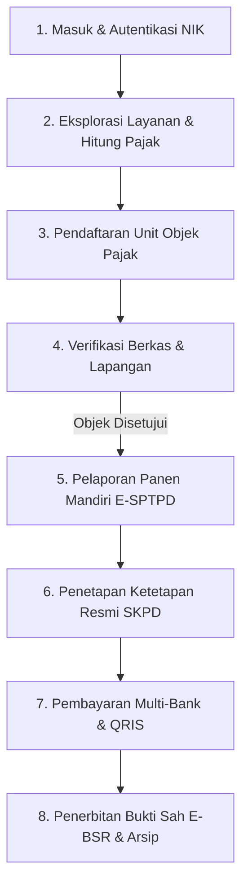

# User Journey Map: M-PAD Mobile (Warga & Wajib Pajak)
**Pemerintah Kota Baubau — Badan Pendapatan Daerah (BAPENDA)**  
*Berdasarkan UU HKPD No. 1 Tahun 2022 & Perda Kota Baubau No. 1 Tahun 2024*

---

## 1. Persona Wajib Pajak

| Atribut | Profil |
| :--- | :--- |
| **Nama Persona** | Pak La Ode (42 Tahun) — Pengusaha Sarang Burung Walet & Kuliner Lokal |
| **Karakteristik** | Praktis, melek digital lewat smartphone, menghargai transparansi hitungan pajak, tidak ingin ribet bolak-balik ke kantor Bapenda. |
| **Tujuan Utama** | Mendaftarkan tempat usaha/gedung walet, melaporkan hasil panen secara jujur dan mudah, serta melunasi kewajiban pajak daerah secara instan dengan bukti sah berkekuatan hukum. |
| **Kekhawatiran** | Takut terkena denda piutang tak terduga, formula hitungan pajak tidak jelas, antrean pembayaran bank yang lama. |

---

## 2. Diagram Alur Makro (End-to-End)

---

## 3. Matriks Detail User Journey (8 Fase Utama)

### Fase 1: Onboarding & Autentikasi Tanpa Sandi Ribet
*Warga membuka aplikasi M-PAD Mobile untuk pertama kali atau saat kembali login.*

* **Tindakan Warga**:
  1. Membuka aplikasi M-PAD di smartphone.
  2. Memasukkan **16 digit NIK** dan verifikasi data kependudukan (Nama Ibu Kandung / Tanggal Lahir).
  3. Menerima kode **OTP resmi via WhatsApp Gateway Bapenda** dan login berhasil.
* **Touchpoint**: Halaman Login NIK, WhatsApp Official Bapenda (`+6282189456728`).
* **Pikiran & Emosi**: *"Mudah sekali, tidak perlu menghafal username/password rumit seperti aplikasi lama."* (😊 Lega & Percaya)
* **Proses Sistem (Backstage)**:
  * Sistem memverifikasi NIK ke database Wajib Pajak terpadu.
  * `WaGatewayService` mengirimkan kode OTP 6-digit terenkripsi dengan masa berlaku 5 menit.

---

### Fase 2: Eksplorasi Layanan & Simulasi Tarif Terbuka
*Warga mencari tahu kewajiban pajak atau retribusi yang berlaku di Kota Baubau.*

* **Tindakan Warga**:
  1. Menjelajahi menu **Katalog Layanan** (PBB-P2, BPHTB, Reklame, Sarang Burung Walet, PBJT Restoran/Hotel, Retribusi Pasar, Sampah, dsb.).
  2. Membuka halaman detail layanan **Pajak Sarang Burung Walet**.
  3. Membaca transparansi formula: Tarif **10%** sesuai Perda No. 1 Tahun 2024 dengan patokan harga pasar standar Bapenda **Rp 6.000.000 / Kg**.
* **Touchpoint**: Katalog Layanan, Tab Rincian Tarif & Regulasi.
* **Pikiran & Emosi**: *"Semua tarif dan dasar hukumnya jelas dan tidak ada pungutan liar terselubung."* (💡 Terinformasi)

---

### Fase 3: Pendaftaran Unit Usaha Baru (Auto-GIS & Smart Form)
*Warga mendaftarkan fisik gedung walet atau tempat usahanya untuk pertama kali.*

* **Tindakan Warga**:
  1. Mengisi data gedung: Tahun mulai beroperasi, luas bangunan, jumlah lantai, dan siklus panen.
  2. Menentukan titik lokasi gedung melalui **Peta Interaktif (MapPicker GIS)**.
  3. Mengambil dan mengunggah foto fisik gedung walet serta dokumen bukti kepemilikan lahan.
  4. Membaca klausul *Legal Consent* dan menandatangani secara digital.
  5. Menekan tombol **Ajukan Pendaftaran**.
* **Touchpoint**: Dynamic Form OPD, MapPicker Leaflet/Mapbox, Camera Capture Module.
* **Proses Sistem (Backstage)**:
  * SmartGIS Bapenda mengekstrak koordinat GPS, mencocokkan bidang persil kadastral (NOP terdekat) dan zonasi tata ruang.
  * Dokumen foto dianalisis geotag dan disimpan aman di storage cloud.
  * Menerbitkan nomor berkas registrasi resmi (misal: `REG-6ABA1607D73E5`).
  * `NotificationDispatcher` mengirim WhatsApp konfirmasi berkas masuk ke HP warga.

---

### Fase 4: Pemantauan Verifikasi & Survei Lapangan Pendaftaran Unit Baru
*Warga memantau perkembangan status permohonan pendaftaran objek baru secara real-time.*

* **Tindakan Warga**:
  1. Membuka menu **Layanan Saya** untuk melihat status berkas pendaftaran unit.
  2. Membaca **Timeline Verifikasi**:
     * Verifikasi Administrasi Bapenda $\rightarrow$ Penugasan Petugas Surveyor Lapangan (Cek Fisik & Titik GPS) $\rightarrow$ Unit Objek Disetujui.
  3. Menerima notifikasi WhatsApp saat berkas dinyatakan **Disetujui (Approved)**.
* **Peran Petugas**:
  * **Petugas Lapangan (Surveyor)** HANYA bertugas pada tahapan ini: mendatangi lokasi untuk memvalidasi fisik gedung walet/usaha dan memverifikasi batas koordinat/poligon GPS. Petugas survei tidak terlibat dalam pelaporan panen bulanan.
* **Pikiran & Emosi**: *"Status berkas sangat transparan, saya tahu persis siapa petugas survei pemeriksanya."* (⏱️ Puas)

---

### Fase 5: Pelaporan Panen Mandiri (E-SPTPD) & Jalur Pengawasan Anomali
*Saat musim panen tiba, Warga melaporkan hasil panen sarang waletnya secara mandiri.*

* **Tindakan Warga**:
  1. Pada kartu gedung walet aktif, menekan tombol **"Lapor Panen"**.
  2. Masuk ke halaman **Pelaporan SPTPD**: unit gedung walet langsung **terkunci otomatis** (tanpa dropdown membingungkan).
  3. Memasukkan **Berat Hasil Panen (Kg)** (contoh: `5` Kg).
  4. Sistem secara otomatis menghitung rincian transparan:
     * Harga Standar Bapenda: `Rp 6.000.000 / Kg`
     * Nilai Penjualan Panen (Omzet): `5 × Rp 6.000.000 = Rp 30.000.000`
     * Pajak Terhitung (10%): `Rp 3.000.000`
  5. Membaca kotak edukasi hukum SKPD.
  6. Mencentang klausul pernyataan kebenaran data & kesiapan sanksi denda SKPDKB jika fiktif.
  7. Menekan tombol **Kirim SKPD**.
* **Touchpoint**: Halaman E-SPTPD Mobile, Interactive Weight Calculator.
* **Proses Sistem & Bidang Pengawasan (Backstage)**:
  * Backend memvalidasi data dan memicu notifikasi badge merah pada menu **Review e-SPTPD** di dashboard Admin Bapenda.
  * **Jalur Normal**: Jika laporan wajar, Admin langsung menyetujui dan menerbitkan SKPD normal.
  * **Jalur Pengawasan (Wasdal)**: Jika terdeteksi **anomali data** (misal volume panen anjlok drastis tidak wajar dibanding kapasitas sarang), berkas akan ditandai untuk **Bidang Pengawasan**:
    - Petugas Pengawasan menjalankan **Uji Petik (*Spot Check*)** ke lokasi (`POST /api/spot-checks`).
    - Jika terbukti ada manipulasi pelaporan, Bidang Pengawasan menerbitkan **SKPDKB (Kurang Bayar)** beserta sanksi denda bunga sesuai Perda 1/2024.

---

### Fase 6: Penerbitan Ketetapan Resmi (SKPD) & Notifikasi Tagihan
*Bapenda memverifikasi kesesuaian data panen dan menerbitkan SKPD.*

* **Tindakan Warga**:
  1. Menerima pesan WhatsApp resmi dari Bapenda:
     > *"Halo Pak La Ode, Laporan SPTPD Sarang Burung Walet periode September 2026 telah DISETUJUI. Nomor Tagihan: INV-20260929-XXXX, Total: Rp 3.000.000."*
  2. Membuka aplikasi M-PAD Mobile, tagihan baru otomatis muncul di tab **Bayar**.
* **Pikiran & Emosi**: *"Laporan saya langsung diproses dan nominal tagihannya tepat sesuai dengan hasil panen yang saya laporkan."* (🎯 Akurat)

---

### Fase 7: Pembayaran Digital Instan (Multi-Bank H2H & QRIS)
*Warga melunasi kewajiban pajak daerah tanpa perlu datang ke kantor kasda.*

* **Tindakan Warga**:
  1. Masuk ke tab **Bayar** dan memilih tagihan yang bersangkutan.
  2. Memilih metode pembayaran yang diinginkan:
     * **QRIS Standar Nasional** (BCA, Mandiri, GoPay, OVO, Dana, dll.)
     * **Virtual Account Bank Sultra** (ATM / Mobile Banking Bank Sultra)
     * **Virtual Account BSI / BRI H2H**
  3. Melakukan scan QRIS atau transfer ke nomor VA.
  4. Sistem langsung mendeteksi pembayaran secara real-time (detik itu juga).
* **Touchpoint**: Tab Bayar, Payment Method Selector, QRIS Viewer, VA Copy Button.
* **Proses Sistem (Backstage)**:
  * Webhook Payment Gateway / H2H Bank menerima notifikasi settlement.
  * Rekonsiliasi data berlangsung secara *idempotent* dan mengunci tagihan menjadi status `LUNAS`.

---

### Fase 8: Bukti Pelunasan Resmi (E-BSR) & Riwayat Terarsip
*Warga menyimpan dokumen bukti lunas yang sah untuk keperluan usaha atau perizinan.*

* **Tindakan Warga**:
  1. Layar menampilkan kartu status **LUNAS** dengan cap stempel digital resmi Pemkot Baubau.
  2. Menekan tombol **Unduh Bukti Bayar (E-BSR)** dalam format PDF ber-barcode verifikasi.
  3. Dokumen tersimpan permanen di tab **Riwayat Transaksi** dan dapat dibuka kapan saja jika ada pemeriksaan petugas lapangan.
* **Pikiran & Emosi**: *"Selesai! Usaha saya aman, legal, dan saya punya bukti bayar resmi yang diakui pemerintah daerah."* (🏆 Tenang & Bangga)

---

## 4. Matriks Ringkasan Emosi & Titik Nilai (Value Drivers)

| Tahap | Touchpoint Utama | Pengalaman Kunci Warga | Titik Nilai (Value Driver) |
| :--- | :--- | :--- | :--- |
| **1. Masuk** | NIK + WhatsApp OTP | Login dalam 15 detik tanpa hafalan password | Aksesibilitas Maksimal |
| **2. Pelajari** | Info Layanan & Regulasi | Tahu tarif 10% dan harga acuan Rp 6 Juta/Kg | Transparansi & Kepatuhan |
| **3. Daftarkan** | Smart Form + Peta GIS | Pinpoint gedung walet presisi di peta | Akurasi Data Spasial |
| **4. Pantau** | Tracking Timeline | Tahu persis berkas sedang diperiksa siapa | Kepastian Layanan (SLA) |
| **5. Lapor** | E-SPTPD (Kg Walet) | Cukup masukkan berat Kg, omzet hitung otomatis | Efisiensi & Kemudahan |
| **6. SKPD** | Edukasi & Checkbox Legal | Memahami dasar hukum piutang daerah resmi | Mitigasi Risiko Fraud |
| **7. Bayar** | QRIS & VA Multi-Bank | Bayar langsung dari HP hitungan detik | Fleksibilitas Finansial |
| **8. Arsip** | E-BSR Bukti Bayar PDF | Bukti sah ber-barcode TTE tersimpan rapi | Kepastian Hukum Wajib Pajak |
