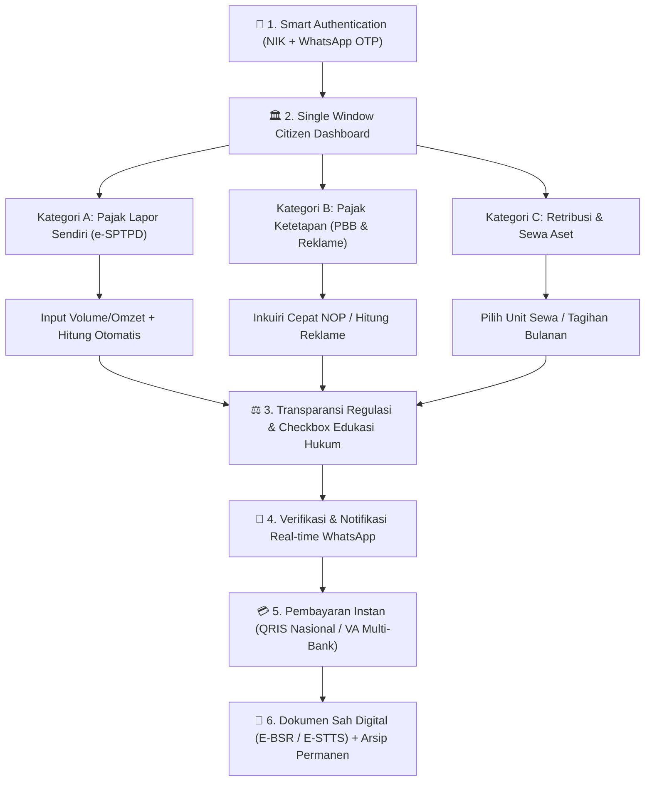

# Universal User Journey Map: Ekosistem M-PAD Mobile
**Pemerintah Kota Baubau — Badan Pendapatan Daerah (BAPENDA)**  
*Blueprint Perjalanan Pengguna untuk Seluruh Layanan Pajak & Retribusi Daerah (UU HKPD 1/2022 & Perda Kota Baubau 1/2024)*

---

## 1. Taksonomi 3 Paradigma Layanan M-PAD

Semua jenis penerimaan Pendapatan Asli Daerah (PAD) di Kota Baubau yang dilayani oleh M-PAD Mobile terbagi ke dalam **3 Paradigma Pola Pelayanan**:

| Parameter | Pola A: Pajak Self-Assessment (Lapor Sendiri) | Pola B: Pajak Official-Assessment (Ketetapan Bapenda) | Pola C: Retribusi & Sewa Aset Daerah (Kontraktual/Rutin) |
| :--- | :--- | :--- | :--- |
| **Cakupan Objek / Layanan** | • PBJT (Restoran, Hotel, Hiburan, Parkir, Listrik) • Sarang Burung Walet • Pajak MBLB (Galian C) | • PBB-P2 (Bumi & Bangunan) • Pajak Reklame (Billboard, Spanduk, Videotron) • BPHTB (Bea Perolehan Tanah) | • Retribusi Pasar (Kios & Los Wameo/Karya Nugraha) • Rusunawa (Kotamara, Wameo, ASN) • Retribusi Kebersihan / Sampah • Tempat Khusus Parkir & Tambat Labuh |
| **Sifat Penetapan** | Wajib Pajak menghitung & melaporkan omzet/panen secara mandiri via e-SPTPD. | Bapenda menetapkan besaran pajak terutang melalui formulasi teknis/zonasi NJOP. | Nominal tagihan diterbitkan berkala (bulanan/tahunan) sesuai SK Perjanjian Sewa / Tarif Perda. |
| **Pintu Masuk Utama** | Pendaftaran Unit Usaha $\rightarrow$ Menu **"Lapor SPTPD"** | Cukup **Inkuiri NOP** (untuk PBB) atau Form Izin Reklame / BPHTB | Nomor Kontrak / ID Unit Sewa $\rightarrow$ Menu **"Tagihan Rutin"** |
| **Dokumen Tagihan** | **SKPD** (Surat Ketetapan Pajak Daerah) | **SPPT** (PBB) / **SKPD Reklame** | **SKRD** (Surat Ketetapan Retribusi Daerah) |
| **Dokumen Bukti Sah** | **E-BSR** (Elektronik Bukti Setor Retribusi/Pajak) | **E-STTS** (Surat Tanda Terima Setoran) | **E-SKRD Lunas** / Bukti Karcis Digital |

---

## 2. Diagram Alur Universal M-PAD Mobile

---

## 3. Matriks 6 Fase Universal User Journey

### Fase 1: Smart Onboarding & Single Sign-On (Akses Inklusif)
* **Tujuan**: Memastikan seluruh warga Kota Baubau dari berbagai kalangan (pelaku UMKM, petani walet, pemilik rumah, pedagang pasar) dapat masuk tanpa kendala lupa password.
* **Aksi Pengguna**:
  1. Masuk ke aplikasi menggunakan **16 digit NIK**.
  2. Menerima kode OTP via WhatsApp resmi Bapenda (`+6282189456728`).
  3. Profil wajib pajak, daftar objek yang dimiliki, dan riwayat tagihan langsung terhubung secara otomatis dari basis data kependudukan.
* **Emosi Warga**: 😊 *Mudah, ramah, dan tidak ada keharusan membuat akun baru yang berbelit-belit.*

---

### Fase 2: Navigasi Satu Pintu & Inisiasi Layanan (Service Initiation)
* **Tujuan**: Memandu warga menemukan layanan yang tepat hanya dalam 1-2 sentuhan layar.
* **Aksi Pengguna sesuai kebutuhan**:
  * **Jalur Cepat Inkuiri PBB-P2**: Memasukkan 18 digit NOP $\rightarrow$ Rincian tagihan tahun berjalan & tunggakan tahun-tahun sebelumnya langsung muncul lengkap dengan rincian NJOP Bumi dan Bangunan.
  * **Jalur Lapor Pajak Mandiri (e-SPTPD)**: Memilih objek usaha (Restoran, Walet, Hotel) $\rightarrow$ Unit usaha langsung terkunci otomatis $\rightarrow$ Masukkan omzet atau berat hasil panen (Kg).
  * **Jalur Retribusi Pasar & Rusunawa**: Melihat kartu hunian/kios aktif $\rightarrow$ Memeriksa tagihan sewa bulan berjalan yang otomatis terbit setiap awal bulan.
  * **Jalur Pendaftaran Baru**: Menggunakan **Smart GIS Form** dengan MapPicker untuk memplot titik lokasi usaha, toko, papan reklame, atau gedung walet secara presisi.
* **Emosi Warga**: 💡 *Pilihan layanan sangat jelas, terstruktur, dan tidak membingungkan.*

---

### Fase 3: Transparansi Regulasi & Interlock Integritas Data
* **Tujuan**: Menghilangkan kecurigaan adanya pungli serta mengedukasi warga mengenai dasar hukum ketetapan piutang daerah.
* **Aksi Pengguna**:
  1. Sistem menampilkan **Kalkulator Transparan**:
     * Dasar Pengenaan Pajak (Harga Standar / Omzet / NJOP).
     * Dasar Hukum: Nomor pasal Perda Kota Baubau No. 1/2024 dan tarif resmi (misal: Walet 10%, Restoran 10%, PBB 0.1-0.2%).
  2. Membaca **Card Edukasi SKPD/SKRD**: Penjelasan bahwa dokumen yang diterbitkan adalah ketetapan berkekuatan hukum negara.
  3. Mencentang klausul pernyataan integritas keabsahan data sebelum tombol pengiriman aktif.
* **Emosi Warga**: 🛡️ *Merasa aman dan paham konsekuensi hukum tanpa rasa diintimidasi.*

---

### Fase 4: Tracking Real-Time & Notifikasi WhatsApp Terpadu
* **Tujuan**: Menghilangkan ketidakpastian status permohonan (*SLA Transparency*).
* **Aksi Pengguna**:
  1. Setelah pengajuan dikirim, pengguna mendapatkan ID Registrasi / Nomor Pelaporan.
  2. Membuka tab **Layanan Saya** untuk melihat linimasa pelacakan:
     * **Jika Pendaftaran Unit Baru**: `Draft` $\rightarrow$ `Verifikasi Berkas` $\rightarrow$ `Survei Fisik Surveyor Lapangan` $\rightarrow$ `Unit Disetujui`.
     * **Jika Pelaporan Rutin (e-SPTPD)**: `Draft` $\rightarrow$ `Review Admin Bapenda` $\rightarrow$ `Disetujui (SKPD Terbit)`.
  3. Tidak perlu membuka aplikasi setiap saat, karena notifikasi resmi terkirim otomatis ke WhatsApp warga saat status berubah.

> ⚖️ **Pemisahan Tupoksi Petugas di Ekosistem M-PAD**:
> - **Petugas Lapangan (Surveyor)**: HANYA bertugas saat masyarakat mendaftarkan/menambahkan unit objek baru (cek fisik, LSPOP, dan GPS).
> - **Petugas Bidang Pengawasan (Wasdal)**: Bertugas menangani **anomali pelaporan** (omzet anjlok tidak wajar), menjalankan **Uji Petik (*Spot Check*)** ke lapangan, serta melakukan penindakan hukum (denda bunga, penerbitan SKPDKB, dan surat teguran) sesuai modul pengawasan yang telah terimplementasi di sistem.

---

### Fase 5: Pembayaran Digital Terpadu (Omni-Payment Gateway)
* **Tujuan**: Memberikan kebebasan opsi pembayaran yang fleksibel bagi warga maupun pengusaha.
* **Aksi Pengguna**:
  1. Menekan tombol **Bayar** pada tagihan yang telah disetujui atau jatuh tempo.
  2. Memilih channel pembayaran resmi:
     * **QRIS Nasional**: Untuk pembayaran instan lintas bank (BCA, Mandiri, BNI, BRI) dan dompet digital (GoPay, OVO, Dana, ShopeePay).
     * **Virtual Account Bank Sultra**: Untuk nasabah bank daerah via teller, ATM, atau mobile banking Bank Sultra.
     * **Virtual Account BSI / BRI H2H**: Untuk transfer antar bank tanpa potongan biaya admin yang memberatkan.
  3. Melakukan otorisasi pembayaran di aplikasi m-banking masing-masing.
  4. Dalam 2–5 detik, layar M-PAD Mobile otomatis beralih menampilkan centang hijau pelunasan.
* **Emosi Warga**: ⚡ *Sangat cepat, bebas antrean loket, dan dapat dilunasi kapan saja (24/7).*

---

### Fase 6: Bukti Sah Digital (E-BSR / E-STTS) & Bebas Pemeriksaan
* **Tujuan**: Memberikan jaminan perlindungan hukum bagi wajib pajak bahwa kewajibannya telah tuntas 100%.
* **Aksi Pengguna**:
  1. Mendapatkan bukti lunas resmi berstempel digital:
     * **E-BSR** untuk Pajak Daerah & e-SPTPD.
     * **E-STTS** untuk Pajak Bumi dan Bangunan (PBB-P2).
     * **E-SKRD Lunas** untuk Sewa Rusunawa & Retribusi Pasar.
  2. Dokumen dilengkapi **QR Code TTE (Tanda Tangan Elektronik)** yang dapat discan oleh siapa saja untuk membuktikan keaslian dokumen ke server Bapenda.
  3. Dokumen tersimpan permanen di tab **Riwayat Transaksi** dan dapat diunduh ulang kapan saja jika ada inspeksi petugas lapangan.
* **Emosi Warga**: 🏆 *Tenang, bangga telah berkontribusi membangun Kota Baubau, dan bebas dari risiko pungli.*

---

## 4. Matriks Layanan Unggulan Kota Baubau

| Layanan | Jalur Masuk di Mobile | Aksi Utama Warga | Keunggulan Inovasi M-PAD |
| :--- | :--- | :--- | :--- |
| **PBB-P2** | Menu `Cek PBB / NOP` | Masukkan 18 digit NOP, cek tagihan tahunan | Bayar multi-tahun sekaligus & unduh E-SPPT instan |
| **Sarang Walet** | Menu `Lapor Panen` | Masukkan berat panen (Kg) | Nilai omzet & pajak 10% dihitung otomatis standar Rp 6jt/Kg |
| **Restoran / Kafe** | Menu `Lapor SPTPD` | Masukkan total omzet kotor bulanan | Langsung terbit draft SKPD tanpa hitung manual |
| **Reklame** | Menu `Daftar Reklame` | Plot lokasi di peta + upload foto desain | Formula NJOP reklame otomatis berdasarkan sudut pandang & luas |
| **Rusunawa & Pasar** | Menu `Retribusi & Sewa` | Cek unit hunian / kios sewa | Tagihan bulanan otomatis terbit, bebas denda lewat notif WA |
| **Kebersihan / Sampah**| Menu `Retribusi Sampah` | Pilih kategori rumah / ruko | Karcis retribusi elektronik langsung terbit ke HP warga |

---

## 5. Indikator Keberhasilan Pengalaman Pengguna (UX KPIs)

1. **Zero Registration Barrier**: Waktu dari buka aplikasi sampai siap transaksi $\le$ 30 detik (lewat WA OTP).
2. **One-Tap Payment**: Tidak lebih dari 3 klik dari melihat tagihan hingga memunculkan QRIS / Nomor VA.
3. **Legal Certainty**: Setiap dokumen bukti lunas memiliki QR Code verifikasi resmi berstandar BSrE BSSN.
4. **Transparent Audit**: Wajib Pajak dapat melihat ke mana uang mereka disetor (rekening Kas Umum Daerah Kota Baubau).
