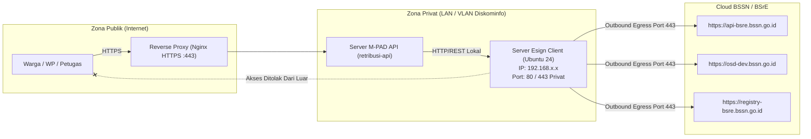

# 🖥️ SPESIFIKASI INFRASTRUKTUR & KEAMANAN SERVER ESIGN CLIENT
## Standarisasi Server Lokal Balai Sertifikasi Elektronik (BSrE - BSSN)
### Data Center Diskominfo Kota Baubau — Sistem M-PAD

---

## 1. Spesifikasi Perangkat Keras & Sistem Operasi

Berdasarkan slide presentasi teknis BSrE (`Screenshot 2026-09-17 at 14.52.09.png` dan `14.52.10.png`), spesifikasi minimum server modul **Esign Client Service** adalah sebagai berikut:

| Komponen | Spesifikasi Minimum | Rekomendasi Alokasi M-PAD (Diskominfo) |
|:---|:---|:---|
| **Sistem Operasi** | Ubuntu 24.04 LTS (Minimal Server) | Ubuntu 24.04 LTS x86_64 Server Edition |
| **Processor (CPU)** | Minimum 4 Core vCPU | 4 vCPU @ 2.5 GHz+ (Dedicated) |
| **Memory (RAM)** | Minimum 8 GB | 8 GB ECC DDR4/DDR5 |
| **Storage (HDD/SSD)** | Minimum 50 GB | 100 GB NVMe / Enterprise SSD |
| **Arsitektur CPU** | x86_64 (64-bit) | x86_64 |

---

## 2. Topologi Jaringan & Pengaturan Port

### A. Prinsip Keamanan Isolasi Jaringan
> ⚠️ **CATATAN KRUSIAL DARI BSrE**:
> 1. Server Esign Client **TIDAK PERLU DAN TIDAK BOLEH DIBUKA KE PUBLIK (INTERNET)**.
> 2. Server aplikasi (`retribusi-api`) harus mengakses Server Esign Client secara **LOKAL (JARINGAN PRIVAT / LAN)**.



### B. Konfigurasi Port
| Port | Protokol | Arah (Direction) | Sumber (Source) | Tujuan (Destination) | Fungsi |
|:---|:---|:---|:---|:---|:---|
| **22** | TCP (SSH) | Inbound | Bastion Host / IP Tim IT | Server Esign | Akses administrasi server internal |
| **80 / 443** | TCP (HTTP/S) | Inbound | IP Privat Server `retribusi-api` | Server Esign | REST API pemanggilan proses signing |
| **443** | TCP (TLS) | Outbound (Egress) | Server Esign | Whitelist Domain BSSN | Sinkronisasi sertifikat & TSA BSSN |

Semua port inbound lainnya wajib diblokir secara total pada firewall `ufw` atau firewall perimeter router Diskominfo.

---

## 3. Skrip Inisialisasi Server (Ubuntu 24 LTS)

Panduan konfigurasi awal yang dijalankan oleh Administrator Jaringan Diskominfo:

```bash
# 1. Update sistem dan paket dasar
sudo apt update && sudo apt upgrade -y
sudo apt install -y curl wget unzip ufw openjdk-17-jre-headless ca-certificates

# 2. Konfigurasi Firewall UFW Terisolasi
sudo ufw default deny incoming
sudo ufw default allow outgoing

# Izinkan SSH hanya dari subnet kantor/bastion
sudo ufw allow from 192.168.10.0/24 to any port 22 proto tcp

# Izinkan HTTP/HTTPS hanya dari IP Server M-PAD API
sudo ufw allow from 192.168.10.50 to any port 80 proto tcp
sudo ufw allow from 192.168.10.50 to any port 443 proto tcp

sudo ufw enable
```
