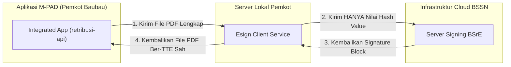

# ⚙️ ARSITEKTUR & FITUR-FITUR MODUL ESIGN CLIENT BSRE
## Desain Perangkat Lunak & Pemanfaatan Fitur pada Ekosistem M-PAD
*Rujukan Slide Resmi BSrE: [`05_skema_integrasi_esign_client.jpeg`](./05_skema_integrasi_esign_client.jpeg) & [`06_fitur_esign_client_v2.3.3.jpeg`](./06_fitur_esign_client_v2.3.3.jpeg)*

---

## 1. Topologi Arsitektur & Skema Hash Value Signing

Berdasarkan slide [`05_skema_integrasi_esign_client.jpeg`](./05_skema_integrasi_esign_client.jpeg), proses penandatanganan elektronik menggunakan konsep **Hash Value Signing**:
1. Aplikasi M-PAD mengirimkan berkas dokumen PDF ke modul Esign Client lokal.
2. Modul Esign Client lokal mengekstrak dan menghitung nilai intisari digital (*Hash Value*) dari berkas PDF.
3. Yang dikirimkan dari server lokal ke Server Signing BSSN **hanyalah nilai Hash Value**, bukan keseluruhan berkas PDF.
4. BSSN menandatangani hash tersebut dan mengembalikan blok tanda tangan digital ke Esign Client untuk di-embed kembali ke dalam dokumen PDF.

---

## 2. 5 Fitur Utama Modul Esign Client v2.3.3 yang Diadopsi M-PAD

Berdasarkan slide [`06_fitur_esign_client_v2.3.3.jpeg`](./06_fitur_esign_client_v2.3.3.jpeg), modul Esign Client v2.3.3 menyediakan 5 fitur utama:

### 1. Segel Elektronik (Electronic Seal / Sertifikasi Organisasi)
- **Fungsi**: Membubuhkan tanda tangan digital atas nama institusi/organisasi (Pemerintah Kota Baubau / Badan Pendapatan Daerah), bukan personal perorangan.
- **Penerapan di M-PAD**:
  - Diterapkan pada **dokumen bukti pelunasan transaksi non-tunai 24/7**:
    - `e-SSPD` (Surat Setoran Pajak Daerah)
    - `e-SSRD` (Surat Setoran Retribusi Daerah)
    - `e-STTS` (Surat Tanda Terima Setoran PBB-P2)
  - **Keunggulan**: Berjalan otomatis (*real-time* < 2 detik) melalui webhook kasda/bank tanpa perlu campur tangan atau pengetikan passphrase manual per transaksi.

### 2. Bulking Signing (Tanda Tangan Banyak Dokumen Sekaligus)
- **Fungsi**: Memproses ratusan atau ribuan dokumen PDF dalam satu antrean batch eksekusi.
- **Penerapan di M-PAD**:
  - Diterapkan pada penerbitan massal berkas **`e-SPPT` PBB-P2 tahunan** (mencapai puluhan ribu lembar SPPT untuk wajib pajak di seluruh kelurahan se-Kota Baubau) sebelum didistribusikan secara elektronik kepada warga.

### 3. Penggunaan OTP pada Tanda Tangan (Two Factor Authentication / 2FA)
- **Fungsi**: Lapisan keamanan ganda di mana selain passphrase, penandatangan wajib memasukkan kode OTP yang dikirimkan oleh sistem BSrE melalui email resmi / SMS.
- **Penerapan di M-PAD**:
  - Diaktifkan untuk transaksi berisiko tinggi dan penetapan bernilai besar, seperti penerbitan SKPDKB hasil pemeriksaan pajak daerah.

### 4. Tanda Tangan Dokumen PDF Ber-Password
- **Fungsi**: Kemampuan menandatangani berkas PDF yang telah diproteksi dengan enkripsi password tanpa merusak struktur proteksinya.
- **Penerapan di M-PAD**:
  - Digunakan untuk naskah rahasia/konfidensial, seperti Laporan Hasil Pemeriksaan Khusus (LHP) Wajib Pajak sebelum diserahkan ke auditor BPK/Inspektorat.

### 5. Pemeriksaan Kedaluwarsa Sertifikat Elektronik
- **Fungsi**: Memeriksa masa berlaku sertifikat elektronik penandatangan sebelum proses signing dipicu.
- **Penerapan di M-PAD**:
  - Service `TTEService` secara proaktif memantau sisa masa berlaku sertifikat pejabat. Jika masa berlaku mendekati habis (H-30), dashboard M-PAD memunculkan peringatan perpanjangan sertifikat ke Diskominfo.
