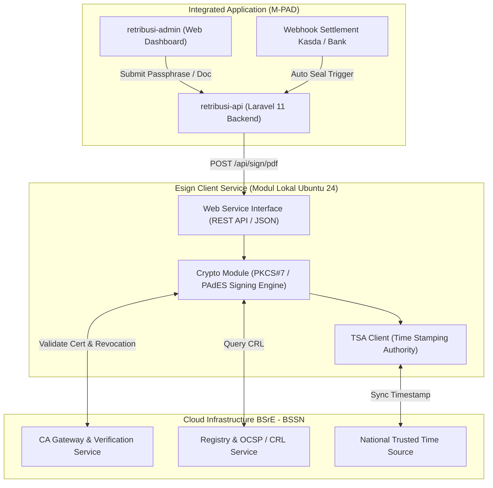

# ⚙️ ARSITEKTUR & FITUR-FITUR MODUL ESIGN CLIENT BSRE
## Desain Perangkat Lunak & Pemanfaatan Fitur pada Ekosistem M-PAD
*Rujukan: Slide Presentasi BSrE (Screenshot 2026-09-17 at 14.53.07.png & 14.53.29.png)*

---

## 1. Topologi Arsitektur Esign Client Service

Modul **Esign Client** adalah middleware kriptografis yang disediakan oleh BSrE BSSN dan dipasang pada server lokal Pemerintah Kota Baubau. Modul ini bertindak sebagai jembatan antara aplikasi M-PAD dengan layanan CA (*Certificate Authority*) BSrE:

---

## 2. 5 Fitur Utama Modul Esign Client yang Diadopsi M-PAD

Berdasarkan slide `14.53.29.png`, modul Esign Client menyediakan fitur-fitur mutakhir yang langsung terintegrasi dengan kebutuhan operasional perpajakan daerah:

### 1. Segel Elektronik (Electronic Seal / Sertifikasi Organisasi)
- **Fungsi**: Membubuhkan tanda tangan digital atas nama institusi/organisasi (Pemerintah Kota Baubau / Badan Pendapatan Daerah), bukan atas nama personal perorangan.
- **Penerapan di M-PAD**:
  - Diterapkan pada **dokumen bukti pelunasan transaksi non-tunai 24/7**:
    - `e-SSPD` (Surat Setoran Pajak Daerah)
    - `e-SSRD` (Surat Setoran Retribusi Daerah)
    - `e-STTS` (Surat Tanda Terima Setoran PBB-P2)
  - **Keunggulan**: Berjalan seketika (*real-time* < 2 detik) secara otomatis melalui webhook kasda tanpa perlu campur tangan manusia atau menunggu pejabat membuka aplikasi.

### 2. Bulking Signing (Tanda Tangan Banyak Dokumen Sekaligus)
- **Fungsi**: Memproses ratusan atau ribuan dokumen PDF dalam satu antrean batch eksekusi.
- **Penerapan di M-PAD**:
  - Diterapkan pada penerbitan massal berkas **`e-SPPT` PBB-P2 tahunan** (mencapai puluhan ribu lembar SPPT untuk wajib pajak di seluruh kelurahan se-Kota Baubau) sebelum didistribusikan secara elektronik kepada warga.

### 3. Two Factor Authentication (2FA) / Penggunaan OTP
- **Fungsi**: Lapisan keamanan ganda di mana selain passphrase, penandatangan wajib memasukkan kode OTP 6-digit yang dikirimkan oleh sistem BSrE melalui email resmi / SMS.
- **Penerapan di M-PAD**:
  - Diaktifkan untuk transaksi berisiko tinggi dan penerbitan ketetapan bernilai besar, seperti penerbitan SKPDKB (Surat Ketetapan Pajak Daerah Kurang Bayar) hasil pemeriksaan pajak daerah.

### 4. Password PDF Signing (Tanda Tangan Dokumen PDF Ber-Password)
- **Fungsi**: Kemampuan menandatangani berkas PDF yang telah diproteksi dengan enkripsi password tanpa merusak struktur proteksinya.
- **Penerapan di M-PAD**:
  - Digunakan untuk naskah rahasia/konfidensial, seperti Laporan Hasil Pemeriksaan Khusus (LHP) Wajib Pajak sebelum dipublikasikan ke pihak pemeriksa eksternal (BPK/Inspektorat).

### 5. Certificate Expired Check (Pemeriksaan Kedaluwarsa Otomatis)
- **Fungsi**: Melakukan audit masa berlaku sertifikat elektronik penandatangan sebelum proses signing dipicu.
- **Penerapan di M-PAD**:
  - Service `TTEService::checkCertificateStatus()` secara proaktif memantau sisa masa berlaku sertifikat Kepala OPD. Jika sisa masa berlaku < 30 hari, dashboard M-PAD akan memunculkan peringatan perpanjangan sertifikat ke Diskominfo.
