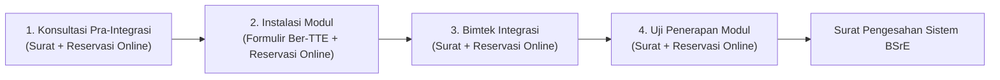

# 📑 SOP RESERVASI & TATA CARA PERMOHONAN INSTALASI MODUL BSRE
## Alur Resmi Pengajuan Integrasi Layanan Sertifikat Elektronik Pemkot Baubau
*Rujukan Slide Resmi BSrE: [`02_tahapan_integrasi_bsre.jpeg`](./02_tahapan_integrasi_bsre.jpeg), [`18_persiapan_instalasi_modul_reservasi.jpeg`](./18_persiapan_instalasi_modul_reservasi.jpeg), & [`19_kontak_center_dan_kanal_resmi_bsre.jpeg`](./19_kontak_center_dan_kanal_resmi_bsre.jpeg)*

---

## 1. 4 Tahapan Integrasi Resmi BSrE

Sesuai penjelasan narasumber BSrE ([`02_tahapan_integrasi_bsre.jpeg`](./02_tahapan_integrasi_bsre.jpeg)), integrasi wajib melalui 4 tahapan berurutan:

> ⚠️ **Catatan Penting Persuratan**:
> - Tahap 1 (Konsultasi), Tahap 3 (Bimtek), dan Tahap 4 (Uji Penerapan) **wajib menyiapkan Surat Permohonan Resmi**.
> - Khusus **Tahap 2 (Instalasi Modul)**: **Tidak perlu membuat surat permohonan**, melainkan cukup mengunggah **Formulir Permohonan Instalasi Modul** yang ditandatangani secara elektronik (TTE) oleh pejabat instansi.

---

## 2. Alur Pelaksanaan Tahap "Instalasi Modul" ([`18_persiapan_instalasi_modul_reservasi.jpeg`](./18_persiapan_instalasi_modul_reservasi.jpeg))

### Langkah 1: Unduh Formulir Permohonan
- Masuk ke portal resmi BSrE: `https://bsre.bssn.go.id`
- Masuk ke menu **Repository**, unduh *Formulir Permohonan Instalasi Modul Esign Client*.

### Langkah 2: Pengisian & Penandatanganan TTE
- Lengkapi formulir dengan data server lokal Diskominfo Kota Baubau (Ubuntu 24 LTS, 4 Core, 8 GB RAM, 50 GB Storage, IP Privat lokal).
- Formulir **WAJIB DITANDATANGANI SECARA ELEKTRONIK (TTE)** oleh pejabat penanggung jawab instansi Pemkot Baubau (Kepala Diskominfo / Sekretaris Daerah). *Scan tanda tangan basah tidak diperbolehkan*.

### Langkah 3: Reservasi di Website BSrE
- Kunjungi menu **Reservasi** pada portal: `https://bsre.bssn.go.id/reservasi`
- Pilih kegiatan: **"Instalasi Modul"**
- Isi identitas instansi dan kontak PIC teknis Pemkot Baubau.
- Unggah file PDF Formulir Permohonan yang telah ber-TTE resmi.

---

## 3. Kanal Kontak Center Resmi BSrE ([`19_kontak_center_dan_kanal_resmi_bsre.jpeg`](./19_kontak_center_dan_kanal_resmi_bsre.jpeg))

Untuk konfirmasi jadwal, penyerahan berkas, maupun konsultasi kendala teknis:
- 📞 **Saluran Telepon**: `183`
- 💬 **Telegram Bot**: `@ccbsre_bot`
- ✉️ **Email Resmi**: `info.bsre@bssn.go.id`
- 📢 **Kanal Informasi Telegram**: `@bsreupdate`
