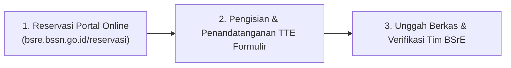

# 📑 SOP RESERVASI & TATA CARA PERMOHONAN INSTALASI MODUL BSRE
## Alur Resmi Pengajuan Integrasi Layanan Sertifikat Elektronik Pemkot Baubau
*Rujukan: Slide Presentasi BSrE (Screenshot 2026-09-17 at 14.56.48.png)*

---

## 1. Alur 3 Langkah Reservasi Kegiatan "Instalasi Modul"

### Langkah 1: Melakukan Reservasi Online
1. Kunjungi portal resmi: `https://bsre.bssn.go.id/reservasi`
2. Pilih jenis kegiatan: **"Instalasi Modul"** (atau *Bimtek Integrasi* / *Uji Penerapan Modul*).
3. Lengkapi formulir reservasi dengan data instansi:
   - Nama Instansi: **Pemerintah Kota Baubau**
   - Unit Pengelola Teknis: **Dinas Komunikasi dan Informatika / Badan Pendapatan Daerah**
   - Nama Sistem Aplikasi: **M-PAD (Mitra Pajak, Retribusi, dan Aset Daerah)**
   - Kontak PIC Teknis: Diskominfo Kota Baubau (Pak Yakin).

---

### Langkah 2: Pengisian Formulir Permohonan & Penandatanganan TTE
1. Unduh formulir resmi dari **Repository BSrE**:
   - `Formulir Permohonan Instalasi Modul Esign Client`
2. Isi data spesifikasi server yang telah disiapkan di Data Center Diskominfo:
   - IP Privat Server: `192.168.x.x`
   - Spesifikasi: Ubuntu 24 LTS, 4 Core vCPU, 8 GB RAM, 50 GB SSD.
   - PIC Server: Administrator Jaringan Diskominfo.
3. **Penandatanganan TTE Wajib**:
   - Formulir **WAJIB DITANDATANGANI SECARA ELEKTRONIK (TTE)** oleh pejabat penanggung jawab instansi (misal: Kepala Dinas Kominfo / Sekretaris Daerah Kota Baubau). Tanda tangan basah yang discan akan ditolak oleh sistem BSrE.

---

### Langkah 3: Unggah Berkas Permohonan
1. Buka tautan konfirmasi yang dikirimkan oleh sistem BSrE ke email PIC saat reservasi dilakukan.
2. Unggah dokumen pendukung:
   - Formulir Permohonan ber-TTE resmi (`.pdf`).
   - Surat Permohonan Integrasi Sistem dari Sekretariat Daerah Kota Baubau.
   - Topologi jaringan server lokal Diskominfo.
3. Tunggu konfirmasi jadwal pelaksanaan instalasi modul jarak jauh (*remote installation*) oleh tim teknis BSSN.

---

## 2. Persiapan Menjelang Hari-H Uji Penerapan Modul

Saat tim verifikator BSrE hadir untuk melakukan **Uji Penerapan Modul (Uji Kesesuaian)**:
1. **Akun Uji Coba**: Disiapkan akun uji coba penandatangan di aplikasi `retribusi-admin`.
2. **Lingkungan Sandbox**: Sistem M-PAD telah terhubung ke modul Esign Client lokal yang tersambung ke `osd-dev.bssn.go.id`.
3. **Dokumen Draf Uji**: Disiapkan beberapa contoh tagihan `e-SSPD`, `e-SSRD`, dan draf kontrak aset untuk didemonstrasikan proses tanda tangannya.
4. **Akses Database**: Terminal database disiapkan untuk demonstrasi query `select * from tte_logs` guna membuktikan perekaman log audit trail telah aktif.
