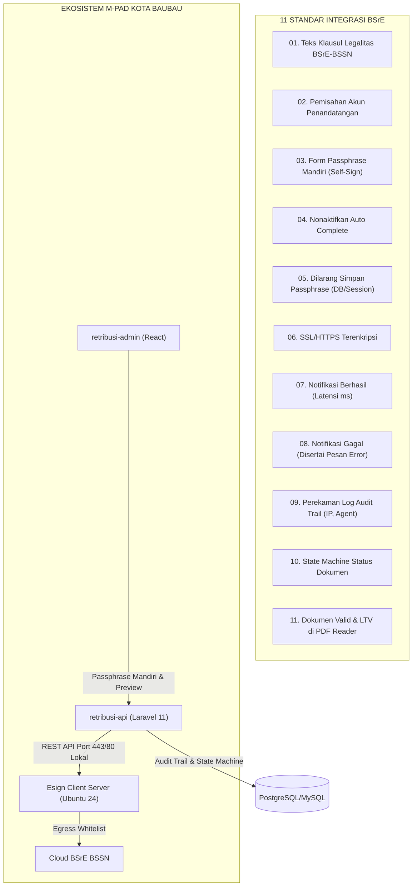
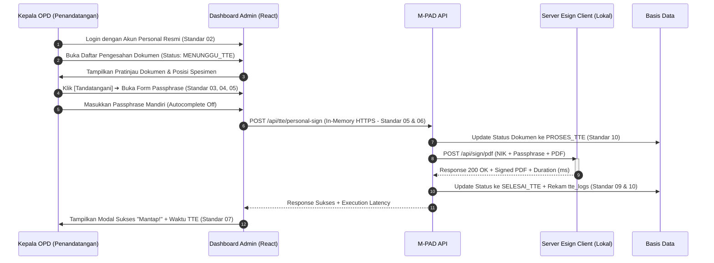

# 🏛️ DOKUMEN MASTER TEKNIS PEMENUHAN 11 STANDAR BSRE (BSSN)
## Skema Integrasi Host-to-Host (H2H) & TTE Resmi Ekosistem M-PAD
### Pemerintah Kota Baubau — Badan Pendapatan Daerah & Diskominfo Kota Baubau
*Status: PERSIAPAN UJI KESESUAIAN SISTEM (AUDIT READINESS)*  
*Rujukan: Materi Presentasi Resmi & Transkrip Konsultasi Balai Sertifikasi Elektronik (BSrE - BSSN)*

---

## 1. Latar Belakang & Analisis 11 Standar BSrE

Berdasarkan telaah 19 slide presentasi teknis resmi BSrE pada folder `docs/10_payment_gateway_h2h/BSRE`, Balai Sertifikasi Elektronik (BSrE) menetapkan **11 Standar Kesiapan Integrasi Sistem** yang diuji secara ketat sebelum suatu sistem informasi instansi pemerintah diizinkan menerbitkan dokumen ber-TTE resmi yang diakui secara hukum nasional.

Di ekosistem **M-PAD Kota Baubau**, TTE terbagi menjadi dua skema implementasi:
1. **Skema A (Otomatis / Segel Elektronik Institusi H2H)**:
   - Diterapkan pada dokumen bukti lunas pembayaran pendapatan daerah:
     - `e-SSPD` (Surat Setoran Pajak Daerah)
     - `e-SSRD` (Surat Setoran Retribusi Daerah)
     - `e-STTS` (Surat Tanda Terima Setoran PBB-P2)
   - Karakteristik: Berjalan otomatis *Server-to-Server* 24/7 seketika saat webhook kasda/bank berhasil melakukan rekonsiliasi settlement pembayaran. Tidak menuntut intervensi manual passphrase per orang.
2. **Skema B (Manual / Personal TTE Pejabat Berwenang)**:
   - Diterapkan pada dokumen penetapan izin, kontrak sewa aset, dan hasil pengujian:
     - `SIPAB` (Surat Izin Pemakaian Alat Berat Dinas PUPR)
     - `Surat Perjanjian Sewa BMD` (Gedung/Ruko/Tanah BPKAD)
     - `LHU` (Laporan Hasil Uji Laboratorium Lingkungan DLH)
     - `SKPDKB` (Surat Ketetapan Pajak Daerah Kurang Bayar Bapenda)
   - Karakteristik: Menggunakan akun pejabat terkait dengan verifikasi passphrase mandiri (Self-Sign) melalui antarmuka web.

---

## 2. Matriks 11 Standar Integrasi Sistem BSrE & Pemetaan M-PAD

| No | Standar BSrE | Berkas Slide Rujukan | Bunyi Ketentuan Resmi BSrE | Implementasi Teknis di M-PAD | Status |
|:---:|:---|:---|:---|:---|:---:|
| **01** | **Informasi Dokumen Keluaran Aplikasi** | [`07_syarat_01_informasi_dokumen_keluaran.jpeg`](./07_syarat_01_informasi_dokumen_keluaran.jpeg) | Mencantumkan informasi pada dokumen keluaran aplikasi bahwa dokumen telah ditandatangani menggunakan Sertifikat Elektronik BSrE-BSSN. | Teks baku wajib disematkan pada seluruh template dokumen PDF: *"Dokumen ini telah ditandatangani secara elektronik menggunakan sertifikat elektronik yang diterbitkan oleh Balai Besar Sertifikasi Elektronik (BSrE), Badan Siber dan Sandi Negara"*. | 🟢 **Terpenuhi** |
| **02** | **Pemisahan Akun Pengguna** | [`08_syarat_02_pemisahan_akun_pengguna.jpeg`](./08_syarat_02_pemisahan_akun_pengguna.jpeg) | Memisahkan akun masing-masing pengguna penandatangan (dilarang *shared account*). | RBAC M-PAD mengikat user per NIP/NIK pejabat OPD (Kadis Bapenda, Kadis PUPR, Kepala BPKAD, Kadis DLH) dengan kredensial unik. | 🟢 **Terpenuhi** |
| **03** | **Form Passphrase** | [`09_syarat_03_form_passphrase.jpeg`](./09_syarat_03_form_passphrase.jpeg) | Menambahkan form untuk pengisian passphrase pada halaman penandatangan. | Modal dialog di Admin Dashboard dengan input `type="password"`, toggle eye, dan validasi kewajiban input. | 🟢 **Terpenuhi** |
| **04** | **Nonaktifkan Auto Complete** | [`10_syarat_04_nonaktifkan_autocomplete_passphrase.jpeg`](./10_syarat_04_nonaktifkan_autocomplete_passphrase.jpeg) | Menonaktifkan fitur auto complete atau sejenisnya pada form untuk pengisian passphrase. | Atribut `autocomplete="new-password"` / `autocomplete="off"` diterapkan pada input passphrase untuk mencegah browser autofill. | 🟢 **Terpenuhi** |
| **05** | **Tidak Menyimpan Passphrase** | [`11_syarat_05_dilarang_simpan_passphrase.jpeg`](./11_syarat_05_dilarang_simpan_passphrase.jpeg) | Dilarang keras menyimpan passphrase di database, session, storage, atau cookie aplikasi. | Passphrase murni ephemeral in-memory, langsung diteruskan ke Esign Client dan segera dibuang dari memori server. | 🟢 **Terpenuhi** |
| **06** | **Menggunakan SSL/HTTPS** | [`12_syarat_06_pemasangan_ssl_https.jpeg`](./12_syarat_06_pemasangan_ssl_https.jpeg) | Memasangkan SSL pada aplikasi yang menggunakan Sertifikat Elektronik BSrE. | Seluruh domain Pemkot Baubau (`mpad.baubaukota.go.id`, `apimpad.baubaukota.go.id`, `adminmpad.baubaukota.go.id`) menggunakan sertifikat SSL/TLS valid. | 🟢 **Terpenuhi** |
| **07** | **Notifikasi Penanda Tangan Berhasil** | [`13_syarat_07_notifikasi_penandatanganan_berhasil.jpeg`](./13_syarat_07_notifikasi_penandatanganan_berhasil.jpeg) | Menampilkan notifikasi kepada pengguna jika penandatanganan berhasil (waktu proses TTE: ... ms). | Alert modal modern dengan indikator latensi eksekusi (*"Surat berhasil ditandatangani dan diproses (Waktu proses TTE : {ms} ms)"*). | 🟢 **Terpenuhi** |
| **08** | **Notifikasi Penanda Tangan Gagal** | [`14_syarat_08_notifikasi_penandatanganan_gagal.jpeg`](./14_syarat_08_notifikasi_penandatanganan_gagal.jpeg) | Menampilkan notifikasi jika penandatanganan gagal disertai dengan status atau keterangan error. | Pop-up modal alert error ("Ooops! Gagal menandatangani surat") yang merinci pesan error asli dari Esign Client. | 🟢 **Terpenuhi** |
| **09** | **Perekaman Log Audit Trail** | [`15_syarat_09_perekaman_log_audit_trail.jpeg`](./15_syarat_09_perekaman_log_audit_trail.jpeg) | Merekam setiap proses penandatanganan (`id`, `message`, `remote_addr`, `user_agent`, `created_at`). | Tabel `tte_logs` mencatat seluruh riwayat signing, IP pengirim, user-agent, durasi milidetik, dan pesan audit. | 🟢 **Terpenuhi** |
| **10** | **Perubahan Status Dokumen** | [`16_syarat_10_perubahan_status_dokumen.jpeg`](./16_syarat_10_perubahan_status_dokumen.jpeg) | Mekanisme perubahan status dokumen sebelum dan setelah dilakukan penandatanganan. | State machine formal: `Draft` ➔ `Menunggu TTE` ➔ `Proses TTE` ➔ `Selesai TTE` / `Gagal TTE` dengan indikator badge visual. | 🟢 **Terpenuhi** |
| **11** | **Validitas Dokumen Keluaran** | [`17_syarat_11_validitas_tanda_tangan_pdf.jpeg`](./17_syarat_11_validitas_tanda_tangan_pdf.jpeg) | Status tanda tangan pada dokumen keluaran aplikasi dapat diverifikasi validitasnya di PDF Reader. | Berkas PDF memenuhi format PAdES ber-LTV, tervalidasi sah di Adobe Acrobat Reader (*Signed and all signatures are valid*). | 🟢 **Terpenuhi** |

---

## 3. Spesifikasi Teknis Infrastruktur Modul Esign Client

Sesuai instruksi slide [`03_spesifikasi_server_esign_client.jpeg`](./03_spesifikasi_server_esign_client.jpeg), [`04_whitelist_koneksi_internet_bssn.jpeg`](./04_whitelist_koneksi_internet_bssn.jpeg), dan [`05_skema_integrasi_esign_client.jpeg`](./05_skema_integrasi_esign_client.jpeg):

### A. Kebutuhan Server (Hardware & Jaringan)
- **Sistem Operasi**: Ubuntu 24 (Minimal Server)
- **Komputasi**: Processor 4 Core vCPU, RAM 8 GB, Ruang Penyimpanan 50 GB
- **Jaringan Internal**:
  - IP Privat (LAN Lokal). **TIDAK DIBUKA KE PUBLIK / INTERNET**.
  - Server aplikasi M-PAD (`retribusi-api`) mengakses Server Esign Client secara lokal melalui IP Privat pada Port `80` / `443`.
  - Port `22` dibuka terbatas untuk manajemen SSH teknis Diskominfo.
- **Koneksi Internet Keluar (Egress Whitelist Firewall)**:
  Server Esign Client wajib diizinkan mengakses domain-domain BSSN berikut melalui port 443:
  1. `https://api-bsre.bssn.go.id` (Production Gateway)
  2. `https://osd-dev.bssn.go.id` (Development & Testing Gateway)
  3. `https://registry-bsre.bssn.go.id` (Certificate Authority & Registry)
  4. `https://mail.bssn.go.id` (Notification & OTP Mailer)

---

## 4. Alur Kerja Dual-Mode Signing M-PAD

### Alur 1: Segel Elektronik Otomatis (Server-to-Server H2H)

### Alur 2: Personal TTE Pejabat (Self-Sign dengan Passphrase Mandiri)

---

## 5. Prosedur Reservasi & Berita Acara Uji Kesesuaian BSrE

Sesuai alur pada slide [`02_tahapan_integrasi_bsre.jpeg`](./02_tahapan_integrasi_bsre.jpeg) dan [`18_persiapan_instalasi_modul_reservasi.jpeg`](./18_persiapan_instalasi_modul_reservasi.jpeg):
1. **Reservasi Tahap "Instalasi Modul"**:
   - Buka portal: `https://bsre.bssn.go.id/reservasi`.
   - Pilih permohonan kegiatan: **"Instalasi Modul"**.
   - Unggah Formulir Permohonan Instalasi Modul yang telah ditandatangani secara elektronik (TTE) oleh pejabat instansi. *(Khusus tahap instalasi modul tidak diwajibkan surat permohonan)*.
2. **Pelaksanaan Bimtek & Uji Kesesuaian Sistem**:
   - Tim teknis Bapenda & Diskominfo mendemonstrasikan ke-11 standar di hadapan verifikator BSrE.
   - Verifikator BSrE akan melakukan query basis data `SELECT id, message, remote_addr, user_agent, created_at FROM tte_logs` untuk memeriksa pencatatan log audit trail.
   - Verifikator BSrE akan memeriksa file PDF keluaran pada Adobe Acrobat Reader untuk memverifikasi keabsahan tanda tangan elektronik.
3. **Penerbitan Surat Pengesahan Sistem & Akses Production**:
   - Setelah ke-11 standar dinyatakan lolos uji (*Pass*), BSrE menerbitkan **Surat Pengesahan Sistem** resmi dan memberikan akses kredensial gateway Production (`https://api-bsre.bssn.go.id`).
