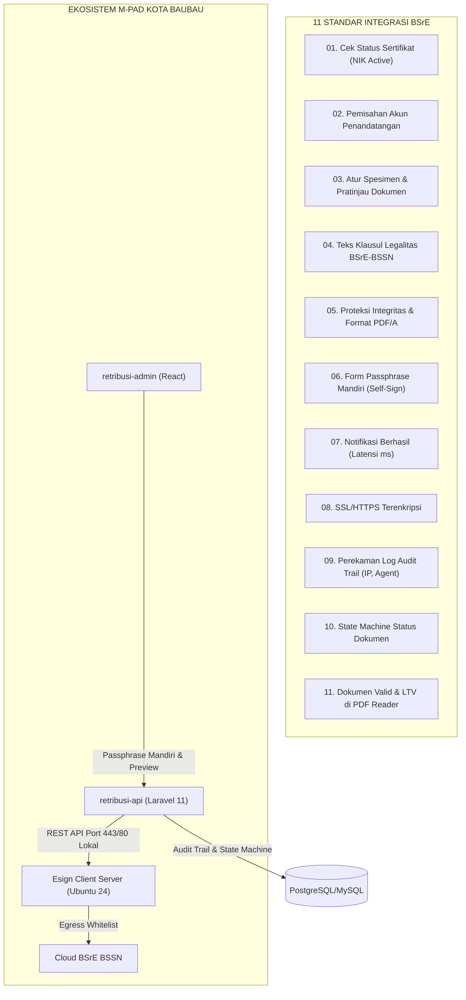
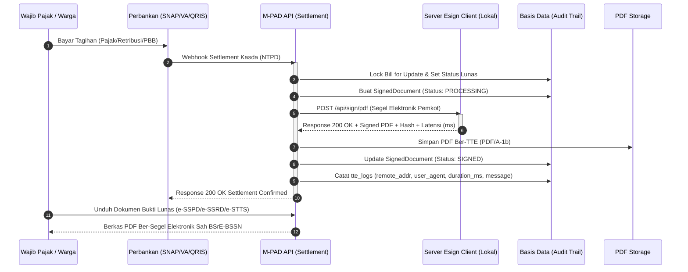
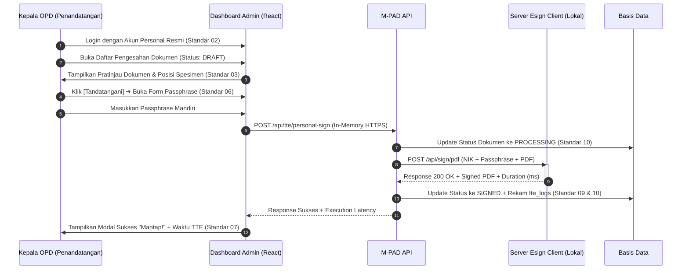

# 🏛️ DOKUMEN MASTER TEKNIS PEMENUHAN 11 STANDAR BSRE (BSSN)
## Skema Integrasi Host-to-Host (H2H) & TTE Resmi Ekosistem M-PAD
### Pemerintah Kota Baubau — Badan Pendapatan Daerah & Diskominfo Kota Baubau
*Status: PERSIAPAN UJI KESESUAIAN SISTEM (AUDIT READINESS)*  
*Tanggal: 17 September 2026*  
*Rujukan: Materi Presentasi Resmi Balai Sertifikasi Elektronik (BSrE - BSSN)*

---

## 1. Latar Belakang & Analisis 11 Standar BSrE

Berdasarkan telaah 15 berkas presentasi teknis BSrE pada folder `docs/10_payment_gateway_h2h/BSRE`, Balai Sertifikasi Elektronik (BSrE) menetapkan **11 Standar Kesiapan Integrasi Sistem** yang diuji secara ketat sebelum suatu sistem informasi instansi pemerintah diizinkan menerbitkan dokumen ber-TTE resmi yang diakui secara hukum nasional.

Di ekosistem **M-PAD Kota Baubau**, TTE terbagi menjadi dua skema implementasi:
1. **Skema A (Otomatis / Segel Elektronik Institusi H2H)**:
   - Diterapkan pada dokumen bukti lunas pembayaran pendapatan daerah:
     - `e-SSPD` (Surat Setoran Pajak Daerah)
     - `e-SSRD` (Surat Setoran Retribusi Daerah)
     - `e-STTS` (Surat Tanda Terima Setoran PBB-P2)
   - Karakteristik: Berjalan otomatis *Server-to-Server* 24/7 seketika saat webhook kasda/bank berhasil melakukan rekonsiliasi settlement pembayaran. Tidak menuntut intervensi manual passphrase per orang.
2. **Skema B (Manual / Personal TTE Pejabat Berwenang)**:
   - Diterapkan pada dokumen penetapan izin, kontrak sewa aset, dan hasil pengujian:
     - `SIPAB` (Surat Izin Pemakaian Alat Berat Dinas PUPR)
     - `Surat Perjanjian Sewa BMD` (Gedung/Ruko/Tanah BPKAD)
     - `LHU` (Laporan Hasil Uji Laboratorium Lingkungan DLH)
     - `SKPDKB` (Surat Ketetapan Pajak Daerah Kurang Bayar Bapenda)
   - Karakteristik: Menggunakan akun pejabat terkait dengan verifikasi passphrase mandiri (Self-Sign) melalui antarmuka web.

---

## 2. Matriks 11 Standar Integrasi Sistem BSrE & Pemetaan M-PAD



| No | Standar BSrE | Bunyi Ketentuan & Visual Slide | Implementasi Teknis di M-PAD | Status Kepatuhan |
|:---|:---|:---|:---|:---|
| **01** | **Pengecekan Status Sertifikat** | Memeriksa status sertifikat elektronik (aktif/tidak) sebelum dokumen diajukan tanda tangan. | Endpoint `GET /api/tte/status/{nik}` menghubungi Esign Client `/api/user/status/{nik}` untuk validasi pre-flight. | 🟡 *Tersedia di Service (Diperluas ke UI)* |
| **02** | **Pemisahan Akun Penandatangan** | *"Memisahkan akun masing-masing pengguna penandatangan"* (Slide 05). | RBAC M-PAD memisahkan user per OPD (Kadis Bapenda, Kadis PUPR, Kepala BPKAD, Kadis DLH) dengan kredensial unik. | 🟢 **Terpenuhi (RBAC Guarded)** |
| **03** | **Atur Spesimen & Pratinjau** | Antarmuka memungkinkan penandatangan melihat pratinjau naskah dan memilih koordinat spesimen (QR Code). | Pratinjau PDF via Web Viewer dan pemilihan penempatan visual tanda tangan (halaman, koordinat x, y). | 🟡 *Template siap, UI Picker disempurnakan* |
| **04** | **Informasi Legalitas Dokumen** | *"Mencantumkan informasi pada dokumen keluaran aplikasi bahwa dokumen telah ditandatangani menggunakan Sertifikat Elektronik yang diterbitkan oleh BSrE-BSSN"* (Slide 04). | Teks baku wajib disematkan pada footer PDF: *"Dokumen ini telah ditandatangani secara elektronik menggunakan sertifikat elektronik yang telah diterbitkan oleh Balai Besar Sertifikasi Elektronik (BSrE), Badan Siber dan Sandi Negara"*. | 🟡 *Penyelarasan Teks Seluruh Template Blade* |
| **05** | **Standar Format PDF/A & Enkripsi** | Berkas PDF memenuhi format PDF/A (tamper-evident), tidak corrupt, dan mendukung dokumen ber-password. | Engine DomPDF diatur mematuhi struktur PDF/A-1b dan menghitung checksum SHA-256 sebelum dan sesudah signing. | 🟢 **Terpenuhi (SHA-256 Checksum)** |
| **06** | **Form Passphrase Mandiri** | *"Menambahkan form untuk pengisian passphrase pada halaman penanda tangan"* (Slide 06). Dilarang keras menyimpan passphrase di database/server! | Modal dialog di Admin Dashboard dengan input `type="password"`, toggle eye, diteruskan in-memory via HTTPS, lalu langsung di-purge dari memori. | 🟡 *Komponen Modal UI Admin* |
| **07** | **Notifikasi Berhasil** | *"Menampilkan notifikasi dan/atau sejenisnya kepada pengguna jika penanda tangan berhasil"* (Slide 07: Popup "Mantap!", waktu proses TTE: ... ms). | Alert modal modern dengan indikator latensi eksekusi (contoh: *Waktu proses TTE : 147 ms*), nomor naskah, dan tombol aksi lanjutan. | 🟡 *Penyelarasan Modal UI Admin* |
| **08** | **Pemasangan SSL/HTTPS** | *"Memasangkan SSL pada aplikasi yang menggunakan Sertifikat Elektronik BSrE"* (Slide 08). | Seluruh domain Pemkot Baubau (`mpad.baubaukota.go.id`, `api.sipanda.online`, `admin.sipanda.online`) terpasang sertifikat SSL/TLS valid. | 🟢 **Terpenuhi (TLS 1.3 / HSTS)** |
| **09** | **Perekaman Log TTE Lengkap** | *"Mengaplikasikan/menerapkan mekanisme penyimpanan/perekaman log untuk setiap proses penandatanganan"* (Slide 09: `id`, `message`, `remote_addr`, `user_agent`, `created_at`). | Tabel `tte_logs` menyimpan kolom `message`, `remote_addr`, `user_agent`, `response_code`, `duration_ms`, dan `status`. | 🟡 *Penyelarasan Kolom Database* |
| **10** | **Perubahan Status Siklus Dokumen** | *"Mengaplikasikan/menerapkan mekanisme perubahan status dokumen sebelum dan setelah dilakukan penandatanganan"* (Slide 10: Draft, Proses, Selesai). | State machine formal pada model `SignedDocument`: `draft` ➔ `processing` ➔ `signed` / `failed`, ditampilkan dengan badge warna di tabel admin. | 🟡 *Penyelarasan Status Lifecycle* |
| **11** | **Validitas Dokumen Keluaran** | *"Status tanda tangan pada dokumen keluaran aplikasi dapat diverifikasi validitasnya"* (Slide 11: Adobe Acrobat "Signed and all signatures are valid", LTV enabled). | Berkas keluaran terverifikasi kriptografis PAdES/PKCS#7 di Adobe Reader dan terhubung ke portal verifikasi resmi. | 🟡 *Uji Coba Sandbox Esign Client* |

---

## 3. Spesifikasi Teknis Infrastruktur Modul Esign Client

Sesuai instruksi slide `14.52.09.png`, `14.52.25.png`, dan `14.53.07.png`:

### A. Kebutuhan Server (Hardware & Jaringan)
- **Sistem Operasi**: Ubuntu 24.04 LTS (Minimal Server Install)
- **Komputasi**: Processor 4 Core vCPU, RAM 8 GB, Ruang Penyimpanan 50 GB SSD
- **Jaringan Internal**:
  - IP Privat (LAN Lokal). **TIDAK DIBUKA KE PUBLIK / INTERNET**.
  - Server aplikasi M-PAD (`retribusi-api`) mengakses Server Esign Client secara lokal melalui IP Privat pada Port `80` / `443`.
  - Port `22` dibuka terbatas untuk manajemen SSH teknis Diskominfo.
- **Koneksi Internet Keluar (Egress Whitelist Firewall)**:
  Server Esign Client wajib diizinkan mengakses domain-domain BSSN berikut melalui port 443:
  1. `https://api-bsre.bssn.go.id` (Production Gateway)
  2. `https://osd-dev.bssn.go.id` (Development & Testing Gateway)
  3. `https://registry-bsre.bssn.go.id` (Certificate Authority & Registry)
  4. `https://mail.bssn.go.id` (Notification & OTP Mailer)

---

## 4. Alur Kerja Dual-Mode Signing M-PAD

### Alur 1: Segel Elektronik Otomatis (Server-to-Server H2H)


### Alur 2: Personal TTE Pejabat (Self-Sign dengan Passphrase Mandiri)


---

## 5. Rencana Aksi Pembenahan Kode & Pengujian

### Langkah 1: Penyesuaian Skema Database (Standar 09 & 10)
Membuat migrasi untuk menambahkan kolom kepatuhan audit BSrE pada `tte_logs` dan `signed_documents`:
```sql
ALTER TABLE tte_logs ADD COLUMN message TEXT NULL AFTER endpoint;
ALTER TABLE tte_logs ADD COLUMN remote_addr VARCHAR(45) NULL AFTER message;
ALTER TABLE tte_logs ADD COLUMN user_agent TEXT NULL AFTER remote_addr;

-- Penegasan status state machine pada signed_documents
-- Nilai status: 'draft', 'processing', 'signed', 'failed'
```

### Langkah 2: Penyempurnaan Teks Baku Legalitas pada Template PDF (Standar 04)
Menambahkan klausul baku resmi di bawah QR code pengesahan pada file:
- `resources/views/pdf/sspd.blade.php`
- `resources/views/pdf/ssrd.blade.php`
- `resources/views/pdf/sipab.blade.php`
- `resources/views/pdf/sppt.blade.php`
- `resources/views/pdf/pbb-receipt.blade.php`

Teks Standar:
```html
<p style="font-size: 8px; color: #444; font-style: italic; margin-top: 6px; text-align: right;">
    Dokumen ini telah ditandatangani secara elektronik menggunakan sertifikat elektronik yang diterbitkan oleh Balai Besar Sertifikasi Elektronik (BSrE), Badan Siber dan Sandi Negara.
</p>
```

### Langkah 3: Modul UI Admin Dashboard (Standar 06, 07, 10)
1. **Tabel Status Dokumen**: Menampilkan kolom Status dengan badge visual:
   - `Draft`: Abu-abu
   - `Proses`: Biru (dengan animasi loading jika sedang diproses)
   - `Selesai`: Hijau (dengan link unduh PDF ber-TTE)
   - `Gagal`: Merah (dengan tombol ulangi dan rincian pesan error)
2. **Modal Input Passphrase Mandiri**: Input form masked dengan validasi sisi klien dan perlindungan anti-keylogger/no-storage.
3. **Modal Notifikasi Berhasil**: Desain pop-up "Mantap!" dengan waktu proses TTE dalam satuan milidetik (ms).

### Langkah 4: Uji Coba Verifikasi Adobe Acrobat Reader (Standar 11)
Menguji file PDF keluaran pada aplikasi Adobe Acrobat Reader DC:
- Memastikan panel tanda tangan menampilkan:
  - *Signature is valid*
  - *Document has not been modified since it was signed*
  - *Signer's identity is valid*
  - *Signature is LTV enabled*
- Menguji pembacaan QR Code verifikasi publik yang mengarah ke portal resmi Pemerintah Kota Baubau (`https://mpad.baubaukota.go.id/verify/...`).

---

## 6. Prosedur Reservasi & Berita Acara Uji Kesesuaian BSrE

Sesuai alur pada slide `Screenshot 2026-09-17 at 14.51.20.png` dan `14.56.48.png`:
1. **Reservasi Tahap 1 (Konsultasi & Instalasi Modul)**:
   - Buka `https://bsre.bssn.go.id/reservasi`.
   - Pilih permohonan "Instalasi Modul".
   - Unggah Surat Permohonan Integrasi dari Sekretaris Daerah / Kepala Bapenda Kota Baubau.
   - Unggah Formulir Permohonan Instalasi Modul yang telah ditandatangani secara TTE oleh pejabat penanggung jawab instansi.
2. **Pelaksanaan Bimtek & Uji Kesesuaian Sistem**:
   - Tim teknis Bapenda & Diskominfo mendemonstrasikan ke-11 standar di hadapan verifikator BSrE.
   - Verifikator BSrE akan melakukan query basis data `select * from esign_log / tte_logs` untuk memeriksa pencatatan log gagal/berhasil.
   - Verifikator BSrE akan memeriksa file PDF keluaran pada Adobe Acrobat Reader untuk memverifikasi keabsahan tanda tangan elektronik.
3. **Penerbitan Surat Rekomendasi Kelayakan & Sertifikat Production**:
   - Setelah ke-11 standar dinyatakan lolos uji (*Pass*), BSrE menerbitkan Berita Acara Uji Kesesuaian Sistem dan memberikan akses kredensial gateway Production (`https://api-bsre.bssn.go.id`).
