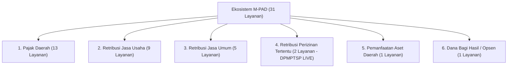

# 📄 MATERI RINGKAS RAPAT KOORDINASI
## Integrasi Layanan Perizinan DPMPTSP Kota Baubau dalam Ekosistem Digital M-PAD

**Dokumen**: Bahan Rapat Koordinasi Kepala Dinas Penanaman Modal dan Pelayanan Terpadu Satu Pintu (DPMPTSP) bersama Badan Pendapatan Daerah (Bapenda) Kota Baubau  
**Topik**: Pemetaan Bidang Layanan, Integrasi OSS, dan Kesiapan Retribusi Perizinan Tertentu di M-PAD  
**Tanggal**: 30 Agustus 2026  
**Status**: Siap Paparan / Dokumen Final  

---

### 1. Eksekutif Ringkasan (Executive Summary)

Sistem Informasi Manajemen Pajak, Retribusi, dan Aset Daerah (**M-PAD**) Kota Baubau telah rampung dibangun sebagai platform terpadu penghimpunan Pendapatan Asli Daerah (PAD). Salah satu pilar strategisnya adalah sinergi bersama **DPMPTSP Kota Baubau** untuk memastikan setiap perizinan daerah yang memiliki unsur retribusi dapat dihitung secara transparan, otomatis, dan terhubung langsung ke kas daerah secara *real-time*.

---

### 2. Jawaban Pemetaan: Berapa Layanan, Berapa Bidang?

Berdasarkan struktur master data produksi M-PAD (Perda Kota Baubau No. 1 Tahun 2024 tentang Pajak Daerah dan Retribusi Daerah):



#### Rincian 5 Bidang Aktif M-PAD:
1. **Pajak Daerah (13 Jenis Pajak)**: PBB-P2, BPHTB, Reklame, PBJT (Makanan/Minuman, Perhotelan, Parkir, Kesenian/Hiburan, Tenaga Listrik), PAT, MBLB, Sarang Burung Walet, dan Pajak Opsen.
2. **Retribusi Jasa Usaha (9 Jenis Retribusi)**: Pasar, Tempat Pelelangan, Terminal, Rumah Potong Hewan, Penyeberangan di Air, Tempat Rekreasi/Olahraga, Laboratorium Lingkungan, Produksi Usaha Daerah, dan Aset JU.
3. **Retribusi Jasa Umum (5 Jenis Retribusi)**: Pelayanan Kebersihan/Persampahan, Pelayanan Parkir Tepi Jalan Umum, Pelayanan Pasar Umum, Pengujian Kendaraan Bermotor (KIR), dan Pengendalian Menara Telekomunikasi.
4. **Retribusi Perizinan Tertentu (2 Jenis Retribusi — Domain Utama DPMPTSP)**:
   * **PBG (`PZ-PBG` / ID: 212)**: Retribusi Persetujuan Bangunan Gedung.
   * **TKA (`PZ-TKA` / ID: 213)**: Retribusi Penggunaan Tenaga Kerja Asing / Pengesahan RPTKA Perpanjangan.
5. **Pemanfaatan Barang Milik Daerah / Aset (1 Jenis)**: Sewa tanah, gedung, dan peralatan daerah.

---

### 3. Status Layanan Olahan DPMPTSP yang Telah LIVE di M-PAD

Layanan perizinan berikut **sudah berstatus AKTIF dan siap digunakan** di lingkungan M-PAD tanpa perlu menunggu pengembangan modul tambahan:

| Kode Layanan | Nama Layanan | Dasar Hukum / Formula | Status di M-PAD | Alur di Lapangan |
| :--- | :--- | :--- | :---: | :--- |
| **`PZ-PBG`** (ID: 212) | **Persetujuan Bangunan Gedung (PBG)** | Standar Luas Bangunan $\times$ Indeks Lokalitas $\times$ Indeks Terintegrasi $\times$ SHST | ✅ **LIVE & Teruji** | Pemohon input parameter fisik/SIMBG $\rightarrow$ Sistem hitung SKRD otomatis $\rightarrow$ Bayar via BRI/QRIS $\rightarrow$ Verifikasi DPMPTSP/PUPR $\rightarrow$ Terbit Sertifikat PBG. |
| **`PZ-TKA`** (ID: 213) | **Pengesahan Perpanjangan RPTKA** | Tarif Kompensasi per Tenaga Kerja Asing / Bulan (sesuai kurs BI & regulasi Kemnaker) | ✅ **LIVE & Teruji** | Perusahaan sponsor unggah berkas $\rightarrow$ Auto-generate billing SKRD $\rightarrow$ Rekonsiliasi kas daerah instan $\rightarrow$ DPMPTSP terbitkan pengesahan. |

---

### 4. Sinergi M-PAD dengan Online Single Submission (OSS) & Tata Ruang

```
┌─────────────────────────┐          ┌─────────────────────────┐
│     OSS RBA (Pusat)     │          │    DPMPTSP Kota Baubau  │
│  - Penerbitan NIB       │          │  - Verifikasi Berkas    │
│  - Data Perusahaan      │          │  - Rekomendasi Teknis   │
└────────────┬────────────┘          └────────────┬────────────┘
             │                                    │
             ▼                                    ▼
┌──────────────────────────────────────────────────────────────┐
│                    PORTAL TERPADU M-PAD                      │
│  - Validasi NIB / NOP / NPWPD Terpadu                        │
│  - Hitung Otomatis Billing SKRD Retribusi Perizinan          │
│  - Gateway Multi-Bank & QRIS Dinamis                         │
│  - E-Registry & Verifikasi Dokumen Publik (QR Code Sah)      │
└──────────────────────────────────────────────────────────────┘
```

1. **Prinsip Kemudahan Data (Interoperabilitas)**:
   * Jika integrasi API langsung ke server OSS Pusat masih dalam proses antrian teknis kementerian, pemohon cukup memasukkan nomor NIB di formulir M-PAD.
   * Petugas DPMPTSP dapat langsung memvalidasi kecocokan NIB pada dashboard admin backoffice.
2. **Keterkaitan Tata Ruang (GISTARU / Poligon Wilayah)**:
   * Lokasi objek bangunan/usaha di M-PAD dilengkapi koordinat GIS (Latitude/Longitude) yang langsung memetakan objek ke Zona Nilai Tanah (ZNT) dan kesesuaian tata ruang daerah.
3. **Anti-Fraud & Idempoten**:
   * Setiap pembayaran retribusi PBG dan TKA mengunci nomor SKRD secara otomatis, mencegah duplikasi pembayaran atau manipulasi nominal retribusi di luar sistem.

---

### 5. Rekomendasi Aksi untuk Rapat Pimpinan

1. **Penerbitan Surat Edaran Bersama**:
   * Menetapkan M-PAD sebagai kanal resmi pembayaran retribusi PBG dan TKA di lingkungan Pemkot Baubau.
2. **Aktivasi Akun Operator DPMPTSP**:
   * Menugaskan staf verifikator DPMPTSP untuk login ke portal Admin M-PAD (`adminmpad.baubaukota.go.id`) menggunakan role `opd` DPMPTSP yang sudah disiapkan.
3. **Sosialisasi ke Notaris, Konsultan Arsitek, & Pelaku Usaha**:
   * Memberikan buku panduan pembayaran digital (Manual Book M-PAD) agar proses izin bangunan dan ketenagakerjaan menjadi 100% *paperless* dan non-tunai.
