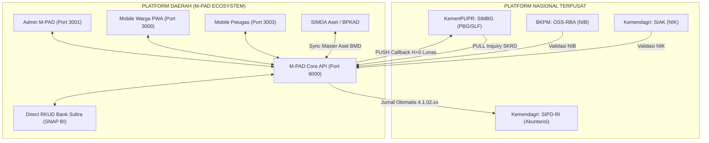
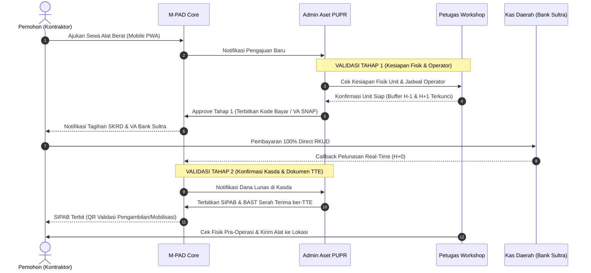

# Tata Kelola Layanan Pendapatan dan Aset Dinas Pekerjaan Umum dan Penataan Ruang (PUPR) Kota Baubau

> **Arsitektur Standar M-PAD V5** — Berdasarkan UU No. 1/2022 (HKPD), PP No. 35/2023, Perda Kota Baubau No. 1/2024, serta Framework 7-Langkah Tata Kelola Pendapatan Daerah.  
> **Folder Rujukan Google Drive Master**: `06_LAYANAN_PENDAPATAN_DAN_ASET_PUPR_MPAD` (Folder Induk M-PAD Baubau).

---

## I. Matriks 4 Dokumen Acuan Resmi (Google Drive)

| No | Dokumen Acuan Master | Tautan Google Docs | Deskripsi & Fokus Teknis |
|:---|:---|:---|:---|
| **01** | `01_Analisis_Proses_Bisnis_dan_Roadmap_Layanan_Pendapatan_PUPR_MPAD` | *Tersedia pada Drive Master* | Pemetaan portofolio retribusi PUPR, audit kepatuhan Perda 1/2024, analisis platform terpusat vs daerah, dan roadmap 4 fase implementasi M-PAD. |
| **02** | `02_Arsitektur_RBAC_Dashboard_dan_Pemisahan_Admin_PUPR_vs_Admin_Aset` | *Tersedia pada Drive Master* | Pemisahan tugas (*Separation of Duties*) antara Admin Teknis PUPR dan Admin Khusus Aset, matriks RBAC 7 persona, serta tata letak widget dashboard. |
| **03** | `03_Spesifikasi_Smart_Forms_dan_Blanko_Mobile_Warga_serta_Petugas` | *Tersedia pada Drive Master* | Spesifikasi blanko digital (*Smart Forms*) berbasis JSON Schema untuk pendaftaran sewa alat berat, lembar cek fisik pra/pasca operasi (Hour Meter), uji lab, dan RUMIJA. |
| **04** | `04_SOP_Integrasi_SIMBG_Alur_Validasi_2_Tahap_dan_Settlement_Kasda` | *Tersedia pada Drive Master* | SOP H2H interoperabilitas SIMBG–MPAD, alur validasi 2 tahap sewa alat berat, penerbitan SIPAB/BAST ber-TTE, dan rekonsiliasi SIPD-RI Bank Sultra. |

---

## II. Portofolio Layanan Pendapatan Dinas PUPR (Perda 1/2024)

Penerimaan dari Dinas PUPR Kota Baubau (OPD ID: 9) terbagi menjadi dua kelompok besar:

### 1. Retribusi Jasa Perizinan Tertentu
* **Persetujuan Bangunan Gedung (PBG) & Sertifikat Laik Fungsi (SLF)**:
  * Kolaborasi trilateral:
    1. **Dinas PUPR**: Kajian teknis Tim Profesi Ahli (TPA) / Tim Penilai Teknis (TPT) dan input parameter perhitungan retribusi.
    2. **Bapenda (M-PAD)**: Engine billing terintegrasi SNAP BI & setoran 100% Direct RKUD Kas Daerah (Bank Sultra).
    3. **DPMPTSP**: Penerbit resmi izin/dokumen ber-TTE setelah konfirmasi lunas *real-time*.
  * Rumus Retribusi PBG:
    $$\text{Retribusi PBG} = \text{Luas Bangunan} \times \text{Indeks Lokalitas} \times \text{Indeks Terintegrasi} \times \text{SHST}$$

### 2. Retribusi Jasa Usaha / Penggunaan BMD (Aset Daerah)
* **Sewa Alat Berat & Mesin Konstruksi (UPTD Peralatan & Workshop)**:
  * Unit: Excavator PC200-8M0, Excavator + Breaker, Wheel Loader WA200, Tandem Roller Bomag, Bulldozer Komatsu, Backhoe Loader CAT, Dump Truck Dyna, Tronton Self-Loader, Motor Grader, Asphalt Sprayer, dan Mobil Sedot Tinja.
  * Satuan tarif: per jam (alat berat), per hari (kendaraan operasional), atau per km/trip (tronton mobilisasi).
* **Pelayanan Laboratorium Pengujian Konstruksi**:
  * Pengujian kuat tekan beton (silinder/kubus 7, 14, 28 hari).
  * Pengujian tarik dan lengkung baja tulangan beton.
  * Pengujian tanah (sondir ringan/berat, CBR, triaxial).
  * Pengujian aspal (ekstraksi, Marshall test, titik lembek).
* **Pemanfaatan Ruang Milik Jalan (RUMIJA) & Infrastruktur Utilitas**:
  * Penempatan kabel fiber optik (bawah tanah minimal 1,5 m / tiang udara).
  * Penempatan pipa air minum (PDAM) dan gas.
  * Jembatan utilitas dan sewa ruang sempadan jalan untuk utilitas komersial.

---

## III. Lanskap Platform: Terpusat (Nasional) vs Daerah



---

## IV. Pemisahan Tegas Dua Role Administrator di Dinas PUPR

Untuk mencegah konflik kepentingan dan tumpang tindih kewenangan (*Separation of Duties*), akun administrator PUPR dibagi menjadi dua peran terpisah:

```
                          ┌─────────────────────────────────────┐
                          │      BACKEND M-PAD (DINAS PUPR)     │
                          └──────────────────┬──────────────────┘
                                             │
             ┌───────────────────────────────┴───────────────────────────────┐
             ▼                                                               ▼
┌──────────────────────────────┐                               ┌──────────────────────────────┐
│  ADMIN LAYANAN TEKNIS PUPR   │                               │  ADMIN KHUSUS ASET & WORKSHOP│
│     (admin_pupr_teknis)      │                               │      (admin_pupr_aset)       │
├──────────────────────────────┤                               ├──────────────────────────────┤
│ • Bidang Cipta Karya & Marga │                               │ • UPTD Peralatan & Workshop  │
│ • Verifikasi SIMBG (PBG/SLF) │                               │ • Master data 13+ unit alat  │
│ • Sidang TPA/TPT & Rekomtek  │                               │ • Kalender sewa (Buffer H±1) │
│ • Validasi sampel Uji Lab    │                               │ • Validasi Tahap 1 (Alat/Op) │
│ • Izin Teknis trase RUMIJA   │                               │ • Validasi Tahap 2 (SIPAB/TT)│
│ • Dilarang kelola armada     │                               │ • Monitor Cek Fisik & Denda  │
└──────────────────────────────┘                               └──────────────────────────────┘
```

### 1. Admin Layanan Teknis PUPR (`admin_pupr_teknis`)
* **Akun Utama**: `admin.pupr@baubaukota.go.id` (`pupr@baubaukota.go.id`) — `opd_id: 9`.
* **Kewenangan**:
  1. Validasi gambar teknis & parameter perhitungan PBG/SLF.
  2. Penerbitan draft e-SKRD PBG dan koordinasi rekomendasi teknis dengan DPMPTSP.
  3. Verifikasi pendaftaran sampel uji laboratorium bahan konstruksi dan penerbitan Laporan Hasil Uji (LHU).
  4. Pengawasan teknis pemanfaatan ruang milik jalan (RUMIJA) & sektor air baku.
* **Menu Akses**:
  * `/dashboard` — Ringkasan Realisasi & Indikator Teknis
  * `/verification` — Verifikasi Dokumen SIMBG & Pengujian Lab
  * `/billing` — Draf & Ketetapan e-SKRD PBG / Lab
  * `/taxpayers` — Database Pemohon Izin & Kontraktor
  * `/opd-sectors` — Pemetaan Sektor Air Baku & Utilitas

### 2. Admin Khusus Aset & Workshop PUPR (`admin_pupr_aset`)
* **Akun Utama**: `aset.pupr@baubaukota.go.id` — `opd_id: 9`.
* **Kewenangan**:
  1. Pengelolaan master data 13+ unit alat berat & kendaraan operasional UPTD Alkal.
  2. Pengaturan kalender sewa unit dengan aturan wajib **Buffer H-1** (inspeksi pra-kirim) dan **Buffer H+1** (pembersihan/servis).
  3. **Validasi Tahap 1**: Verifikasi ketersediaan unit, kondisi mekanis, dan penugasan operator resmi.
  4. **Validasi Tahap 2**: Verifikasi konfirmasi setoran Kasda (Direct RKUD) dan penerbitan Surat Izin Pemakaian Alat Berat (**SIPAB**) serta BAST ber-TTE.
  5. Monitoring pencatatan Hour Meter (HM) awal/akhir, lembar cek fisik pra/pasca operasi, dan kalkulasi denda *over-hour* / kerusakan.
* **Menu Akses**:
  * `/asset/rentals` — Workspace Utama Permohonan Sewa Alat BMD
  * `/tax-objects` — Inventaris Objek Fisik Alat Berat & Armada Truk
  * `/billing` — SKRD Sewa Alat Berat & Tagihan Denda Kompensasi
  * `/taxpayers` — Rekanan Proyek, Kontraktor & Penyewa Unit
  * `/transactions` — Riwayat Setoran Kasda Sewa Aset

---

## V. Matriks RBAC 7 Persona Pengelola PUPR

| No | Persona | Role Code | Hak Akses & Tanggung Jawab |
|---|---|---|---|
| 1 | **Wajib Retribusi / Kontraktor** | `taxpayer` | Ajukan sewa alat berat, input lokasi GIS, bayar via VA/QRIS SNAP BI, unduh SIPAB & LHU. |
| 2 | **Admin Layanan Teknis PUPR** | `admin_pupr_teknis` | Validasi berkas SIMBG, hitung SKRD PBG, verifikasi benda uji lab, rekomendasi teknis RUMIJA. |
| 3 | **Admin Khusus Aset PUPR** | `admin_pupr_aset` | Manajemen unit UPTD Alkal, atur kalender buffer H±1, Validasi 2 Tahap, terbitkan SIPAB/BAST TTE. |
| 4 | **Petugas Lapangan / Operator** | `petugas_pupr` | Cek fisik pra/pasca operasi, rekam Hour Meter (HM) ber-watermark geotagged, BAST serah terima. |
| 5 | **Petugas Laboratorium Uji** | `lab_pupr` | Terima sampel uji beton/baja/aspal, rekam hasil uji tekan/tarik, terbitkan draf LHU. |
| 6 | **Bendahara Penerimaan PUPR** | `bendahara_pupr` | Rekonsiliasi setoran Kasda harian, cetak laporan BKU retribusi, monitoring piutang SKRD. |
| 7 | **Kepala Dinas PUPR / Kabid** | `kadis_pupr` | Monitoring executive dashboard, approval rekomendasi ber-TTE, disposisi pengawasan lapangan. |

---

## VI. Standar Blanko Pendaftaran & Cek Fisik Cerdas (Smart Forms)

### 1. Formulir Sewa Alat Berat (Mobile Warga - PWA)
* **Identitas Otomatis**: Auto-fill NIK/NIB melalui integrasi IKD & OSS.
* **Pemilihan Unit**: Dropdown unit alat berat aktif (hanya unit berstatus `Operasional`).
* **GIS MapPicker**: Penandaan titik koordinat lokasi proyek kerja (lat, lng) serta deskripsi medan lapangan.
* **Kalkulasi Otomatis**: Estimasi biaya sewa berdasarkan durasi jam kerja + perkiraan biaya mobilisasi tronton (jika alat beroda rantai).
* **Legal Clause Interlock**: Kewajiban menyetujui klausul ganti rugi kerusakan alat akibat kelalaian operasional penyewa.

### 2. Lembar Pemeriksaan Fisik Alat Berat (Petugas Mobile App)
* **Pra-Operasi (Sebelum Mobilisasi)**:
  * Angka Hour Meter (HM) / Odometer awal.
  * Foto kamera ber-watermark waktu, tanggal, dan koordinat GPS.
  * Checklist cairan operasional: Oli mesin, oli hidrolik, air radiator, minyak rem, bahan bakar solar.
  * Checklist fungsi mekanis: Track/ban, bucket/blade, silinder hidrolik, lampu kerja.
  * E-signature serah terima operator dan penyewa.
* **Pasca-Operasi (Setelah Pekerjaan Selesai)**:
  * Angka Hour Meter (HM) akhir.
  * Deteksi otomatis *over-hour*: Jika $\text{HM Akhir} - \text{HM Awal} > \text{Durasi Kontrak}$, sistem otomatis menerbitkan draf tagihan e-SKRD kelebihan jam sewa.
  * Checklist inspeksi kerusakan komponen.
  * Penerbitan BAST Pengembalian Alat.

### 3. Formulir Uji Laboratorium Bahan Konstruksi
* Pilihan spesifikasi uji: Kuat tekan beton (silinder $\varnothing 15 \times 30\text{ cm}$ atau kubus $15 \times 15\text{ cm}$), umur uji 7/14/28 hari, kuat tarik baja tulangan ($D < 16\text{ mm}$ atau $D \ge 16\text{ mm}$), uji Marshall aspal.
* Pilihan jumlah sampel & perhitungan tarif otomatis sesuai Perda 1/2024.
* Pelacakan status pengujian secara real-time dan unduhan LHU digital.

---

## VII. Alur Validasi 2 Tahap Sewa Alat Berat (Interlock Kasda)



---

## VIII. Kerangka Roadmap 4 Fase (Framework 7-Langkah)

| Fase | Periode | Output Kunci & Deliverables |
|---|---|---|
| **Fase 0: Fondasi Regulasi, Data, & Demarkasi** | Minggu 1–2 | • Penguncian formula tarif Perda 1/2024 di database.<br>• Pemetaan 13+ unit alat berat & armada di `asset_items` ke `opd_id: 9`.<br>• Pemisahan role `admin_pupr_teknis` dan `admin_pupr_aset` di API & Admin.<br>• Aktivasi akun `aset.pupr@baubaukota.go.id`. |
| **Fase 1: MVP Layanan Inti & SNAP BI** | Minggu 3–5 | • Katalog sewa alat berat di Mobile Warga.<br>• Pembayaran 100% Direct RKUD via Virtual Account Bank Sultra & QRIS Dinamis.<br>• Penerbitan e-SKRD dan e-SSRD otomatis ber-barcode.<br>• Modul inquiry tagihan PBG untuk DPMPTSP. |
| **Fase 2: Otomasi SIMBG & App Petugas** | Minggu 6–8 | • Integrasi Two-Way Webhook SIMBG–MPAD.<br>• Rilis App Petugas Lapangan untuk cek fisik Hour Meter ber-watermark geotagged.<br>• Alur Validasi 2 Tahap (SIPAB & BAST TTE).<br>• Digitalisasi pendaftaran sampel pengujian laboratorium konstruksi. |
| **Fase 3: Spasial GIS, IoT Fleet Tracking, & SIPD-RI** | Minggu 9–12 | • Peta spasial trase utilitas RUMIJA (GIS).<br>• Integrasi GPS/IoT fleet tracking alat berat di dashboard admin aset.<br>• Otomasi posting jurnal BKU pendapatan ke SIPD-RI Kemendagri.<br>• Audit komprehensif performa PAD dan pemeliharaan alat berat. |

---

*Dokumen ini merupakan standar baku operasional dan rujukan rekayasa perangkat lunak untuk seluruh modul Dinas PUPR pada ekosistem M-PAD Pemerintah Kota Baubau.*
