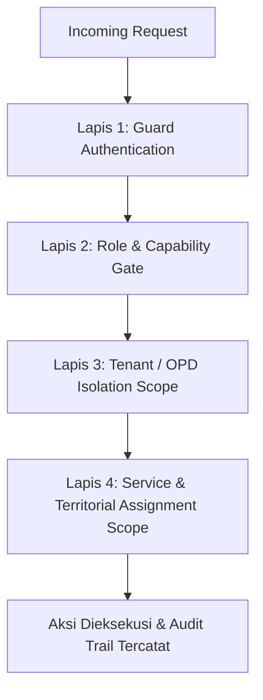

# Arsitektur Hybrid RBAC & Taksonomi Akses M-PAD
## Bagian 1: Prinsip Desain Otorisasi 3-Dimensi & Quadruple Security Layer

### 1. Prinsip Desain 3 Dimensi Otorisasi M-PAD
Pada ekosistem retribusi dan pajak daerah multi-tenant Pemkot Baubau, penggunaan Role sederhana saja tidak mencukupi. Seorang petugas penagih di Dinas Lingkungan Hidup (DLH) tidak boleh memungut retribusi pasar (Dinas Perdagangan) ataupun parkir tepi jalan (Dishub). Bahkan di OPD yang sama, petugas penagih sampah perumahan di Kelurahan Batupoaro tidak boleh menerbitkan tiket/karcis di Timbangan TPA.

Setiap permintaan akses (*API request*) dievaluasi melalui 3 lapis filter kontekstual:



1. **Lapis 1 — Identity & Role (Siapa dia?)**:
   Menentukan kapabilitas fungsi umum pengguna (`create_billing`, `verify_tax_object`, `view_report`, `collect_cash`).
2. **Lapis 2 — Tenant / OPD Scope (Di bawah instansi mana?)**:
   Menentukan batas isolasi data instansi (`opd_id`). Bapenda & Super Admin bersifat *Cross-OPD* (Global/Super), sedangkan dinas teknis (DLH, Dishub, Disperindag, DPMPTSP, dll) terisolasi mutlak di instansinya masing-masing.
3. **Lapis 3 — Service & Territorial Scope (Layanan & Wilayah mana?)**:
   Menentukan jenis sub-retribusi spesifik (`retribution_classification_id` / `service_code`) dan batas wilayah penugasan fisik (`kelurahan_id`, `pasar_id`, `pos_id`).

---

### 2. Taksonomi Role & Hierarki Pengguna

#### A. Web Admin Platform (`adminmpad.*` / Internal Dashboard)
| Tier | Role Slug | Deskripsi & Wewenang | Batasan Lingkup Data |
|---|---|---|---|
| **Super / Root** | `super_admin` | Akses penuh sistem, manajemen konfigurasi server, gateway SNAP BI, manajemen OPD, audit trail global. | Seluruh Pemda (Semua OPD) |
| **Penyetuju Bapenda** | `kepala_bapenda` | Otorisasi penghapusan denda, reversal PBB, persetujuan aktivasi PPAT/Notaris, approval SKRD penetapan jabatan. | Seluruh Pemda (Semua OPD) |
| **Admin Pengendali** | `admin` / `bapenda_admin` | Administrator teknis Bapenda; monitoring rekonsiliasi kasda RKUD Bank Sultra, broadcast tagihan massal, pengelolaan master tarif Perda. | Seluruh Pemda (Semua OPD) |
| **Pimpinan Pemda** | `walikota` / `viewer` | Read-only executive dashboard, monitoring target realisasi PAD antar-dinas se-Kota Baubau. | Seluruh Pemda (Read-Only) |
| **Pengawas Bapenda** | `pengawas` / `kabid_pengawas` / `kasubid_pengawas` | Uji petik lapangan (*spot check*), penerbitan Surat Peringatan / Penindakan (*Enforcement Notice*), pelacakan GPS petugas. | Lintas OPD / Khusus Pajak Daerah |
| **Admin Instansi** | `opd` / `admin_opd` | Mengelola operasional OPD teknis: membuat akun petugas lapangan dinasnya, memetakan layanan petugas, verifikasi objek retribusi baru. | Terkunci pada `opd_id` sendiri |
| **Admin Perizinan** | `admin_ptsp` | Operator DPMPTSP: sinkronisasi izin berusaha (NIB OSS), rekomendasi teknis PBG, dan retribusi TKA. | Terkunci pada DPMPTSP |
| **Mitra BPN / Notaris** | `notaris` | PPAT mitra: pembuatan dan validasi dokumen e-BPHTB serta permohonan NOP baru. | Terkunci pada berkas transaksinya |
| **Auditor Eksternal** | `auditor_bpk_itda` | Pemeriksaan kepatuhan transaksi keuangan daerah, riwayat mutasi perbankan, dan log rekonsiliasi. | Read-Only (Global / Terpilih) |

#### B. Mobile Petugas Lapangan (`petugasmpad.*` / Field App)
Akun petugas lapangan dibuat, dikelola, dan didelegasikan langsung oleh `admin_opd` dinasnya masing-masing:
| Role Slug | Fungsi Utama Lapangan | Pembatasan Layanan (*Service Scope*) |
|---|---|---|
| `petugas` (Juru Pungut / Kolektor) | Penagihan *door-to-door*, cetak struk kasir Bluetooth, penerimaan bayar via QRIS Dinamis & Tunai. | Dibatasi pada klasifikasi retribusi binaannya (`user_retribution_assignments`) dan zonasi kelurahan/blok kerja. |
| `petugas` (Surveyor / Pendata) | Sensus objek retribusi baru, geotagging koordinat GPS persil, pemotretan fisik ruko/lapak. | Terbatas pada pendaftaran objek retribusi yang masuk ke antrean verifikasi OPD pengampunya. |
| `petugas` (Operator Loket / Gerbang) | Pencatatan transaksi statis: pos karcis parkir, retribusi timbangan TPA, pos pelelangan ikan (TPI). | Terkunci pada satu titik fisik terminal / pos layanan dinas terkait. |

#### C. Mobile / PWA Wajib Retribusi (`mpad.*` / Citizen App)
Menggunakan otorisasi terpisah (`guard: api_taxpayer` / `Taxpayer` model):
| Tipe Profil | Target Pengguna | Kemampuan Mandiri |
|---|---|---|
| `taxpayer_personal` | Warga umum / Rumah Tangga | Pendaftaran objek rumah tinggal, cek e-SKRD sampah/PBB, bayar via VA Bank Sultra/QRIS, cetak e-SSRD tanda lunas. |
| `taxpayer_business` | Pelaku Usaha / Korporasi / Ruko | Pengelolaan banyak titik objek pajak (restoran, hotel, reklame, parkir khusus), pelaporan mandiri e-SPTPD bulanan. |

---

### 3. Logika 4 Lapis Pengaman (*Quadruple Security Layer*)

```
┌────────────────────────────────────────────────────────────────────────┐
│                      LAPIS PERLINDUNGAN RBAC M-PAD                     │
├────────────────────────────────────────────────────────────────────────┤
│ 1. Route Middleware : EnsureAdmin (Hanya staf internal; tolak warga)   │
│ 2. Role Gate        : EnsureRole (Pemisahan Pelaksana vs Penyetuju)    │
│ 3. OPD Data Scope   : EnsureOpdScope (Filter global vs opd_id)         │
│ 4. Domain & Tupoksi : OpdAccess Helper & Dynamic Client UI (Layout)    │
└────────────────────────────────────────────────────────────────────────┘
```

1. **Lapis 1 — `EnsureAdmin` (API Gateway)**:
   Memeriksa apakah token berasal dari aparatur internal (`App\Models\User`). Akun wajib pajak/warga (`App\Models\Taxpayer`) otomatis ditolak HTTP 403 Forbidden bila mengakses endpoint manajemen internal.
2. **Lapis 2 — `EnsureRole` (Maker-Checker Gate)**:
   Memisahkan peran pelaksana (staf/admin) dari peran penyetuju (`kepala_bapenda`, `super_admin`) pada aksi bernilai uang atau pengubahan data krusial (misal penghapusan denda, reversal piutang).
3. **Lapis 3 — `EnsureOpdScope` (Backend Tenant Scope)**:
   - *Role Global* (`super_admin`, `admin`, `kepala_bapenda`, `walikota`, `pengawas`): Dapat melihat data lintas-OPD se-Kota Baubau atau memfilter dengan parameter `?opd_id=X`.
   - *Role Sektoral* (`opd`, `petugas`, `admin_ptsp`): Dikunci mutlak pada `opd_id` miliknya (`where opd_id = auth()->user()->opd_id`).
4. **Lapis 4 — Client Dynamic UI (`opdCanAccessPath` & `officerCanAccessPath`)**:
   Sidebar dan route guards menyaring menu dinamis berdasarkan bendera akses instansi (`user.access.flags`) dan profil OPD petugas lapangan, sehingga tidak ada menu kosong (*dead routes*) atau kebocoran fitur antar-dinas.
