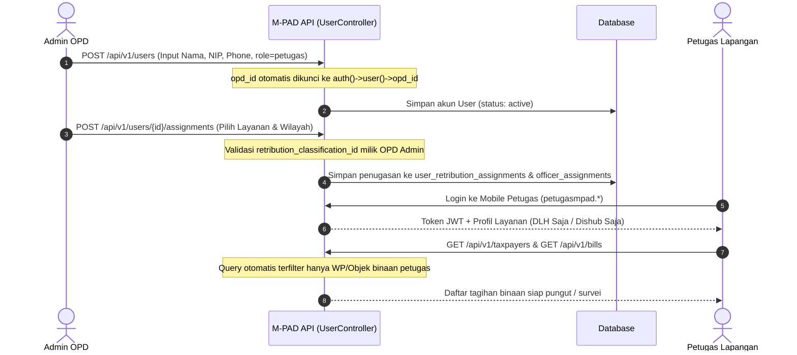

# Pembatasan Layanan dan Penugasan Wajib Pajak Petugas
## Bagian 2: Scoping Lapangan, Model Penugasan WP/Objek, dan Isolasi Layanan

### 1. Masalah & Kebutuhan Operasional di Lapangan
Pada implementasi awal sistem daerah, petugas lapangan role `petugas` sering kali hanya dibatasi di level OPD (`opd_id`).
Kelemahan pola tersebut di lapangan:
- Di OPD besar seperti Dinas Lingkungan Hidup (DLH) dengan ribuan titik sampah rumah tangga dan ruko, seorang petugas penagih di Kecamatan Wolio dapat melihat dan memungut tagihan WP binaan petugas lain di Kecamatan Murhum, Sorawolio, atau Betoambari.
- Petugas berpotensi mendatangi WP yang sama secara bergantian, menimbulkan keluhan warga dan sengketa setoran kas di tangan.

**Kebutuhan Mutlak Sistem M-PAD**:
1. **Setiap OPD dikelola mandiri oleh `admin_opd`**: Admin dinas membuat akun petugas dinasnya dan menetapkan portofolio layanannya.
2. **Setiap petugas dibatasi hanya mengelola Wajib Pajak / Objek Retribusi yang ditugaskan kepadanya**: Tidak ada akses bebas melihat seluruh basis data WP se-dinas.

---

### 2. Dimensi Pendekatan: WP-Centric vs Object-Centric vs Wilayah

Dalam retribusi dan pajak daerah, karakteristik subjek dan objek sangat bervariasi:
- **Model A: WP-Centric (Berbasis Wajib Retribusi Langsung)**:
  - *Karakteristik*: Juru tagih mengampu daftar entitas wajib pajak/retribusi spesifik.
  - *Penerapan*: Pajak Hotel, Restoran, dan Reklame Bapenda (misal Petugas A mengampu 30 badan usaha tertentu).
- **Model B: Object-Centric (Berbasis Objek Fisik Persil / Kios)**:
  - *Karakteristik*: Penyewa atau pemilik dapat berganti, tetapi titik fisik persil/kios/lapak tetap.
  - *Penerapan*: Retribusi Pasar Disperindag (sewa kios nomor A-12 s.d. A-30 Pasar Sentral) dan sewa aset BPKAD.
- **Model C: Territorial / Zonasi (Berbasis Wilayah Spasial Kelurahan/Blok)**:
  - *Karakteristik*: Petugas mengampu seluruh rumah tangga dan ruko dalam 1 kelurahan atau beberapa RW.
  - *Penerapan*: Retribusi Pelayanan Persampahan DLH (Kelurahan Batupoaro, Kelurahan Wameo) dan Parkir Tepi Jalan Dishub (Ruas Jalan Sudirman).

---

### 3. Skema Basis Data Penugasan Petugas Lapangan

Sistem M-PAD menerapkan dua tingkat skema penugasan:
1. **Tingkat Layanan / Sub-Retribusi (`user_retribution_assignments`)**:
   Menentukan klasifikasi retribusi apa saja yang boleh ditangani petugas:
   - `user_id`: ID petugas lapangan.
   - `retribution_type_id`: Jenis retribusi (misal: Retribusi Jasa Umum).
   - `retribution_classification_id`: Sub-klasifikasi spesifik (misal: Pelayanan Persampahan / Kebersihan).

2. **Tingkat Target Granular (`officer_assignments`)**:
   Menentukan target WP, Objek, atau Wilayah yang ditugaskan secara spesifik:

```sql
CREATE TABLE officer_assignments (
    id VARCHAR(30) PRIMARY KEY,
    opd_id BIGINT UNSIGNED NOT NULL REFERENCES opds(id),
    officer_id BIGINT UNSIGNED NOT NULL REFERENCES users(id) ON DELETE CASCADE,
    assignment_mode VARCHAR(20) NOT NULL, -- 'SPECIFIC_WP', 'SPECIFIC_OBJECT', 'WILAYAH_ZONASI'
    
    -- Target Penugasan
    taxpayer_id BIGINT UNSIGNED REFERENCES taxpayers(id) ON DELETE CASCADE,
    tax_object_id BIGINT UNSIGNED REFERENCES tax_objects(id) ON DELETE CASCADE,
    kelurahan_id VARCHAR(50),             -- Zonasi Kelurahan
    blok_pasar VARCHAR(50),               -- Zonasi Blok Kios Disperindag
    
    -- Klasifikasi Layanan yang Diampu
    retribution_classification_id BIGINT UNSIGNED REFERENCES retribution_classifications(id),
    
    -- Kontrol Operasional & Batas Kasda
    can_collect_cash BOOLEAN DEFAULT FALSE,
    max_cash_float_limit DECIMAL(12,2) DEFAULT 1000000.00, -- Plafon kas di tangan
    
    -- Status & Audit Trail Penugasan
    is_active BOOLEAN DEFAULT TRUE,
    assigned_by BIGINT UNSIGNED NOT NULL REFERENCES users(id), -- Admin OPD penunjuk
    assigned_at TIMESTAMP WITH TIME ZONE DEFAULT CURRENT_TIMESTAMP,
    revoked_at TIMESTAMP WITH TIME ZONE,
    
    CONSTRAINT chk_assignment_target CHECK (
        (assignment_mode = 'SPECIFIC_WP' AND taxpayer_id IS NOT NULL) OR
        (assignment_mode = 'SPECIFIC_OBJECT' AND tax_object_id IS NOT NULL) OR
        (assignment_mode = 'WILAYAH_ZONASI' AND kelurahan_id IS NOT NULL)
    )
);

CREATE INDEX idx_officer_assignment_active ON officer_assignments(officer_id, is_active);
CREATE INDEX idx_officer_taxpayer ON officer_assignments(officer_id, taxpayer_id);
```

---

### 4. Alur Manajemen Petugas oleh `admin_opd`



---

### 5. Mekanisme Enforcing Otorisasi di Backend API

#### A. Scoping pada `TaxpayerController` (Daftar Wajib Pajak)
Petugas lapangan hanya melihat:
1. Wajib pajak yang dibuat/didaftarkan oleh petugas tersebut (`created_by === $user->id`), ATAU
2. Wajib pajak yang memiliki objek pada klasifikasi retribusi yang ditugaskan kepada petugas (`user_retribution_assignments`), ATAU
3. Wajib pajak yang terdaftar dalam surat penugasan aktif (`officer_assignments`).

```php
if ($user->role === 'petugas') {
    $assignments = $user->assignments;
    $query->where(function ($masterQ) use ($user, $assignments) {
        $masterQ->where('created_by', $user->id);

        if ($assignments->isNotEmpty()) {
            $masterQ->orWhereHas('retributionTypes', function ($q) use ($assignments) {
                $q->where(function ($query) use ($assignments) {
                    foreach ($assignments as $assignment) {
                        $query->orWhere(function ($sq) use ($assignment) {
                            $sq->where('retribution_types.id', $assignment->retribution_type_id);
                            if ($assignment->retribution_classification_id) {
                                $sq->where('taxpayer_retribution_type.retribution_classification_id', $assignment->retribution_classification_id);
                            }
                        });
                    }
                });
            });
        }
    });
}
```

#### B. Scoping pada `BillController` (Daftar Tagihan & SKRD)
Tagihan yang tampil pada mobile scanner atau daftar pungut petugas dibatasi secara ketat:
```php
if ($user->role === 'petugas') {
    $assignments = $user->assignments;
    $query->where('opd_id', $user->opd_id);

    if ($assignments->isNotEmpty()) {
        $query->where(function ($q) use ($assignments, $user) {
            $q->where('user_id', $user->id); // Tagihan yang diterbitkan petugas
            foreach ($assignments as $assignment) {
                $q->orWhere(function ($sq) use ($assignment) {
                    $sq->where('retribution_type_id', $assignment->retribution_type_id);
                    if ($assignment->retribution_classification_id) {
                        $sq->where('retribution_classification_id', $assignment->retribution_classification_id);
                    }
                });
            }
        });
    } else {
        $query->where('user_id', $user->id);
    }
}
```

---

### 6. Manfaat Penerapan Pola Scoping Petugas

1. **Pencegahan Sengketa Lapangan (*Zero Overlap*)**:
   Tidak ada dua petugas pungut yang mendatangi atau menagih WP yang sama secara bersamaan.
2. **Kepatuhan Privasi Data Keuangan (UU Perlindungan Data Pribadi / PDP)**:
   Petugas lapangan tidak dapat mencari atau melihat histori kekayaan/pembayaran warga di luar lingkup tugasnya.
3. **Integritas Rekonsiliasi Kasda**:
   Semua penerimaan tunai terikat pada identitas petugas penerima, mencegah uang titipan tak bertuan (*unclaimed cash*).
