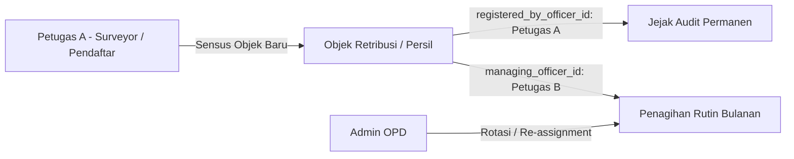
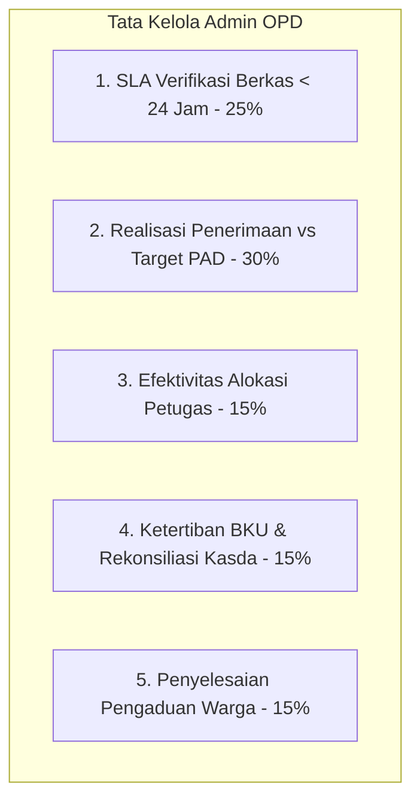

# Rantai Atribusi Data & Pengukuran Kinerja Petugas dan Admin
## Bagian 3: Pelacakan Asal Usul Objek, Formula KPI Petugas, dan Tata Kelola Admin OPD

### 1. Skema Rantai Atribusi Data (Data Attribution Chain)

Agar sistem dapat mengetahui secara presisi siapa yang mendaftarkan warga/objek dan siapa yang bertanggung jawab menagihnya dari bulan ke bulan, model data memisahkan antara **Pendaftar Pertama (*Registrar*)** dan **Pengelola Aktif (*Managing Officer*)**:

#### Struktur Kolom Atribusi pada Model `TaxObject` dan `Taxpayer`
1. **`registered_by_officer_id` (ID Petugas Pendaftar Awal)**:
   - Disuntikkan secara otomatis dari token autentikasi petugas lapangan saat melakukan input form sensus.
   - Bersifat **permanen (*immutable*)** dan tidak pernah berubah meskipun objek tersebut dirotasi pengelolaannya ke petugas lain.
   - Menjadi basis penghitungan **KPI Ekstensifikasi Objek Baru**.
2. **`managing_officer_id` (ID Petugas Pengelola / Penagih Aktif)**:
   - Petugas yang saat ini memegang tanggung jawab penagihan, monitoring pembayaran bulanan, dan pengantaran e-SKRD.
   - Dapat dirotasi (*re-assigned*) oleh `admin_opd` sewaktu-waktu (misal saat rotasi wilayah kerja atau pergantian personel).
   - Menjadi basis penghitungan **KPI Kolektibilitas Tagihan Berjalan**.
3. **`registration_channel` (Jalur Pendaftaran)**:
   - `OFFICER_APP`: Diinput langsung oleh petugas lapangan via aplikasi mobile scanner/surveyor.
   - `PUBLIC_PWA`: Pendaftaran mandiri oleh warga melalui portal web warga.
   - `ADMIN_PORTAL`: Input berkas manual oleh operator backoffice dinas.

---

### 2. Skema Pengukuran Kinerja Petugas Lapangan (Officer KPI Engine)

Kinerja petugas lapangan diukur secara kuantitatif, transparan, dan otomatis melalui 5 indikator utama:

| No | Indikator Kinerja | Formula Perhitungan | Bobot | Sasaran / Target Ideal |
|---|---|---|:---:|---|
| **1** | **Ekstensifikasi Objek Baru** ($K_1$) | $$\frac{\text{Objek Baru Terdaftar \& Disetujui}}{\text{Target Kuota Sensus Bulanan}} \times 100\%$$ | **25%** | Mencapai 100% target kuota sensus dinas per bulan |
| **2** | **Kolektibilitas Tagihan** ($K_2$) | $$\frac{\text{Nominal Retribusi Tertagih dari WP Binaan}}{\text{Total Pokok e-SKRD WP Binaan Aktif}} \times 100\%$$ | **30%** | $\ge 85\%$ sebelum tanggal jatuh tempo (tanggal 15 tiap bulan) |
| **3** | **Validitas Data Lapangan** ($K_3$) | $$\frac{\text{Pendaftaran Objek Disetujui Verifikator}}{\text{Total Pendaftaran yang Diajukan Petugas}} \times 100\%$$ | **15%** | $\ge 95\%$ (minim berkas ditolak karena data anomali) |
| **4** | **Penyelesaian Tunggakan** ($K_4$) | $$\frac{\text{Piutang Tertagih }(>30\text{ Hari})}{\text{Total Saldo Piutang Berjalan Awal Bulan}} \times 100\%$$ | **15%** | Penurunan saldo piutang kumulatif secara konsisten |
| **5** | **Disiplin Kliring Kasda** ($K_5$) | Kepatuhan kliring setoran tunai ke rekening kasda Bank Sultra sebelum mencapai batas limit plafon kas (*Cash Float Limit* Rp1.000.000) atau $< 24$ jam. | **15%** | $100\%$ tertib kliring tanpa pelanggaran *lockout* |

#### Formula Skor Kinerja Gabungan Petugas
$$\text{Skor Kinerja Petugas} = (0.25 \times K_1) + (0.30 \times K_2) + (0.15 \times K_3) + (0.15 \times K_4) + (0.15 \times K_5)$$

**Kategori Evaluasi Akhir**:
- **90 – 100 (Sangat Baik / Sangat Efektif)**: Berhak memperoleh alokasi upah pungut maksimal & prioritas wilayah binaan strategis.
- **75 – 89 (Baik / Memenuhi Target)**: Kinerja reguler standar operasional.
- **60 – 74 (Cukup / Perlu Bimbingan)**: Dilakukan evaluasi wilayah kerja dan audit acak oleh Pengawas Bapenda.
- **< 60 (Kurang / Tidak Efektif)**: Pembekuan wewenang pungut tunai (*cash collection revoke*) dan rotasi penugasan.

---

### 3. Skema Pengukuran Kinerja Admin OPD (Admin Governance KPI)

Admin OPD bertanggung jawab penuh atas tata kelola unit kerja retribusinya. Kinerjanya dievaluasi melalui 5 pilar tata kelola:

1. **SLA Kecepatan Verifikasi Berkas (Bobot 25%)**:
   - Rata-rata waktu (*Mean Time to Approve / MTTA*) dari saat berkas pendaftaran objek atau pengajuan tarif diajukan petugas/warga hingga disahkan menjadi SKRD aktif.
   - Target Standar Pelayanan: $< 24\text{ jam}$ kerja.
2. **Realisasi Penerimaan vs Target PAD OPD (Bobot 30%)**:
   $$\text{Persentase Realisasi} = \frac{\text{Penerimaan Riil RKUD Bank Sultra Tahun Berjalan}}{\text{Target Anggaran Kasda APBD Tahun Berjalan}} \times 100\%$$
3. **Efektivitas Alokasi & Pengawasan Petugas (Bobot 15%)**:
   - Memastikan tidak ada petugas lapangan yang menganggur ($0\text{ penugasan/transaksi}$) sementara petugas lain mengalami kelebihan beban (*overburdened*).
   - Rasio petugas aktif minimal $90\%$ dari total personel yang terdaftar.
4. **Ketertiban Rekonsiliasi Kasda & Buku Kas Umum / BKU (Bobot 15%)**:
   - Ketepatan waktu penutupan kas harian dan rekonsiliasi H2H Bank Sultra dengan prinsip *zero discrepancy* (selisih Rp0 antara sistem internal dengan rekening koran bank).
5. **Penyelesaian Pengaduan & Keberatan Warga (Bobot 15%)**:
   - Persentase sanggahan tagihan, keberatan nominal, atau laporan warga yang diselesaikan secara tuntas melalui menu manajemen aduan tanpa eskalasi sengketa ke Bapenda/Ombudsman.

---

### 4. Kontrol Pengurangan Risiko (*Safety & Risk Controls*)

1. **Plafon Kas di Tangan (*Cash Float Ceiling*)**:
   - Setiap petugas lapangan memiliki limit nominal kas fisik di tangan (standar Rp1.000.000).
   - Jika total pungutan tunai yang belum disetor ke bendahara/bank telah mencapai batas limit, aplikasi mobile petugas **terkunci otomatis untuk transaksi tunai** sampai setoran divalidasi oleh bendahara OPD atau bukti setor bank diunggah.
2. **Device Binding (Fingerprint Hardware)**:
   - Aplikasi mobile petugas mengikat *Device IMEI / Android Hardware ID* pada login pertama yang disetujui Admin OPD, mencegah penggunaan akun oleh pihak tidak berwenang.
3. **Geotagging Interlock**:
   - Pendaftaran objek atau transaksi pungutan lapangan wajib menyertakan koordinat GPS real-time berakurasi tinggi ($< 15\text{ meter}$) untuk mencegah data fiktif (*ghost taxpayers*).
