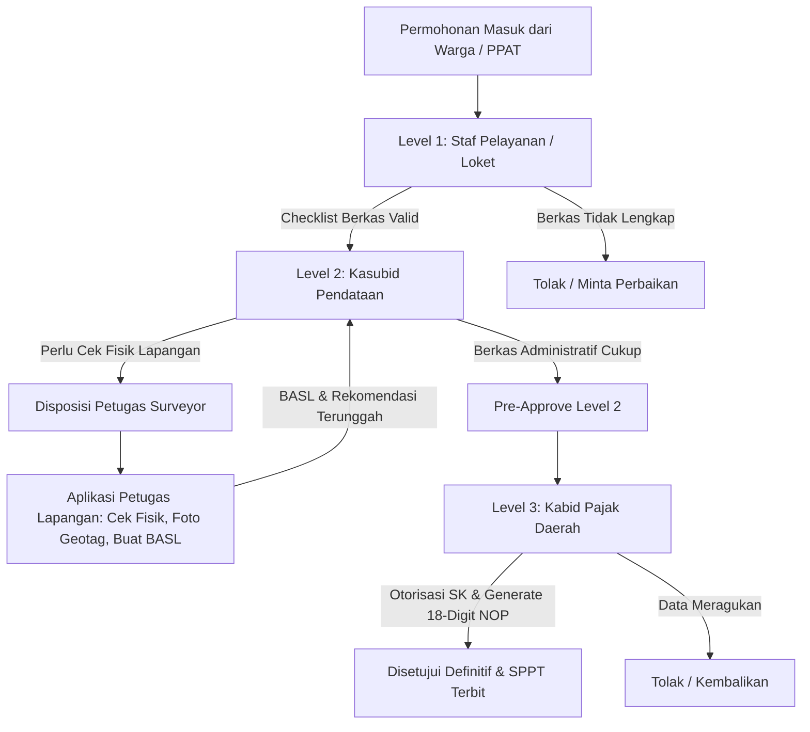

DOKUMEN KOMPREHENSIF ACUAN OPERASIONAL & ARSITEKTUR SISTEM: SELURUH SKENARIO WAJIB PAJAK DALAM LAYANAN PBB-P2 PADA SUPER APP M-PAD KOTA BAUBAU
BAB I: LANDASAN REGULASI & PRINSIP TATA KELOLA FISKAL
Dokumen ini disusun sebagai panduan teknis operasional dalam pengelolaan Pajak Bumi dan Bangunan Perdesaan dan Perkotaan (PBB-P2) melalui platform digital M-PAD Kota Baubau, dengan landasan hukum dan prinsip sebagai berikut:

Landasan Hukum Pusat:
UU No. 1 Tahun 2022 tentang Hubungan Keuangan antara Pemerintah Pusat dan Pemerintahan Daerah (HKPD).
PP No. 35 Tahun 2023 tentang Ketentuan Umum Pajak Daerah dan Retribusi Daerah (KUPDRD), khususnya Pasal 12-17 mengenai pendaftaran, Pasal 27-35 mengenai penetapan, dan Pasal 71-78 mengenai tata cara penagihan serta pembetulan.
PMK No. 208/PMK.07/2018 tentang Pedoman Penilaian PBB-P2 sebagai acuan teknis perhitungan nilai objek pajak.
Landasan Hukum Daerah:
Peraturan Daerah Kota Baubau No. 1 Tahun 2024 (Pasal 3-10 mengenai Objek dan Subjek, Pasal 103 mengenai sistem Official Assessment).
Ketentuan Nilai Jual Objek Pajak Tidak Kena Pajak (NJOPTKP) ditetapkan sebesar Rp 10.000.000,-.
Penerapan Tarif Progresif (0,15% s.d. 0,30%) dan tarif khusus Lahan Pangan sebesar 0,25%.
Perwali Baubau No. 43 Tahun 2025 sebagai petunjuk teknis pelaksanaan pemungutan pajak daerah.
Prinsip Output Resmi:
Dokumen ketetapan awal dalam proses pemungutan adalah Surat Pemberitahuan Pajak Terutang (SPPT). Perlu ditekankan bahwa Surat Setoran Pajak Daerah (SSPD) bukan merupakan dokumen ketetapan, melainkan bukti setoran pelunasan yang diterbitkan setelah dilakukan pembayaran melalui kanal perbankan.
Prinsip Single Source of Truth & Zero-Friction:
Sistem M-PAD mengedepankan integrasi data secara real-time melalui:
Identitas Kependudukan Digital (IKD) dari Kemendagri untuk verifikasi subjek pajak.
Data spasial BHUMI BPN untuk validasi geometri lahan.
Koneksi Host-to-Host (H2H) dengan SIMPBB Bapenda melalui alamat IP 103.182.72.241.
BAB II: HIERARKI TATA KELOLA & MATRIKS VERIFIKASI 3 TINGKAT
Operasional layanan PBB-P2 pada aplikasi M-PAD dikelola melalui jenjang verifikasi yang ketat untuk menjaga akuntabilitas data fiskal:

Level 1: Admin Operasional Layanan Pajak Daerah (Ibu Yani)
Bertanggung jawab dalam penerimaan awal permohonan melalui sistem.
Melakukan verifikasi kelengkapan berkas baik fisik maupun digital.
Bertindak sebagai gatekeeper untuk validasi status bebas tunggakan pajak.
Melakukan verifikasi teknis batas geometri poligon tanah menggunakan modul GIS pada M-PAD.
Level 2: Kepala Sub Bidang Pendataan, Pendaftaran, dan Penetapan (Ibu Salma)
Melakukan verifikasi substantif dan analisis fiskal terhadap permohonan.
Menelaah kesesuaian Zona Nilai Tanah (ZNT) dan Daftar Biaya Komponen Bangunan (DBKB).
Menerbitkan surat tugas survei fisik kepada Petugas Lapangan.
Mengesahkan Berita Acara Survei Lapangan (BASL) dan formulir LSPOP.
Memberikan persetujuan atas draf ketetapan NOP baru maupun rekalkulasi NJOP.
Level 3: Kepala Bidang Pajak Daerah / Pendapatan (Ibu Ochi)
Memegang otoritas tertinggi dalam kebijakan fiskal daerah.
Menandatangani secara elektronik SK Mutasi, SK Pembetulan, dan SK Pembatalan.
Mengesahkan penetapan e-SPPT PBB-P2 definitif.
Melakukan supervisi terhadap aliran penerimaan Kas Daerah (Kasda).
Memberikan otorisasi khusus untuk pembatalan (reversal) transaksi jika diperlukan.
Petugas Lapangan (Surveyor):
Melakukan verifikasi faktual di lapangan.
Mengambil koordinat GPS objek pajak dan mendata detail teknis fisik bangunan (LSPOP).
Mengunggah dokumentasi foto lapangan dan menandatangani BASL secara digital melalui Petugas App.
BAB III: ANALISIS MENDALAM SKENARIO PEMUTAKHIRAN & MUTASI PBB-P2
3.1 Skenario Pemecahan NOP & Kebijakan Khusus Pemecahan Kavlingan
Bapenda Kota Baubau menerapkan kebijakan afirmatif bagi pengembang atau wajib pajak yang melakukan pemecahan lahan kavlingan.

Kebijakan Khusus: Wajib Pajak diperbolehkan membayar sebagian piutang pajak pada NOP Induk secara proporsional sesuai luas kavling yang dimohonkan/dipecah. Hal ini bertujuan agar proses pecah NOP tidak terhambat oleh kewajiban melunasi seluruh piutang NOP induk yang besar sebelum kavling terjual seluruhnya.
Prinsip Konservasi Luas: Luas Tanah Induk Awal = Luas Sisa Induk + Σ Luas Pecahan Baru.
Kelengkapan Dokumen:
SPPT PBB NOP Induk & bukti bayar proporsional.
Sertifikat pemecahan dari BPN atau gambar situasi resmi.
Akta peralihan hak (AJB/APHB/Waris) jika terjadi peralihan.
KTP pemilik baru dan surat pernyataan kesepakatan batas.
Peta situasi kavling/gambar bidang pecahan.
SK Mutasi/Pembetulan Bapenda.
Alur: Validasi (Ibu Yani) → Verifikasi Dokumen (Ibu Salma) → Otorisasi SK (Ibu Ochi) → Penerbitan SPPT pecahan baru & pembaruan sisa induk.
3.2 Skenario Bangunan Fisik Ada tetapi Belum Memiliki PBG (Bangunan Eksisting)
Asas Kebenaran Materiil: Sesuai prinsip Substance over Form, setiap keberadaan bangunan riil wajib dikenakan pajak guna mengamankan potensi PAD. Ketiadaan Persetujuan Bangunan Gedung (PBG) tidak boleh menjadi alasan penolakan pendaftaran PBB.
Disclaimer Yuridis: Pada e-SPPT akan dicantumkan klausul bahwa SPPT adalah instrumen pajak dan bukan merupakan bukti kepemilikan hak atas tanah maupun izin mendirikan bangunan.
Alur: Pengisian LSPOP oleh Petugas Lapangan → Perhitungan NJOP Bangunan via DBKB → Integrasi dengan SIMBG untuk edukasi pengurusan SLF/PBG.
3.3 Skenario Pendaftaran Objek Baru (Mandiri & Proxy)
Mandiri: Pengguna melakukan onboarding via IKD, input luas dan lokasi, serta plot peta GIS secara mandiri.
Proxy: Pendaftaran untuk keluarga/lansia wajib melampirkan KTP pemilik asli dan Surat Kuasa bermaterai.
Output: Penerbitan SPPT Perdana setelah verifikasi berjenjang oleh Yani, Salma, dan Ochi.
3.4 Skenario Pembetulan SPPT (Rectification)
Dasar: Pasal 71 PP 35/2023. Diperuntukkan bagi kesalahan tulis (Nama/NIK/Alamat) atau kesalahan hitung tanpa mengubah kepemilikan.
Alur: Audit dokumen oleh Ibu Yani → Koreksi teknis oleh Ibu Salma → SK Pembetulan oleh Ibu Ochi → Pembatalan tagihan lama dan penerbitan SPPT revisi.
3.5 Skenario Mutasi Penuh / Balik Nama
Terjadi pada pengalihan hak secara utuh (Jual Beli/Hibah/Waris). NOP tetap, subjek berganti.
Sistem terintegrasi otomatis dengan e-BPHTB; validasi NTPD akan memicu mutasi balik nama PBB secara otomatis.
3.6 Skenario Penggabungan Objek Pajak (Amalgamation)
Penggabungan beberapa NOP yang berdampingan menjadi satu NOP Utama.
NOP pendukung akan dinonaktifkan (MERGED/INACTIVE) dan total luas diakumulasikan ke NOP Utama.
3.7 Skenario Pembatalan Ketetapan & Objek Pajak Ganda
Digunakan untuk kasus NOP ganda (overlapping), tanah musnah akibat bencana, atau pembebasan lahan untuk fasilitas umum.
Memerlukan rekonsiliasi spasial GIS dan SK Pembatalan dari Ibu Ochi untuk penutupan NOP di SIMPBB.
BAB IV: INTEGRASI IKD KEMENDAGRI & UNIVERSAL SMART BILLING BOX
Arsitektur M-PAD dirancang untuk memberikan kemudahan akses maksimal bagi warga Kota Baubau:

Single Identity Onboarding: Warga melakukan login melalui IKD. Sistem secara otomatis melakukan query NIK ke SIMPBB untuk menarik seluruh daftar NOP yang dimiliki ke dalam tab "Objek Saya".
Universal Smart Billing Box: Halaman beranda aplikasi menampilkan rekapitulasi seluruh kewajiban daerah dalam satu tampilan terpadu, mencakup:
Pajak Daerah (PBB-P2).
Retribusi Daerah (Persampahan DLH, Kios Pasar Disperindag, PBG SIMBG).
Sewa Aset Daerah (Ruko atau penyewaan Alat Berat PUPR).
Metode Pembayaran: Mendukung Virtual Account SNAP (Bank Sultra, BRI, BNI) dan QRIS Dinamis dengan fitur auto-split settlement langsung ke Rekening Kas Umum Daerah (RKUD).
BAB V: LEMBAR PENGESAHAN DOKUMEN ACUAN SISTEM
Jenjang Validasi


BLUEPRINT RENCANA AKSI & IMPLEMENTASI TEKNIS SISTEM M-PAD: PENGEMBANGAN FITUR SELURUH SKENARIO LAYANAN PBB-P2 KOTA BAUBAU
Dokumen ini disusun sebagai panduan teknis bagi tim pengembang (Pondok Informatika / CV Sarjana Komputer Indonesia) untuk mengeksekusi kebutuhan operasional Bapenda Kota Baubau.
BAB I: STRATEGI & RUANG LINGKUP IMPLEMENTASI
1. Tujuan Implementasi
Implementasi sistem bertujuan untuk mengakomodasi 9 skenario Wajib Pajak PBB-P2, kebijakan khusus pemecahan kavlingan yang mencakup pembayaran piutang secara proporsional, penanganan bangunan tanpa PBG melalui klausul disclaimer pada SPPT, serta digitalisasi alur verifikasi berjenjang 3 level yang melibatkan Ibu Yani, Ibu Salma, dan Ibu Ochi.
2. Arsitektur Komponen
Sistem M-PAD dibangun di atas infrastruktur modern dengan rincian sebagai berikut:
3. Arsitektur Role-Based Access Control (RBAC)
Sistem mendefinisikan Role Ibu Salma (ROLE_KASUBID_PENDATAAN / Kasubid Pendataan, Pendaftaran, dan Penetapan) dengan 6 permission teknis: pbb.mutation.view_l2, pbb.mutation.verify_technical, pbb.survey.assign, pbb.survey.review, pbb.sppt.pre_approve, dan pbb.kavling.verify_debt. Role ini berinteraksi erat dengan ROLE_PPAT yang bertindak sebagai pemohon awal.

Backend Core: Menggunakan Laravel 11 REST API dengan database MySQL/PostgreSQL, didukung oleh Redis Caching untuk performa dan PostGIS untuk data geospasial.
Frontend Citizen: React + Vite PWA (Offline-first Ready) yang diakses melalui mpad.baubaukota.go.id.
Frontend Admin: React SPA Dashboard dengan 3 Level Role-Based Access Control (RBAC) yang diakses melalui adminmpad.baubaukota.go.id.
Frontend PPAT: Portal khusus Notaris/PPAT (ROLE_PPAT) sebagai inisiator transaksi dan pemecahan kavling.
Frontend Petugas: React PWA Mobile yang dilengkapi Geolocation API di petugasmpad.baubaukota.go.id.
Konektivitas Eksternal: Integrasi H2H dengan SIMPBB Bapenda (103.182.72.241), IKD Kemendagri, BHUMI BPN, SIMBG PUPR, dan Gateway SNAP BI.
BAB II: REKAYASA SKEMA DATABASE & STATE MACHINE
1. Tabel Migrasi Baru
Untuk mendukung fungsionalitas baru, diperlukan struktur tabel sebagai berikut:


Nama Tabel
Field Utama
Deskripsi
pbb_mutations
id, ticket_no, mutation_type, parent_nop, applicant_nik, status, notes, previous_taxpayer_nik, new_taxpayer_nik, bphtb_ntpd_ref, bphtb_skb_no, primary_target_nop, merged_source_nops_json, duplicate_nop_target, cancellation_reason_code, relief_category (PENSIUNAN, VETERAN, CAGAR_BUDAYA, LAHAN_PANGAN, BENCANA), discount_percentage, disputed_njop_amount, taxpayer_calculation_notes, re_appraisal_status
Mencatat seluruh 9 skenario mutasi termasuk Balik Nama, Penggabungan, Pembatalan Ganda, Pengurangan/Keringanan, dan Keberatan Pajak.
pbb_split_items
id, mutation_id, item_index, target_nik, land_area_m2, proportional_debt_amount, polygon_geom
Rincian pecahan untuk skenario pemecahan kavling.
pbb_building_details
id, mutation_id/nop, has_physical_building, pbg_status, pbg_no, structural_specs, disclaimer_printed
Detail bangunan untuk skenario Bangunan Tanpa PBG.
pbb_workflow_logs
id, mutation_id, step_level, actor_id, action, notes
Audit trail verifikasi berjenjang.
smart_billing_boxes
id, nik_ikd, billing_type (PBB, RETRIBUSI, SEWA), amount, due_date, snap_token
Agregasi tagihan berbasis IKD untuk portal warga.

2. Logika Formula Bisnis
Formula Piutang Proporsional Kavling:
Piutang_Kavling = (Luas_Kavling / Luas_Induk) * Total_Piutang_NOP_Induk.
Formula Konservasi Luas:
Luas_Sisa_Induk = Luas_Induk - SUM(Luas_Kavling_Pecahan).
Sistem akan melempar validation error jika SUM(Luas_Pecahan) >= Luas_Induk.
BAB III: SPESIFIKASI ENDPOINT REST API (LARAVEL 11)
1. Citizen & Integration Endpoints (9 Skenario)
POST /api/v1/pbb/mutations/building-unregistered: (Skenario 2) Bangunan tanpa PBG dengan klausul disclaimer.
GET /api/v1/simbg/pbg/sync-status: Webhook sinkronisasi izin PBG dari SIMBG PUPR.
POST /api/v1/pbb/mutations/transfer-ownership: (Skenario 5) Balik Nama dipicu pembayaran e-BPHTB.
POST /api/v1/pbb/callbacks/bphtb-paid: Webhook trigger mutasi otomatis setelah NTPD terbit.
POST /api/v1/pbb/mutations/amalgamation: (Skenario 6) Penggabungan beberapa NOP menjadi satu.
POST /api/v1/pbb/mutations/cancellation: (Skenario 7) Penghapusan NOP ganda.
POST /api/v1/pbb/mutations/tax-relief: (Skenario 8) Pengurangan PBB (Pensiunan, Veteran, Lahan Pangan, dll).
POST /api/v1/pbb/mutations/objection: (Skenario 9) Pengajuan Keberatan Pajak/NJOP.
GET /api/v1/citizen/billing-box/aggregated: Integrasi IKD untuk billing gabungan PBB, Retribusi, dan Sewa Aset.
POST /api/v1/payment/checkout-universal: Integrasi Gateway SNAP BI untuk pembayaran multiskenario.
POST /api/v1/pbb/mutations/split-kavling: Pengajuan pecah kavling, input array pecahan, dan upload 6 dokumen wajib.
GET /api/v1/pbb/calculator/proportional-debt: Kalkulator instan piutang proporsional berdasarkan NOP induk dan luas pecahan.
POST /api/v1/pbb/mutations/register-new: Pendaftaran baru untuk mandiri maupun proxy.
POST /api/v1/pbb/mutations/rectification: Permohonan pembetulan data SPPT.
2. Level 1 - Admin Operasional (Ibu Yani)
GET /api/v1/admin/pbb/mutations/queue-l1: Melihat antrean berkas masuk.
POST /api/v1/admin/pbb/mutations/{id}/verify-l1: Pemeriksaan berkas dan validasi spasial GIS sebelum diteruskan ke L2.
3. Level 2 - Kasubid Pendataan (Ibu Salma)
GET /api/v1/admin/pbb/mutations/queue-l2: Antrean verifikasi teknis.
POST /api/v1/admin/pbb/mutations/{id}/assign-surveyor: Disposisi tugas survei lapangan ke petugas.
POST /api/v1/admin/pbb/mutations/{id}/pre-approve: Persetujuan parameter ZNT, DBKB, dan draf NOP.
4. Level 3 - Kabid Pajak Daerah (Ibu Ochi)
GET /api/v1/admin/pbb/mutations/queue-l3: Antrean otorisasi pimpinan.
POST /api/v1/admin/pbb/mutations/{id}/authorize: Penandatanganan SK dan pengesahan e-SPPT definitif.
5. Petugas Lapangan Endpoints
GET /api/v1/petugas/tasks: Daftar tugas survei yang ditugaskan.
POST /api/v1/petugas/tasks/{id}/submit-lspop: Pengiriman data GPS, foto, spesifikasi fisik gedung, dan tanda tangan digital BASL.
BAB IV: REKAYASA ANTARMUKA (UI/UX IMPLEMENTATION)
3. Database Seeder & Navigation (Laravel 11)
public function run() {
  $role = Role::create(['name' => 'ROLE_KASUBID_PENDATAAN']);
  $role->givePermissionTo([
    'pbb.mutation.view_l2', 'pbb.mutation.verify_technical',
    'pbb.survey.assign', 'pbb.survey.review',
    'pbb.sppt.pre_approve', 'pbb.kavling.verify_debt'
  ]);
}
Menu navigasi Admin Panel untuk Ibu Salma mencakup: Dashboard Verifikasi L2 (9 Skenario), Penugasan Surveyor, dan Review Parameter ZNT/DBKB. Portal PPAT difungsikan sebagai inisiator Skenario 1 (Pecah Kavling) dan Skenario 5 (Balik Nama).
1. PWA Warga
Wizard Form Pemecahan Kavling:
Form Multiskenario (1-9): Wizard adaptif yang menyesuaikan input berdasarkan tipe permohonan (misal: input NOP asal untuk Penggabungan, atau kategori diskon untuk Keringanan).
Integrasi MapPicker OpenLayers: Plotting poligon untuk Pecah Kavling, Penggabungan, dan Pendaftaran Baru.
Billing Box IKD: Tampilan agregasi tagihan (PBB, Retribusi, Sewa) dengan status sinkronisasi real-time.
Status Tracking 3 Level: Pemantauan posisi berkas di meja Ibu Yani, Ibu Salma, atau Ibu Ochi.
Form PBB Bangunan Eksisting: Integrasi dropdown status PBG yang transparan tanpa memblokir proses submit.
2. Admin Dashboard
Panel Ibu Yani: Tampilan split-screen antara penampil berkas PDF dokumen dan peta OpenLayers GIS untuk validasi lokasi.
Panel Ibu Salma: Konsol verifikasi teknis untuk 9 skenario, termasuk kalkulasi piutang proporsional (S1), audit BPHTB (S5), dan validasi kriteria keringanan (S8).
Panel Ibu Ochi: Dasbor visual performa fiskal PAD, fitur preview SK Mutasi/Pembetulan dengan QR Code, serta tombol TTE untuk pengesahan.
BAB V: ROADMAP IMPLEMENTASI & TIMELINE SPRINT (5 MINGGU)
Minggu
Fokus Sprint
Aktivitas Utama
Minggu 1
Database Migration (9 Skenario), Schema Refactor, & Base Models.
Database Migration, Schema Refactor, & Base Models.
Minggu 2
Core API (9 Skenario)
Backend Services, Formula Engine (Piutang & Keringanan), & 14+ API Endpoints.
Minggu 3
Citizen App
Frontend PWA Warga (Smart Forms, Kalkulator, MapPicker).
Minggu 4
Admin & Mobile
Admin Dashboard 3-Tier Views (Yani, Salma, Ochi) & Petugas Mobile App.
Minggu 5
Integration
Integrasi H2H SIMPBB, Pengujian 4 Kuadran, UAT, & Deployment.

BAB VI: DEFINITION OF DONE (DoD) & STANDAR PENGUJIAN
Keberhasilan rilis fitur ditentukan oleh kriteria berikut:

Checklist Kriteria: Seluruh fungsionalitas 9 skenario layanan (Pecah Kavling hingga Keberatan Pajak) berjalan sesuai alur bisnis.
Monitoring: Performa Redis Caching dipastikan stabil untuk menangani lonjakan data.
Integritas Data: Pencegahan terhadap race-condition pada pembuatan nomor NOP baru.
Keabsahan: Jaminan keabsahan e-SPPT yang dihasilkan melalui sistem otoritas berjenjang.
Pengujian 4 Kuadran: Mencakup Happy Path, Boundary (batas nilai), Concurrency (akses bersamaan), dan Resilience (ketahanan sistem).


Viewed BRD_PBB_MUTASI_DAN_VERIFIKASI_BERJENJANG.md:1-117
Viewed PbbMutationsTab.tsx:110-250
Viewed PbbMutationsTab.tsx:350-545
Viewed PbbNopApplicationsTab.tsx:100-200
Viewed PbbNopApplicationsTab.tsx:350-450
Viewed PbbNopApplicationsTab.tsx:600-750
Searched for "scenario"
Searched for "skenario"
Viewed plan.md:45-92
Viewed PbbMutationsTab.tsx:100-160
Viewed PbbMutationsTab.tsx:350-480
Viewed PbbNopApplicationsTab.tsx:190-320
Viewed PbbNopApplicationsTab.tsx:980-1100
Viewed PbbNopApplicationsTab.tsx:1220-1330

Berikut adalah penjelasan lengkap mengenai **skema penugasan di dashboard Admin (`retribusi-admin`)** dan **rincian apa saja yang perlu diinput** untuk menangani **7 Skenario Layanan PBB-P2 Kota Baubau** berdasarkan tata kelola berjenjang (*3-Tier Governance* Bapenda Baubau).

---

### 1. Peta 7 Skenario PBB-P2 di Dashboard Admin

Semua permohonan masuk secara terpusat pada menu **Pajak Bumi & Bangunan (PBB-P2)** ([`PbbBapenda.tsx`](file:///Users/pondokit/Herd/retribusi-admin/src/pages/PbbBapenda.tsx)):

| No | Skenario Layanan | Tab di Admin | Kebutuhan Survei Lapangan? |
| :--- | :--- | :--- | :--- |
| **S1** | **Pecah Kavling / Bidang** | *Mutasi PBB* | **Ya** (verifikasi batas bidang baru & jalan akses) |
| **S2** | **Bangunan Eksisting Tanpa PBG** | *Permohonan NOP* | **Ya** (pendataan fisik bangunan riil & LSPOP) |
| **S3** | **Pendaftaran Objek Pajak Baru** | *Permohonan NOP* | **Ya** (tinjauan batas fisik & geotagging koordinat) |
| **S4** | **Pembetulan Data SPPT (Rectification)** | *Mutasi PBB* | **Tidak** (*Paperless* / verifikasi dokumen administrasi) |
| **S5** | **Balik Nama Penuh (e-BPHTB)** | *Mutasi PBB* | **Tidak** (Otomatis terintegrasi via validasi NTPD H2H) |
| **S6** | **Penggabungan Multi-NOP** | *Mutasi PBB* | **Kondisional** (jika ada sengketa fisik bidang tanah) |
| **S7** | **Pembatalan NOP Ganda / Tanah Musnah** | *Mutasi PBB* | **Ya** (uji petik peninjauan fisik / rekonsiliasi GIS) |

---

### 2. Skema Alur Penugasan di Admin

Proses penugasan dan persetujuan mengikuti alur **3 Level + Petugas Lapangan**:



1. **Level 1 (Staf Pelayanan / Loket)**: Memeriksa kelengkapan berkas pemohon (KTP, bukti kepemilikan, surat kuasa).
2. **Level 2 (Kasubid Pendataan)**: 
   - Melakukan telaah teknis fiskal (ZNT, kelas bumi/bangunan).
   - Memutuskan apakah permohonan memerlukan peninjauan lapangan (*Survei*).
   - Jika butuh survei, memilih nama petugas lapangan dari dropdown penugasan. Tiket otomatis masuk ke aplikasi `retribusi-petugas`.
3. **Petugas Lapangan (Surveyor)**: Menerima notifikasi di aplikasi mobile petugas, turun ke lokasi, mengambil foto fisik bergeotag GPS, mengisi Berita Acara Survei Lapangan (BASL), dan memberi rekomendasi teknis (*Layak Terbit NOP* atau *Perlu Koreksi*).
4. **Level 3 (Kabid Pajak Daerah)**: Menelaah hasil BASL dan menerbitkan Surat Keputusan (SK) definitif serta pengesahan 18-digit NOP SISMIOP.

---

### 3. Apa Saja yang Perlu Diinput di Dashboard Admin

#### A. Input Aksi Penugasan & Keputusan Berjenjang (Form Tindakan)

Ketika admin membuka detail permohonan, terdapat form aksi modal dengan input sebagai berikut:

1. **Jika Menugaskan Survei Lapangan (Status: `SURVEY`)**:
   - **Pilih Petugas Surveyor Lapangan** *(Wajib)*: Dropdown memilih nama staf petugas lapangan yang bertugas di zonasi tersebut.
   - **Instruksi Fokus Tinjauan Lapangan** *(Opsional tapi dianjurkan)*: Catatan instruksi khusus bagi petugas (contoh: *"Cek batas patok sebelah timur dan pastikan luas bangunan ruko lantai 2 sesuai"*).

2. **Jika Menyetujui & Menerbitkan NOP (Status: `APPROVED`)**:
   - **18 Digit NOP SISMIOP** *(Wajib)*: Sistem secara otomatis menyediakan format usulan:
     $$\text{74.72.KEC.KEL.BLOK-URUT.KODE}$$
     Admin dapat memakai nomor usulan otomatis tersebut (*Auto-Generate*) atau mengetikkan nomor buku SISMIOP secara manual.
   - **Checklist Verifikasi Dokumen**:
     - [x] KTP / Identitas Pemohon atau Kuasa
     - [x] Sertifikat Tanah / Akta Jual Beli / Alas Hak
     - [x] Bukti Pelunasan Pajak / Bebas Tunggakan
     - [x] Kesesuaian Lokasi Fisik & Titik Geotagging
   - **Catatan Pemeriksaan / SK Penetapan**: Keterangan persetujuan resmi Bapenda.

3. **Jika Menolak / Meminta Perbaikan (Status: `REJECTED`)**:
   - **Alasan Penolakan Resmi** *(Wajib)*: Penjelasan jelas penyebab penolakan (misal: *"Surat kuasa belum bermaterai"* atau *"Hasil survei menunjukkan luas fisik tanah berbeda dengan sertifikat"*). Pesan ini otomatis tampil di aplikasi warga.

---

#### B. Input & Verifikasi Data Spesifik per Skenario

Selain form keputusan di atas, admin memeriksa dan memvalidasi data spesifik berikut:

| Skenario | Data yang Muncul & Wajib Divalidasi / Diinput Admin |
| :--- | :--- |
| **Skenario 1 (Pecah Kavling)** | • **Luas Induk Awal vs Sisa Luas Induk**: Memastikan asas konservasi luas ($\text{Luas Awal} = \text{Luas Sisa} + \sum \text{Luas Pecahan}$).<br>• **Piutang Proporsional**: Memvalidasi nominal pelunasan piutang yang dialokasikan khusus untuk kavling pecahan tersebut agar pecah NOP dapat disetujui tanpa harus melunasi seluruh utang NOP induk yang besar.<br>• **Rincian Pecahan Baru**: Jumlah pecahan kavling dan usulan NOP anak. |
| **Skenario 2 (Bangunan Tanpa PBG)** | • **Fisik Bangunan Riil**: Input luas lantai bangunan, jumlah lantai, dan jenis konstruksi.<br>• **Klausul Disclaimer Yuridis**: Sistem mengunci bahwa SPPT yang diterbitkan berstatus *"Bukan Bukti Izin PBG"* sesuai asas *Substance over Form* untuk mengamankan potensi PAD. |
| **Skenario 3 (Objek Baru Mandiri/Proxy)** | • **Status Pemohon**: Memeriksa apakah pendaftaran mandiri (KTP sama dengan pemilik) atau melalui Proxy/Kuasa (harus ada upload Surat Kuasa bermaterai).<br>• **Plotting GIS**: Memeriksa koordinat garis lintang/bujur tanah agar tidak tumpang tindih (*overlapping*) dengan persil NOP yang sudah ada. |
| **Skenario 4 (Pembetulan Data SPPT)** | • **Tabel Komparasi Data**: Admin melihat tampilan komparasi *Data Lama (Eksisting)* berdampingan dengan *Data Baru (Usulan)* untuk ejaan nama WP, NIK, alamat objek, atau koreksi luas.<br>• **Dasar Hukum**: Mengonfirmasi pasal pembetulan (Pasal 71 PP 35/2023) tanpa perubahan subjek kepemilikan. |
| **Skenario 5 (Balik Nama / Peralihan Hak)** | • **Validasi NTPD e-BPHTB**: Sistem mengecek otomatis via H2H; jika nomor NTPD valid dan berstatus `LUNAS H2H`, admin cukup memverifikasi KTP pemilik baru.<br>• **Nama & NIK Subjek Baru**: Memastikan data subjek pajak baru sesuai dokumen peralihan hak (AJB/APHB/Waris). |
| **Skenario 6 (Penggabungan Multi-NOP)** | • **NOP Utama**: Memvalidasi NOP tujuan tempat seluruh akumulasi luas tanah dan bangunan dialihkan.<br>• **Daftar NOP Sumber**: Memeriksa daftar NOP pendukung yang akan dilebur dan otomatis berstatus `NON-AKTIF / MERGED` di SIMPBB. |
| **Skenario 7 (Pembatalan NOP Ganda / Musnah)** | • **NOP Target Pembatalan**: Memverifikasi nomor NOP yang akan dihapus.<br>• **Kode Alasan Pembatalan**: Memilih/memvalidasi salah satu alasan: `NOP_GANDA` (Duplikasi/Overlap), `TANAH_MUSNAH` (Bencana alam/abrasi), atau `FASILITAS_UMUM` (Pembebasan jalan/fasum).<br>• **Nomor SK Pembatalan**: Input nomor Berita Acara / Surat Keputusan pembatalan ketetapan. |

Dengan skema ini, proses pelayanan PBB di Admin berjalan transparan, akuntabel, dan bebas celah sengketa karena setiap penerbitan NOP atau mutasi tercatat lengkap mulai dari petugas survei hingga pejabat penetap.


Skema **Zero Internet dengan Offline-First** untuk petugas lapangan adalah **solusi yang SANGAT TEPAT, KRUSIAL, dan WAJIB** untuk aplikasi operasional lapangan seperti `retribusi-petugas`.

Berikut adalah analisis mendalam mengapa skema ini sangat bagus, potensi tantangan, dan blueprint implementasinya:

---

### 1. Mengapa Ini Keputusan yang Sangat Tepat?

1. **Menghilangkan *Blocker* di Lapangan (Zero Downtime)**
   * Kondisi geografis Kota Baubau (wilayah perbukitan Sorawolio, pesisir Lea-Lea, atau lorong-lorong padat) kerap mengalami *dead zone* sinyal.
   * Jika aplikasi bergantung pada internet hidup: petugas akan frustrasi karena tombol *submit* berputar terus (*loading*), *timeout*, atau bahkan form-nya *reset* dan petugas terpaksa foto ulang.
   * Dengan *Offline-First*: petugas bekerja mulus tanpa jeda: buka kamera, jepret foto, beri catatan, simpan $\rightarrow$ **Selesai dalam 3 detik**.

2. **Menjaga Validitas Bukti & Anti-Fraud**
   * Jika aplikasi harus online, petugas sering mengakali dengan cara: pergi dulu ke tempat yang ada sinyal (misalnya di jalan raya), baru mengambil foto/mengirim data. Akibatnya: **koordinat GPS meleset jauh dari objek pajak aslinya (> 100 meter)**.
   * Dengan *Offline-First*: koordinat GPS dan foto dikunci di lokasi patok asli menggunakan sensor satelit HP saat itu juga.

3. **Efisiensi Baterai & Kuota HP Petugas**
   * Mencoba upload file foto berulang-ulang di sinyal yang lemah menguras baterai HP dan boros kuota.
   * Menyimpan dulu di memori HP, lalu mengunggah sekaligus saat sinyal stabil/ada Wi-Fi kantor jauh lebih hemat energi dan cepat.

---

### 2. Arsitektur Skema yang Ideal (3 Pilar Utama)

Agar skema ini berjalan aman tanpa resiko kehilangan data (*data loss*) atau duplikasi data, berikut 3 pilar yang diterapkan:

```
┌────────────────────────────────────────────────────────┐
│                   Aplikasi Petugas                     │
│                                                        │
│  [1. Pagi di Kantor / Ada Sinyal]                      │
│     Pre-fetch daftar tugas hari ini ke Cache Lokal     │
│                                                        │
│  [2. Di Lapangan Blank Spot / Zero Internet]           │
│     - Buka detail tugas dari Cache Lokal               │
│     - Jepret foto & Watermark koordinat satelit        │
│     - Simpan payload survei ke IndexedDB Lokal         │
│     - Tanda: "Tersimpan di HP (Antrean #1)"            │
│                                                        │
│  [3. Kembali Mendapat Sinyal / Wi-Fi]                  │
│     - Event listener 'online' aktif                    │
│     - Auto-Sync kirim antrean ke retribusi-api         │
│     - Validasi Idempotency (cegah kirim ganda)         │
│     - Hapus antrean lokal setelah API balas 200 OK     │
└────────────────────────────────────────────────────────┘
```

#### A. Penyimpanan Antrean (IndexedDB)
Gunakan **IndexedDB** di browser HP (bukan `localStorage`), karena IndexedDB mampu menampung puluhan foto beresolusi terkompresi (WebP/JPEG 300KB) dengan kapasitas hingga ratusan Megabyte tanpa membuat browser lambat.

#### B. Mekanisme Idempotensi (Anti Duplikasi)
Setiap input survei diberi `client_sync_id` (UUID unik). Jika internet putus-nyambung saat proses pengiriman, backend `retribusi-api` mengenali UUID tersebut dan tidak akan menyimpan survei ganda jika request terkirim lebih dari sekali.

#### C. Indikator Status Transparan di UI Petugas
Petugas harus tahu persis status datanya:
* **Badge Mengambang (Floating Pill)** di atas layar:  
  * 🟢 *"Semua data tersinkron"*
  * 🟡 *"2 Survei tersimpan di HP (Menunggu Sinyal)"* + Tombol **[Sinkronkan Sekarang]**.

---

### 3. Ekosistem Sudah Siap Mengadopsinya

Di repositori `retribusi-petugas`, fondasi ini sebenarnya **sudah berhasil kita gunakan** pada tiket wisata offline (`offlineTicketStore.ts` & `qrisService.ts`). 

Kita tinggal membuat modul serupa untuk survei lapangan, misalnya `surveyOfflineStore.ts`:
1. Saat petugas klik *"Simpan Hasil Survei"*:
   - Cek `navigator.onLine`.
   - Jika online $\rightarrow$ langsung kirim ke API.
   - Jika offline atau API timeout $\rightarrow$ simpan ke IndexedDB antrean survei, lalu notifikasi *"Hasil survei tersimpan aman di HP. Akan otomatis dikirim saat ada sinyal."*
2. Saat koneksi pulih $\rightarrow$ antrean otomatis terkirim.

**Kesimpulan:**  
Idenya **sangat direkomendasikan** dan akan menjadikan aplikasi petugas tangguh (*bulletproof*) di segala kondisi medan Kota Baubau. 

Apakah Anda ingin kita langsung buatkan modul antrean offline survei ini di `retribusi-petugas`?