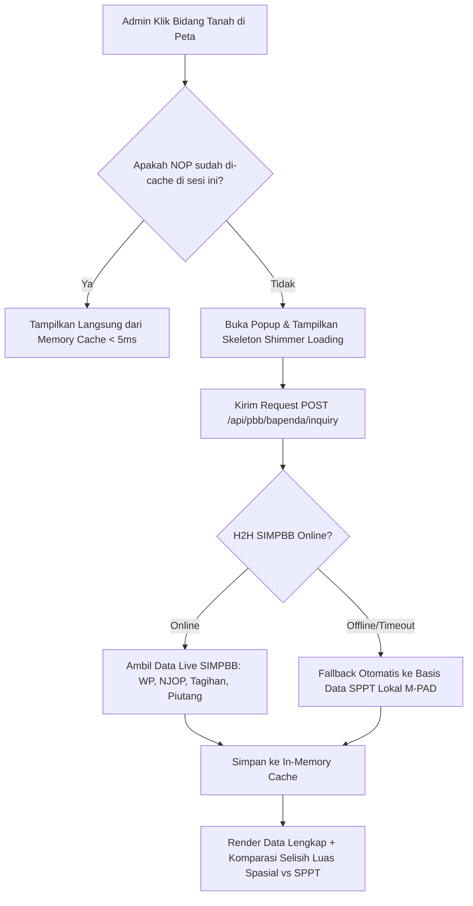

Berikut adalah **skema *Best Practice* arsitektur dan UX** untuk integrasi penarikan data live **SIMPBB pada Peta Pajak Admin (`retribusi-admin`)**:

---

### 1. Prinsip Utama Arsitektur: *On-Demand Lazy Inquiry + Client Cache*



#### Keunggulan Arsitektur Ini:
1. **Peta Tidak Pernah Lag**: Peta hanya memuat poligon geometri ringan. Tidak ada ribuan *request* berat saat peta pertama kali digeser/di-zoom.
2. **Anti-Spam & Hemat Bandwidth (*In-Memory Cache*)**: Ketika admin mengklik Bidang A $\rightarrow$ Bidang B $\rightarrow$ kembali ke Bidang A, data Bidang A langsung muncul instan tanpa menembak server ulang.
3. **Resiliensi Tinggi (*Dual-Source Fallback*)**: Jika server SIMPBB Pemda sedang *maintenance* atau jaringan lambat, sistem otomatis mengambil *snapshot* SPPT lokal sehingga admin tidak pernah menemui *blank error*.

---

### 2. Desain Tampilan Popup Detail Bidang (*UX Blueprint*)

Ketika admin mengklik poligon suatu bidang tanah di peta, Popup Leaflet menampilkan 4 blok informasi cerdas:

```
┌──────────────────────────────────────────────────────────┐
│  NOP: 74.72.010.001.001-0010.0            [🟢 LUNAS 2026] │
│  Kel. Batupoaro, Kec. Betoambari                         │
├──────────────────────────────────────────────────────────┤
│ 👤 WAJIB PAJAK & ALAMAT (Live SIMPBB)                    │
│  Nama   : H. MUHAMMAD RIDWAN (Tampil penuh untuk admin)  │
│  Alamat : JL. GAJAH MADA NO. 45                          │
├──────────────────────────────────────────────────────────┤
│ 💰 KETETAPAN & TAGIHAN PBB-P2                            │
│  Pokok PBB   : Rp 350.000                                │
│  Denda       : Rp 0                                      │
│  Total Bayar : Rp 350.000                                │
│  Sumber Data : [🟢 Live SIMPBB H2H]                      │
├──────────────────────────────────────────────────────────┤
│ 📐 KOMPARASI LUAS & NILAI NJOP                           │
│  Luas Peta GIS : 320 m²                                  │
│  Luas SPPT     : 250 m²   ⚠️ Selisih +70 m² di Peta!     │
│  NJOP Bumi     : Rp 250.000.000 (Rp 1.000.000 / m²)      │
│  NJOP Bangunan : Rp 120.000.000                          │
│  Total NJOP    : Rp 370.000.000                          │
├──────────────────────────────────────────────────────────┤
│  [📥 Unduh E-SPPT]  [📋 Salin NOP]  [🔗 Hubungkan NIB]    │
└──────────────────────────────────────────────────────────┘
```

---

### 3. Nilai Tambah Cerdas untuk Bapenda (*Reconciliation Engine*)

Fitur ini bukan sekadar menampilkan teks, melainkan memberi **3 nilai analisis strategis**:

1. **Deteksi Anomali Luas (Potensi PAD Tambahan / Kebocoran)**
   - Sistem membandingkan `luas_peta` (hasil hitung poligon citra satelit SmartGIS) dengan `luas_bumi` (yang terdaftar resmi di berkas SPPT SIMPBB).
   - Jika terdapat selisih signifikan (misal $> 5\%$), sistem langsung memunculkan peringatan:  
     `⚠️ Terdapat selisih luas tanah sebesar +70 m² antara citra peta SmartGIS dengan berkas SPPT. Rekomendasi: Penilaian ulang / survei lapangan.`
2. **Deteksi Piutang PBB Spasial**
   - Admin lapangan dapat langsung melihat apakah bangunan mewah yang dilihat di citra satelit statusnya sudah lunas atau masih menunggak pajak bertahun-tahun.
3. **Penyelarasan NIB-NOP (*Single Land Identity*)**
   - Menghubungkan batas persel BPN (NIB) dengan basis data ketetapan pajak Bapenda (NOP).

---

### 4. Komponen yang Akan Diterapkan di Kode

1. **State Management di `PetaPajak.tsx`**:
   - `inquiryCache = useRef<Map<string, SimpbbInquiryData>>(new Map())`
   - `activeInquiryNop: string | null`
   - `inquiryLoading: boolean`
2. **Event Trigger**:
   - Dipicu otomatis saat event `click` pada poligon bidang tanah Leaflet atau saat popup terbuka.
3. **Endpoint Backend Terpakai**:
   - `POST /api/pbb/bapenda/inquiry` (sudah siap di backend dengan dukungan H2H + fallback SPPT lokal).

---

Jika Anda setuju dengan skema *best practice* di atas, saya siap **langsung memasangnya pada komponen `PetaPajak.tsx` di `retribusi-admin`** sekarang. Silakan konfirmasi untuk memulai!